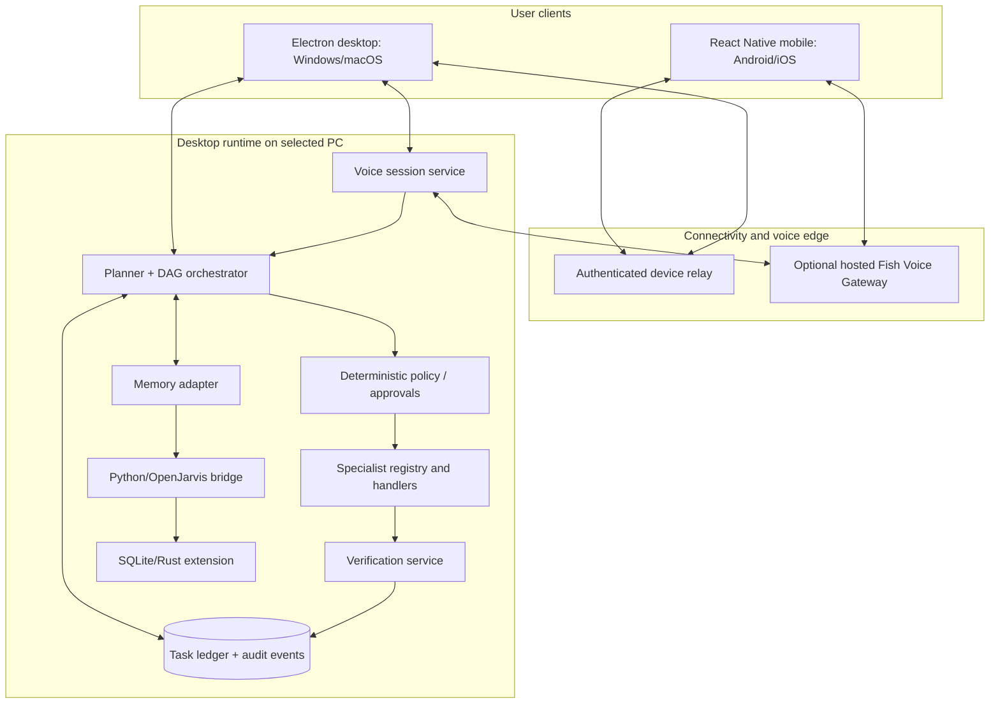
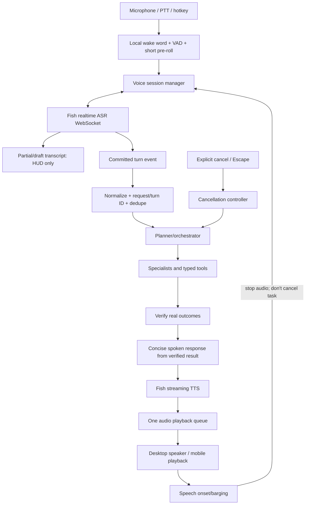

# Project Vanessa — Complete Project Dossier and Build Guide

**Document:** A–Z project record, architecture, current reported implementation, build guide and roadmap  
**Version:** 1.0  
**Prepared:** 20 October 2026  
**Repository:** https://github.com/Kshitij-Tripathi87/Project_Vanessa  
**Status:** Consolidated from the project updates shared in this conversation, previously prepared architecture plans, and a review of the public repository. Reported local test outcomes are marked as reported rather than independently executed.

> **Truthfulness note:** This dossier is the single narrative source of project intent and current understanding. It is not an audited export of every commit or every local file. Where only an IDE/tool log was shared, the item is marked “reported.” Where a public repository observation was checked, it is marked “public repo observation as of 20 Oct 2026.” Verify the local working tree before applying commands because it may differ from GitHub `main`.

## Contents

1. Executive summary
2. Product vision and positioning
3. Project history and decisions
4. Current architecture
5. Agent catalogue and responsibilities
6. Voice subsystem and Fish Audio
7. Memory and context architecture
8. Mobile-to-PC connectivity
9. Safety, privacy and security
10. Reported implementation inventory
11. Repository and module map
12. Clean build and local setup guide
13. Development workflows and commands
14. Testing and evaluation strategy
15. Deployment, recovery and updates
16. Known gaps and risks
17. Roadmap and team plan
18. Definition of done
19. Glossary
20. References

---

## 1. Executive summary

**Vanessa** is a voice-first, AI-native execution layer for personal computers and engineering/IT work. A user speaks or types a desired outcome; Vanessa interprets it, builds a plan, dispatches bounded tasks to specialist agents, executes through approved tools, verifies real outcomes and summarizes what happened. The larger product is one coherent assistant on Windows, macOS, Android and iOS, with different capabilities on desktop and mobile.

The initial generic idea—voice control for anything on a personal computer—was deliberately narrowed for the buildathon because voice-driven desktop automation is already available in open source and adoption/trust is not established by the idea alone. The sharper product hypothesis is **context-aware engineering and IT execution**: Vanessa remembers relevant operational context, investigates a failure across repositories/logs/runbooks/history, coordinates agents, prepares bounded changes and proves the result. General PC control remains part of the long-term vision.

The existing project is a TypeScript/React/Electron-oriented monorepo with an orchestrator, specialist agents, a separate voice-agent service, a relay/mobile-connection direction and an OpenJarvis Python/Rust tool and memory subsystem. Several project updates report successful builds/tests and live services. Those are valuable milestones, but they do not prove every component works together in a real voice-to-action scenario. The immediate engineering priority is integration reliability and verification rather than more feature breadth.

### One-sentence architecture

**One Vanessa, one versioned task/event model, one policy authority per target device, one authoritative orchestrator for each desktop task, and multiple client/OS-specific execution adapters.**

## 2. Product vision and positioning

### 2.1 Character and interaction philosophy

Vanessa's intended persona is intelligent, composed, warm, confident without arrogance, curious, privacy-conscious and action-oriented. Her defining principle is integrity of execution: she must not claim a task succeeded without evidence, must admit uncertainty/errors, and should offer a recovery step instead of fabricating a success story.

The character is a product behavior guide, not a claim that the system is human or conscious. It influences voice, phrasing and UI; it must never override policy or safety.

### 2.2 Product thesis

> Vanessa is a voice-first engineering assistant that remembers operational context, coordinates specialist agents, executes bounded work and proves what it accomplished.

### 2.3 Target customers and first use case

- Primary users: developers, platform/SRE, DevOps and IT operations engineers.
- Initial buyer hypothesis: engineering lead, platform lead or IT operations manager at a small/midsize software organization.
- First demonstrable workflow: investigate a checkout service failure using recent code changes, logs, previous incidents and the runbook; prepare a fix, run tests and report evidence without deploying.
- Secondary general-assistant demonstrations: safe Bluetooth/Wi-Fi actions, browser navigation, folder/file workflow, developer CLI launch and optional mobile-to-PC task execution.

This customer selection remains a hypothesis pending actual user interviews and a paid-pilot signal; it is not proven market demand.

## 3. Project history and key decisions

### 3.1 Initial concept

Vanessa began as a voice-controlled computer/OS agent inspired by JARVIS: spoken commands should launch apps, change selected settings, control browsers, manipulate files, drive coding tools and coordinate multiple actions. The goal includes hands-free voice, wake phrase, task parallelism, remote phone access and persistent memory.

### 3.2 Pivot for differentiation

The initial “voice controls the whole PC” positioning was considered generic. The strategic pivot is to start with engineering and IT operations, emphasizing long-term contextual memory, incident investigation, cross-tool reasoning, safe execution and verifiable outcomes. The general personal assistant vision remains the destination.

### 3.3 Architecture evolution

The project reports evolved through these stages:

1. Existing `Project_Vanessa` monorepo with Electron desktop UI, TypeScript orchestrator and shared types.
2. OpenJarvis Python/Rust tool/memory foundation integrated through a bridge, with SQLite memory, tools/skills, and local service endpoints.
3. Specialist agents added for Windows/system, browser, files/cloud, developer, coding, IT operations, knowledge, testing, memory, cloud, incident intelligence and OpenJarvis integration.
4. Voice streaming code added to the orchestrator path, including sentence-boundary TTS and a Web Audio playback queue.
5. A dedicated `services/voice-agent` service was created with audio framing, VAD/turn detection, ASR/TTS provider adapters, barge-in logic, orchestrator client and health endpoint.
6. Fish Audio was selected as the preferred voice provider. Integration planning identifies real-time Fish ASR plus Fish streaming TTS, explicit configuration, server-side secrets and truthful provider failure states.
7. Cross-device design established: full PC runtime on Windows/macOS, limited mobile companion on Android/iOS, secure relay between them, mobile-local tasks where the platform permits them.
8. Recent bridge maintenance update: imports `List` and `Optional` were added in `Agents and tools/vanessa_bridge.py`; the user report says `py_compile` succeeded, `pnpm test:skills` passed 7/7, commit `b7becc2` was created and pushed to `main`. This is a user-reported result, not independently run in this environment.

### 3.4 Decisions to keep

- Desktop first, Windows 11 as the first reference platform; macOS is a planned supported desktop platform.
- Electron/React/TypeScript for the desktop UI; keep native execution behind capability adapters.
- React Native + Expo for the planned installable Android/iOS companion.
- Fish Audio as the selected speech provider behind an adapter, with no provider key in renderer/mobile code.
- One authoritative orchestrator/task state per desktop task; specialist agents are bounded workers, not autonomous competing orchestrators.
- Memory is a service/adapter over one canonical backend, not duplicate stores maintained by separate agents.
- Verification must be independent from the agent's text claim.
- Phone commands target an explicit paired PC or mobile capability; ambiguous target must ask.
- Zero-budget-first development. Hosted APIs, app-store distribution, TLS relay hosting and signing may still incur costs; those are release constraints to plan for, not assume away.

## 4. System architecture

### 4.1 Logical view



### 4.2 Service ownership

| Component | Responsibility | Should not do |
|---|---|---|
| Desktop UI | Voice visual state, timeline, approvals, memory controls, settings | Run arbitrary OS commands from the renderer |
| Voice agent | Audio session, wake/VAD/ASR/TTS, transcript commits, playback and barge-in | Decide task plan or execute OS tools directly |
| Planner | Produce structured DAG, agent selection, dependencies and acceptance criteria | Bypass permission gate or mark tasks successful without results |
| Orchestrator | Dispatch registered handlers, persist state, coordinate concurrency, cancellation/recovery | Become a second uncontrolled LLM planner loop for every specialist |
| Policy service | Authorize tool calls, approval scopes, file roots and risk classes | Trust client-provided `requiresApproval=false` |
| Specialist agents | Do bounded work via allowlisted tools; return evidence and artifacts | Expand own permissions or overwrite authoritative task state |
| Verification | Check actual postconditions, output exit codes and artifacts | Accept an agent's “done” string as proof |
| Memory | Search/store/revise authorized context with provenance/retention | Store every raw transcript indefinitely or mix user/team scopes |
| Relay | Authenticated routing, durable metadata, event delivery and reconnection | Execute desktop tools or widen local permissions |
| Voice Gateway (optional) | Keep Fish key server-side for mobile-independent voice; control audio sessions | Expose API credentials to clients or promise free/unlimited service |
| OpenJarvis bridge | Adapter to available Python tools/skills/memory | Create a second competing source of task truth |

### 4.3 Agent catalogue

These roles reflect the reported agent inventory and intended architecture; each name should be checked against actual registry entries before marking implementation complete.

| Agent ID | Responsibility | Example tools / output |
|---|---|---|
| `planner` | Convert request into an explicit task DAG | task objective, dependency, criteria, target, plan version |
| `orchestrator` | Deterministic task scheduler/dispatcher | queue, dispatch, timeout, cancellation, durable state |
| `windows` | Windows settings, processes, app launch, system state | `wifi.restart_adapter`, `bluetooth.enable`, `app.open`; observed state |
| `macos` | macOS capability adapter; planned | supported app launch, settings/network operations and state |
| `browser` | Browser navigation and web interactions | open URL, search, page-state verification |
| `files` / `file` | Find/manage files within approved roots; cloud file actions through connector | file refs, checksum, upload ID/link, access policy |
| `developer` | IDE/coding CLI/workspace integrations | open VS Code/Claude Code, project workspace; should not equate launch with code creation |
| `coding` | Inspect repositories, history, diffs; prepare patch in isolated worktree | commit evidence, unified diff, changed files |
| `it_ops` | Logs/diagnostics/error clustering | observations, time windows, likely causes with evidence |
| `knowledge` | Runbooks/docs/historical incident search | source-backed relevant passages |
| `testing` | Run approved commands and validate acceptance criteria | exit code, stdout/stderr summary, report/artifact, verification result |
| `memory` | Retrieve/store/correct memory via canonical backend | memory IDs, provenance, scope, freshness |
| `incident` | Reusable incident workflow coordinating other agents | synthesized root-cause analysis; not a second generic orchestrator |
| `cloud` / `integrations` | Connectors for Gmail/WhatsApp/Drive/GitHub or other services when configured | scoped external action result; approval when needed |
| `openjarvis` / `vanessa` adapter | Access approved OpenJarvis tools and schedules | tool results and status, not duplicate task truth |
| `voice` service | ASR/TTS/session lifecycle | transcript commit, audio chunks, provider health; no OS execution authority |
| `policy` / verifier | Shared cross-cutting services, preferably deterministic | authorization decision / verified postconditions |

An agent becomes “working” only after a test proves the registry dispatches to its real handler, the handler invokes a real tool or process, returns structured output, and the verifier checks the outcome.

## 5. Common task and agent contracts

Define and version contracts in `packages/shared`, adapting existing types instead of adding duplicate structures.

```ts
type TaskStatus =
  | "created" | "planned" | "queued" | "running" | "awaiting_approval"
  | "verifying" | "completed" | "partial" | "failed" | "blocked"
  | "cancelled" | "expired" | "interrupted_reconciling";

interface TaskRequest {
  schemaVersion: number;
  requestId: string;
  taskId: string;
  originDeviceId: string;
  targetDeviceId: string;
  source: "desktop_voice" | "mobile_voice" | "desktop_text" | "mobile_text" | "shortcut";
  commandText: string;
  createdAt: string;
  expiresAt: string;
  idempotencyKey: string;
}

interface AgentTask {
  taskId: string;
  parentTaskId?: string;
  objective: string;
  contextRefs: string[];
  allowedTools: string[];
  dependsOn: string[];
  acceptanceCriteria: string[];
  workspaceId?: string;
  timeoutMs: number;
}

interface AgentResult {
  taskId: string;
  agentId: string;
  status: TaskStatus;
  summary: string;
  evidence: Array<{ description: string; source?: string; timestamp?: string }>;
  artifacts: string[];
  verification: { passed: boolean; details: string };
  error?: { code: string; message: string; retryable: boolean };
}
```

Use runtime schema validation, a version field and clear error handling; TypeScript typing alone does not validate network input. Agent `status=completed` is necessary but not sufficient: the orchestrator requires verification where acceptance criteria demand it.

## 6. Voice system and Fish Audio

### 6.1 Voice is a separate subsystem

The reports mention both `services/orchestrator/src/voice/voiceStreamServer.ts` and a newer `services/voice-agent` service on port 4500. The architecture must identify the canonical voice session server and eliminate duplicate session/task dispatch paths once call sites are known. The dedicated voice-agent service is the preferred owner of ASR/TTS session state; orchestrator stays the work owner.

### 6.2 Voice pipeline



### 6.3 Fish Audio integration facts and requirements

- Current Fish Audio documentation describes real-time ASR over `wss://api.fish.audio/v1/asr/realtime` using `transcribe-stream-1`, with draft and committed-turn events. Use draft text for HUD updates only; only committed turns may trigger planning. Verify the protocol and current audio framing when integrating: [Fish realtime ASR](https://docs.fish.audio/features/speech-to-text/realtime).
- Fish offers a TypeScript SDK and streaming TTS mechanisms: [Fish TypeScript SDK](https://github.com/fishaudio/fish-audio-typescript), [Fish realtime streaming](https://docs.fish.audio/features/realtime-streaming).
- `FISH_API_KEY` is server-only: use an OS credential store/environment for desktop dev, secret manager for hosted Voice Gateway. Never put it in renderer code/mobile app or print it in logs.
- Explicitly select Fish providers (`VOICE_ASR_PROVIDER=fish`, `VOICE_PROVIDER=fish` or the final canonical config names). A requested Fish provider with missing key/voice ID/failed handshake should report unavailable; do not silently use mock/ElevenLabs.
- Local wake word should activate an active ASR session; don't send continuous idle room audio to Fish by default.
- A provider-committed transcript dispatches once; attach a unique turn/request ID.
- Use one bounded audio queue and the correct decoder/framing for Fish's actual returned format. Do not decode each arbitrary MP3 byte fragment as an independent MP3 file.
- Barge-in stops/flushes TTS and returns to listening. It does not automatically cancel task execution. Explicit spoken cancel/Escape/emergency-stop does.
- State clearly which work is cloud processed. A local wake word does not make cloud ASR/TTS entirely local.
- For remote mobile commands, if the PC is online, audio may route to that PC's voice service through the relay. If mobile-local voice must work while no PC is online, provide a hosted Fish Voice Gateway or use native speech for mobile-local tasks. There is no safe way to use a desktop-local key when the laptop is offline without an authorized backend.

### 6.4 Fish documentation/coding-agent distinction

Fish's coding-assistant skill/SDK docs can help coding agents author Fish integration code; that does **not** automatically give voice control to every installed application. Vanessa's installed desktop app supplies the global voice entry point and invokes app/OS adapters when permitted. For apps without a public API, accessibility controls or stable automation, support may be partial rather than universal.

## 7. Memory and contextualization

The project report says a Rust-native `openjarvis_rust` extension was compiled and loaded, SQLite memory is available, memory store/search/stats endpoints were tested, and storage tools were updated to instantiate the configured backend. It also reports a configured context path and 56 tools registered. Treat those as reported until rerun on a clean environment.

Memory types:

1. **Working:** current task state, steps, unresolved questions and intermediate evidence.
2. **Episodic:** prior tasks/incidents and their outcomes.
3. **Semantic:** source-backed facts about repositories, services and dependencies.
4. **Procedural:** approved runbooks and routines.
5. **Personal:** user preferences and chosen defaults.

Every durable item should have source/provenance, timestamp/freshness, owner, access scope, sensitivity classification, confidence/verification type and retention/expiry. Keep user memory separate from organization/project memory. Store only when appropriate, allow inspection/deletion/correction and don't make every ASR draft or raw audio buffer a permanent memory.

SQLite is suitable for the local memory/ledger on one device. SQLite WAL supports concurrent local readers with a writer but is not a shared network-filesystem database; relay state belongs in a service database. See [SQLite WAL](https://www.sqlite.org/wal.html).

## 8. Mobile-to-PC connectivity

### 8.1 Capability model

- **Desktop (Windows/macOS):** full approved capability set—OS, browser, files, developer workflows, memory, connected cloud tools.
- **Mobile (Android/iOS):** voice/text command client, task monitoring, approvals, cancellation and limited app-local tasks (reminders, timers, notes, provided-text summarization). Do not promise arbitrary mobile OS control.
- **Relay:** authenticated connection/routing and event delivery; never an executor.
- **Desktop target:** revalidates scope and authorizes locally before execution.

### 8.2 PC request from mobile

```mermaid
sequenceDiagram
  participant P as Mobile app
  participant R as Relay
  participant D as Desktop agent host
  participant O as Planner/orchestrator
  participant A as Specialist agents
  participant V as Verifier
  P->>R: Authenticated command + explicit target + idempotency key
  R->>D: Route command to paired device
  D->>D: Validate device, expiry, scope; persist local task
  D-->>R: ACCEPTED + task ID
  R-->>P: ACCEPTED
  D->>O: Task request
  O->>A: Dispatch dependency-aware work
  A-->>O: Results, evidence and artifacts
  O->>V: Check acceptance criteria
  V-->>O: Verified/partial/failed
  O-->>R: Sequence-numbered task events/result
  R-->>P: Live task feed/result
```

### 8.3 Pairing/security

- One-time, short-lived, random pairing challenge; QR must not contain a long-lived secret.
- Desktop approval of new phone identity.
- Device key and short-lived token; rotate/revoke credentials and device sessions.
- Rate limit challenges and failed claims; validate each message even on an authenticated socket.
- Relay authorizes user/device/target room; desktop locally authorizes the actual tool call.
- Command envelope includes request ID, authenticated origin/target, time bounds, idempotency key and source. Server authenticates identity; JSON claims alone are not identity.
- Don't let mobile client set `requiresApproval=false`. Target policy decides approval requirement.
- Use TLS/WSS, origin allowlist for browser/PWA connections, message schema validation, payload limits, heartbeat, reconnect/backpressure controls and secret-redacted audit logs. See [OWASP WebSocket Security](https://cheatsheetseries.owasp.org/cheatsheets/WebSocket_Security_Cheat_Sheet.html) and [NIST Zero Trust](https://www.nist.gov/publications/zero-trust-architecture).

### 8.4 Failure behavior

- PC offline: report unavailable; queue only with explicit user opt-in, expiry and reauthorization on reconnect.
- Relay offline: no remote execution; no false acceptance.
- Phone disconnects: desktop task continues under policy, state persists, phone requests snapshot/events after reconnect.
- Replayed delivery: idempotency key reconciles existing task; no blind repeat of file upload, email or git mutation.
- Emergency stop: cancellation request is acknowledged by PC; show whether work stopped, is cancelling, is unreachable or partly non-interruptible. Do not claim to undo already completed external effects.
- Approvals are bound to exact task/operation, expire and fail closed.

## 9. Safety, privacy and security model

1. **Least privilege:** agents receive a tool allowlist and explicit workspace roots; models cannot add tools to their own allowlist.
2. **Fail-closed defaults:** unspecified project scope, permission or authorization means deny.
3. **Typed tools:** no arbitrary model-generated shell/PowerShell string as the default execution interface. Use validated tools such as `run_tests`, `open_url`, `search_files`, `restart_wifi`.
4. **Risk tiers:** read-only/reversible local actions may be auto-approved within configured scope; external data transfers, destructive changes, secrets, admin/root actions, code push and production deploy require appropriate confirmation/policy.
5. **Isolated coding:** disposable Git worktree/branch, constrained environment, normal user privileges, explicit workspace and child-process/time limits.
6. **Verification:** policy and verifier are deterministic and outside the model's control.
7. **Secrets:** Fish key and API keys must not enter renderer/mobile assets, source commits or logs. Check `.env` tracking and rotate if exposure is suspected.
8. **Privacy:** show which tasks upload audio/text to providers, minimize log content, apply retention policy and provide memory controls.
9. **Desktop security:** Electron renderer sandbox, context isolation, `nodeIntegration: false`, restrictive CSP, validated IPC and controlled navigation. Official guidance: https://www.electronjs.org/docs/latest/tutorial/security/.
10. **Remote trust:** the network location or pairing status alone does not confer unrestricted power; authenticate and authorize each command/tool call.

## 10. Reported implementation inventory

This section records facts stated in project updates. The status is **reported**, not independently guaranteed.

### 10.1 Windows/Rust/Python/OpenJarvis work

The user-provided report says:

- Rust toolchain installed (`rustc`/`cargo` were reported working), Cargo added to user PATH.
- Native PyO3 extension `openjarvis_rust` compiled into the `OpenJarvis/.venv` serving environment with `maturin develop`.
- `RUST_AVAILABLE: True` and a native module import succeeded.
- Windows path resolution patched in both Python and Rust SQLite implementations, using `USERPROFILE`/`expanduser()` where `HOME` was unavailable.
- `storage_tools.py` updated so memory tools automatically instantiate the configured SQLite backend.
- Dependencies reportedly installed: `faiss-cpu`, `rank-bm25`, `pdfplumber`, `tavily-python`, `tiktoken`, FastAPI/Uvicorn/Pydantic/multipart, faster-whisper stack and LLM SDKs.
- 20 built-in skill TOML files copied into `~/.openjarvis/skills`.
- 56 registered tools were reported active, including memory store/retrieve/search/index, knowledge search and KG query tools.
- OpenJarvis API at `127.0.0.1:8000` reportedly had `/v1/memory/config`, `/v1/memory/store`, `/v1/memory/search` and `/v1/memory/stats` tested.

### 10.2 TypeScript application/orchestrator

The report says:

- Shared `AgentName` includes `vanessa`.
- `vanessaAgent` added to agent registry; planner/fallback routing directs Vanessa and memory commands to its adapter.
- Shared and orchestrator packages build.
- Scenario tests passed 10/10 in one update and later 20/20 locked scenarios in a subsequent update. These are different snapshots; use current test output rather than assuming both counts remain current.
- Reported scenarios included Wi-Fi plan/approval flow, parallel Bluetooth/Chrome/folder actions, Claude Code task creation, Drive upload/share link, destructive-operation block, agent status/tool count, scheduler, shell diagnostics and memory backend/Rust extension checks.

### 10.3 Reported specialist agents

A later project update listed:

- `windows.agent.ts`: Wi-Fi adapter restart, Bluetooth, volume, app open/close and screenshots; claims to query state/ping after actions.
- `browser.agent.ts`: URL opening, search and YouTube search/play; claims to verify navigation/playback.
- `developer.agent.ts`: Claude Code/VS Code/project opening and tests; later changed to headless process handling.
- `file.agent.ts`: file search, folder creation, project archive and Drive upload; claims allowlisted directories and upload ID/link verification.
- `coding.agent.ts`: Git status/diff/log inspection and isolated branch patch preparation.
- `it_ops.agent.ts`: log parsing, streaming grep and error clustering.
- `knowledge.agent.ts`: local markdown runbook lookup, e.g., a reported `RB-CHK-04` fixture.
- `testing.agent.ts`: headless Vitest/Jest invocation and zero-deploy policy.
- `memory.agent.ts`: SQLite/Rust memory, user/task history and redaction layer.
- `openjarvis.agent.ts`: local OpenJarvis daemon adapter and recurring task scheduling.
- `cloud.agent.ts`: integrations reported for Gmail/WhatsApp drafting/sending.
- `incident.agent.ts`: incident workflow coordinating Memory/Coding/IT Ops/Testing.
- `registry.ts`: central registration map.

Check actual source, current interfaces, agent call sites and permissions before assuming every listed capability is implemented and verified.

### 10.4 Voice subsystem reports

A prior report says `streamingTts.ts` was added for clause-boundary speech, provider abstraction and local fallback, and `useAudioCapture.ts` was modified for audio buffering and barge-in. A later update reports a dedicated `services/voice-agent/`:

```text
services/voice-agent/
├── src/server.ts
├── src/audio/capture.ts
├── src/audio/vad.ts
├── src/audio/turnDetector.ts
├── src/asr/types.ts
├── src/asr/whisperAdapter.ts
├── src/asr/fishAdapter.ts
├── src/asr/elevenlabsAdapter.ts
├── src/tts/types.ts
├── src/tts/fishTts.ts
├── src/tts/elevenlabsTts.ts
├── src/session/voiceSession.ts
├── src/session/bargeIn.ts
├── src/session/wakeWord.ts
├── src/orchestratorClient.ts
└── src/tests/voiceAgent.test.ts
```

The report says this service listens on port 4500, connects to an orchestrator on port 4319, and the desktop uses `useAudioCapture.ts` to stream 16 kHz PCM frames and display partial transcripts. It reports six voice tests passed and 20 scenario tests passed. This is not independently verified here.

Earlier voice reports claimed sub-500ms first audio and sub-50ms barge-in; later details describe a 240ms speech debounce. These are different metrics and the targets are not yet proven. Measure microphone speech onset → playback stop, ASR partial/commit timings, final transcript → first audio, and task cancellation separately. Do not publish latency claims until measured with real devices and provider sessions.

### 10.5 Latest reported bridge fix

Update shared by the user:

- File: `Agents and tools/vanessa_bridge.py`.
- Added `List` and `Optional` in a `typing` import.
- `python -m py_compile vanessa_bridge.py` reportedly exited 0.
- `pnpm test:skills` reportedly passed 7/7.
- Git commit reportedly created: `b7becc2`, message `fix(bridge): import List and Optional from typing`, pushed directly to `main` of the public repo.

Treat the result as the latest stated baseline. The next change should be made in a feature branch, not by default through direct pushes to main.

## 11. Public repository observations to recheck

On 20 October 2026, the public repository review identified these possible gaps; verify against the local worktree before changing:

1. The root `pnpm dev` script appeared to start relay, orchestrator and desktop but not the separate voice-agent package. Add it and a readiness check if still true.
2. `test:all` appeared not to invoke the separate `test:voice:real` task. Keep real-provider tests separate from mock CI and run explicitly when safe/configured.
3. `voiceSession.ts` appeared to default ASR to `voice` and TTS to `elevenlabs` unless variables are configured. Fish is the selected provider, so config should make that explicit and fail visibly if unavailable.
4. `evals/drills/failureDrills.test.ts` appeared to use `FAKE=1`; at least the relay-kill drill did not genuinely kill/restart the relay, and voice-failover only checked orchestrator availability. Retain as logic drills but add true process/network fault-injection tests.
5. Public README appeared to pitch generic PC control. Revise product narrative to engineering/IT context, specialist agents and verified execution.

Repository links: [repository](https://github.com/Kshitij-Tripathi87/Project_Vanessa), [root package scripts](https://github.com/Kshitij-Tripathi87/Project_Vanessa/blob/main/package.json), [voice session](https://github.com/Kshitij-Tripathi87/Project_Vanessa/blob/main/services/voice-agent/src/session/voiceSession.ts), [failure drills](https://github.com/Kshitij-Tripathi87/Project_Vanessa/blob/main/evals/drills/failureDrills.test.ts).

## 12. Clean build and development setup

These are the recommended onboarding steps. The exact command required may differ if package scripts or Python dependency groups change; inspect the current `package.json`, `pnpm-workspace.yaml`, `OpenJarvis/pyproject.toml` and README before assuming a command is valid.

### 12.1 Prerequisites

- Supported Windows 11 machine for current baseline; macOS machine needed before declaring macOS support.
- Git.
- Node.js version pinned by repository/tooling; use Corepack or the documented pnpm version.
- `pnpm` compatible with `packageManager` in root `package.json`.
- Python version pinned/configured by OpenJarvis and `uv`.
- Rust toolchain and MSVC Build Tools on Windows if rebuilding the PyO3 native extension.
- Optional Fish Audio account/API key and selected model/voice ID for real provider tests.
- Optional provider/model credentials for whichever LLM is selected (do not assume a specific model identifier is currently available).
- For mobile: Node/pnpm, Expo tooling, Android SDK/physical Android phone; for iOS builds, macOS/Xcode or a compatible remote build service and Apple developer provisioning.

### 12.2 Clone and install JS workspace

```powershell
git clone https://github.com/Kshitij-Tripathi87/Project_Vanessa.git
cd Project_Vanessa
git status --short
pnpm install --frozen-lockfile
```

Inspect changes before building. Never reset/clean a working tree with uncommitted user work just to make a build clean. Do not commit `.env` files, API keys, token dumps, audio recordings or personal data.

### 12.3 Python/OpenJarvis environment

```powershell
cd OpenJarvis
uv sync
uv run python --version
uv run jarvis doctor
uv run jarvis memory stats
```

`uv sync` is the suggested clean-environment path; check the actual project extras/groups and README before running if the package metadata changed. If the repository requires native build, ensure Rust/Cargo/MSVC build tools are available, then use the repository's documented `maturin develop` command from the OpenJarvis environment, reported previously as:

```powershell
uv run maturin develop -m rust/crates/openjarvis-python/Cargo.toml
```

Do not assume the Rust extension built on Windows is automatically present on macOS: native dependencies must be rebuilt/tested per platform.

### 12.4 Environment configuration

Create local `.env` from `.env.example` or use OS credential storage for production. Names below are conceptual/currently proposed; reconcile with exact config names used in source before adding new variables:

```dotenv
VOICE_ASR_PROVIDER=fish
VOICE_TTS_PROVIDER=fish
FISH_API_KEY=<set-locally-never-commit>
FISH_ASR_MODEL=transcribe-stream-1
FISH_TTS_MODEL=<verified-supported-model-id>
FISH_TTS_VOICE_ID=<voice-or-reference-id>
VANESSA_VOICE_MODE=desktop-local
```

The earlier repo report calls the TTS variable `VOICE_PROVIDER`; standardize to one name in a documented config schema or temporarily support a backward-compatible alias with a deprecation warning. Fish model/voice IDs and endpoint details must be verified against the current Fish docs and account capabilities. API keys stay in server-side/local service configuration, never frontend/mobile.

### 12.5 Build and test existing workspace

Run from repo root, recording each command and its exit code:

```powershell
pnpm build
pnpm test:scenarios
pnpm test:skills
pnpm --filter @vanessa/voice-agent test
pnpm --filter @vanessa/voice-agent build
pnpm --filter @vanessa/desktop build
pnpm test:all
```

Only run commands that exist in current `package.json`. The real Fish/provider test, referred to in current reports as `pnpm test:voice:real`, should be an opt-in stage after checking API cost, microphone/file upload behavior and side-effect safety.

### 12.6 Start services and verify readiness

Current reported local endpoints:

| Service | Reported endpoint | Purpose |
|---|---|---|
| Orchestrator | `http://127.0.0.1:4319` | Task planning/dispatch/event stream |
| Voice agent | `http://127.0.0.1:4500/health`, WebSocket `ws://127.0.0.1:4500/ws` | Speech sessions |
| OpenJarvis server | `http://127.0.0.1:8000` | Python tools and memory API |
| Relay | Repository-specific/configured | Device pairing/remote routing; actual port must be read from config |

Ports are development values from user reports and must be configurable. `pnpm dev` should start all required local services and fail/mark degraded when a required readiness probe fails. The app must show a useful error if Fish credentials/provider are unavailable; do not report voice “ready” simply because an HTTP port is listening.

## 13. How to develop a new agent

Every new agent must follow this procedure.

1. Identify the business responsibility and explicitly list things it must not do.
2. Define typed `AgentTask` input, result schema, tool allowlist, dependencies, timeout and acceptance criteria.
3. Register the agent in the central registry and ensure planner routing reaches the actual handler.
4. Implement tools using APIs/OS adapters/CLI, with arguments validated independently of the LLM.
5. Return evidence, artifacts, errors and a terminal status; don't return success prose alone.
6. Add unit/contract tests for schema, tool selection and policy denial.
7. Add an integration test that observes an actual side effect in a disposable environment.
8. Add a failure test (timeout, missing tool, permission denied, malformed output, child process failure).
9. Add telemetry events for start, tool calls, verification and final state.
10. Integrate into one end-to-end DAG test before public claims.

Example structure (target proposal):

```text
services/orchestrator/src/agents/<agent>.agent.ts
services/orchestrator/src/agents/<agent>.tools.ts
services/orchestrator/src/agents/<agent>.schema.ts
services/orchestrator/src/agents/<agent>.test.ts
```

The exact file naming should remain consistent with the existing code. A test passing because an agent is registered is not sufficient; it must prove invocation, real tool use and postcondition verification.

## 14. Testing and evaluation

### 14.1 Layers

- Unit: task schemas, planner decisions, policy rules, speech chunk/session behavior.
- Agent contracts: every registered agent input/result/tool allowlist.
- Adapter integration: real test subprocess, isolated Git repo, temp folder, test browser and disposable local services.
- Orchestrator integration: actual dispatch, dependencies, concurrent independent work, task state, cancellation and idempotency.
- Voice pipeline integration: audio/capture → Fish ASR commit → one request → real agent → verification → Fish TTS playback.
- Mobile integration: pair → send command → desktop acceptance → progress events → reconnect snapshot → final result.
- Failure injection: actually kill/restart relay/voice/orchestrator child; disconnect socket; return provider error; deny permission; expire approval; replay message; stop task during a long subprocess.
- Security: revoked device rejected; client cannot suppress approvals; path traversal rejected; secrets never logged/bundled.
- Live-provider smoke: separate and opt-in, because Fish and any LLM may cost credits and audio is sent externally.

### 14.2 What the tests should prove

The key user bug has been “I ask to test an agent, but it only opens a terminal.” The fix must be covered by a regression test:

1. “Test the voice agent” routes to a test handler, not a terminal-launch handler.
2. The runner spawns an approved test process headlessly.
3. The runner waits for exit, captures output and exit code, and respects timeout/cancel.
4. The verifier checks expected assertions/artifacts.
5. Nonzero exit code or missing evidence yields `failed` or `partial`, never `completed`.
6. A terminal can be opened only when requested as its own action; opening it is not test success.

### 14.3 Metrics

Measure, don't assume:

- ASR partial latency and committed-turn latency.
- Final-transcript-to-planner dispatch latency.
- Tool start-to-result timing and task completion distributions.
- TTS time to first playable audio and playback underruns.
- Speech onset → audio stopped for barge-in.
- Barge-in versus explicit task cancellation correctness.
- Task success rate and false-success rate in a controlled corpus.
- Unauthorized tool call denial rate (target 100% in defined tests).
- Relay reconnect and duplicate side-effect count (target zero duplicates in defined tests).
- Recovery time after each actual injected service failure.

Avoid hard-coded performance claims (for example sub-50ms end-to-end interruption) before measured on hardware and actual providers.

## 15. Deployment and operational model

### 15.1 Local development

- Root supervisor starts orchestrator, voice-agent, relay client/relay as configured and desktop.
- Each required service has `/health` plus readiness/config diagnostics.
- Service graph is displayed in the UI: ready/degraded/unavailable, active provider and last failure.
- Keep test mode separate from live mode; fake provider adapters must identify themselves visibly.

### 15.2 Desktop installers

- Windows: signed installer via selected Electron packaging tool; per-user install default, clean upgrade/uninstall and logs location documented.
- macOS: signed/notarized app and disk image; test OS permissions and app launch after install.
- Keep local data and memory separate from app binaries, so app upgrade/rollback doesn't erase user data.
- Versioned migrations, backup before migration, crash-loop detection and tested rollback.
- Don't run local agent host with administrator/root privileges by default.

### 15.3 Mobile

- Expo development builds for real mic/push tests; internal Android APK or testing track; iOS TestFlight then App Store.
- `apps/mobile` is planned, not established by the reported current status. Do not claim mobile app is delivered until a real device pairs with desktop and completes acceptance tests.

### 15.4 Relay/gateway

- Public relay uses TLS/WSS, server-side user/device registry, durable request metadata, expiry, idempotency and event cursors.
- Desktop connections are outbound; no router port forwarding.
- Hosted Fish Voice Gateway (if enabled) stores Fish key server-side, enforces user quotas/max session length, logs metadata rather than raw audio by default and reports cloud processing.
- Relay and voice gateway are separate logical responsibilities; relay routes messages and does not perform OS actions.

### 15.5 Recovery patterns

| Failure | Required behavior |
|---|---|
| Fish ASR unreachable | Stop/retry with bounded policy; display provider unavailable; typed fallback; don't dispatch partial transcript |
| Fish TTS fails | Preserve task result and display it; optionally configured fallback; never say audio was played if it wasn't |
| Voice service dies | UI reconnects, task state remains with orchestrator, session state marked interrupted, no blind replay of committed turn |
| Orchestrator dies | Rehydrate task ledger, reconcile in-flight side effects, mark ambiguous tasks `interrupted_reconciling` |
| Agent child process fails | Capture exit/signal/log; fail or partial; no false success |
| Relay loses network | Desktop task proceeds under policy; local state persists; mobile sees stale/offline state until sync |
| Laptop restarts during task | On startup reconcile state and workspace before resuming; never blind retry non-idempotent actions |
| DB migration fails | Restore backup or rollback migration; retain user memory |
| Update fails health checks | Roll back app version; keep compatible persistent data; report diagnosis |
| Approval expires | Block the action and ask for a new approval |

## 16. Roadmap and milestones

### M0 — Baseline hardening

- Feature branch; protect secrets; record clean build/test output.
- Audit actual local source versus public `main`.
- Document current ports, service startup and provider config.
- Fix the root dev script if it still omits voice-agent.

### M1 — Voice contract and startup

- Make Fish configuration explicit.
- Add voice-agent service to supervised startup and readiness.
- Trace one request ID from voice turn to orchestrator and result.
- Remove duplicate voice session dispatch after validating call sites.

### M2 — Reliable agent execution

- Shared schemas and event stream.
- Agent registry invokes real handlers; testing runner headless with exit-code evidence.
- Policy and verifier tests.
- Real test repo scenario for incident investigation.

### M3 — Fish voice end-to-end

- Wake word/VAD and bounded session.
- Real-time Fish ASR committed-turn semantics.
- Single request dispatch and streaming Fish TTS playback.
- Distinct interruption, cancel and emergency-stop behavior.
- Real audio + provider acceptance test.

### M4 — Cross-device command

- Device identity/pairing and secure relay.
- One mobile-to-PC unit-test task, durable acceptance, live updates and snapshot after reconnect.
- Revocation and offline tests.

### M5 — Mobile-local companion

- Reminders/notes/task history without PC connection.
- Voice via hosted Fish Gateway or clearly disclosed native speech fallback.
- Android internal and iOS TestFlight physical-device tests.

### M6 — macOS and production readiness

- Native adapters/capability matrix, permissions, installer/signing/notarization.
- Crash/recovery, upgrade/migration/rollback tests.
- Public docs, privacy policy, supported capability matrix, support diagnostics.

### Four-person team ownership

| Teammate | Ownership |
|---|---|
| 1 | Planner/orchestrator contracts, DAG, dispatcher, task ledger |
| 2 | Fish ASR/TTS, voice sessions, barge-in, audio benchmark |
| 3 | OS/Files/Coding/Testing adapters, tool policy and real postconditions |
| 4 | Desktop UX, readiness, integration test harness, release/docs; later mobile scaffold/relay UI |

Everyone participates in end-to-end testing. Each task has one owner, one reviewer and a verifiable acceptance criterion.

## 17. Definition of done

### MVP release

- [ ] Windows install/build works from documented clean setup.
- [ ] Voice service is started/supervised and provider state visible.
- [ ] Fish selected path is actually used, and missing key/config is reported.
- [ ] Committed transcript dispatches exactly one request.
- [ ] Correct specialist handler runs; actual tool side effect is visible.
- [ ] Real verifier determines completion, with evidence.
- [ ] “Test agent” launches a test runner rather than just terminal UI.
- [ ] Barge-in, cancel and emergency stop are distinct and tested.
- [ ] Memory retrieval is scoped and source-aware.
- [ ] All dangerous operations pass policy; no model can expand permissions.
- [ ] Fault drills actually interrupt and restore services.
- [ ] Controlled demo repeats successfully 10 times; report metrics.

### Cross-device release

- [ ] Android/iOS app pairs securely with desktop.
- [ ] Phone-to-PC task executes once and returns a verified result.
- [ ] Offline/reconnect and event snapshot behavior verified.
- [ ] Mobile-local reminder works without PC.
- [ ] Revoked device rejected; app has no Fish/provider key.
- [ ] Physical Android and iOS tests complete.

### Commercial-quality release

- [ ] Windows installer signed; macOS signed/notarized.
- [ ] Privacy/data retention disclosures and memory deletion controls.
- [ ] Secret scanning, dependency audit, security test and release rollback.
- [ ] Support bundle redacts keys, tokens, raw audio and sensitive transcripts.
- [ ] Customer discovery confirms repeated engineering/IT pain; business pricing remains evidence-led.

## 18. Glossary

- **Agent:** bounded capability worker that accepts a typed task and returns structured evidence/results.
- **Planner:** creates the intended task graph and criteria.
- **Orchestrator:** validates and executes the graph, persists state and handles failures.
- **DAG:** directed acyclic graph of task dependencies.
- **ASR:** automatic speech recognition, converting speech to text.
- **TTS:** text-to-speech.
- **VAD:** voice activity detection, estimating where speech is present.
- **Barge-in:** user begins speaking while Vanessa is speaking; stops audio output. Does not automatically cancel task work.
- **Task cancellation:** explicit request to stop running work; can be partial if actions are non-interruptible or already completed.
- **Relay:** authenticated message router between paired mobile and desktop devices.
- **Voice Gateway:** optional hosted service that holds Fish credentials for clients that cannot use a local desktop credential.
- **Verification:** independent comparison of expected and actual postconditions.
- **Idempotency key:** stable key used to deduplicate repeat delivery of one logical task/action.

## 19. Sources and current documentation

### Project source

- Public repository: https://github.com/Kshitij-Tripathi87/Project_Vanessa
- Root scripts: https://github.com/Kshitij-Tripathi87/Project_Vanessa/blob/main/package.json
- Voice session: https://github.com/Kshitij-Tripathi87/Project_Vanessa/blob/main/services/voice-agent/src/session/voiceSession.ts
- Failure drills: https://github.com/Kshitij-Tripathi87/Project_Vanessa/blob/main/evals/drills/failureDrills.test.ts

### Official technical references

- Fish realtime ASR: https://docs.fish.audio/features/speech-to-text/realtime
- Fish streaming TTS: https://docs.fish.audio/features/realtime-streaming
- Fish TypeScript SDK: https://github.com/fishaudio/fish-audio-typescript
- Electron security: https://www.electronjs.org/docs/latest/tutorial/security/
- Electron distribution: https://www.electronjs.org/docs/latest/tutorial/application-distribution
- Electron code signing: https://www.electronjs.org/docs/latest/tutorial/code-signing
- Microsoft UI Automation: https://learn.microsoft.com/en-us/windows/win32/winauto/entry-uiauto-win32
- Expo EAS Build: https://docs.expo.dev/build/introduction/
- Expo distribution: https://docs.expo.dev/distribution/introduction/
- Expo notifications: https://docs.expo.dev/versions/latest/sdk/notifications/
- Expo SecureStore: https://docs.expo.dev/versions/latest/sdk/securestore/
- Apple background modes: https://developer.apple.com/documentation/xcode/configuring-background-execution-modes
- Android foreground service types: https://developer.android.com/develop/background-work/services/fgs/service-types
- OWASP WebSocket security: https://cheatsheetseries.owasp.org/cheatsheets/WebSocket_Security_Cheat_Sheet.html
- NIST zero trust architecture: https://www.nist.gov/publications/zero-trust-architecture
- SQLite WAL: https://www.sqlite.org/wal.html

---

**Final operating principle:** Voice owns speech sessions; planner owns the proposed work; orchestrator owns task state and dispatch; policy owns authorization; the target device owns execution; verifier owns completion claims. This separation is the foundation for a reliable Vanessa on desktop and mobile.
