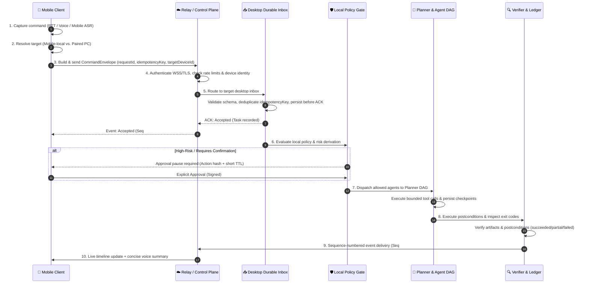
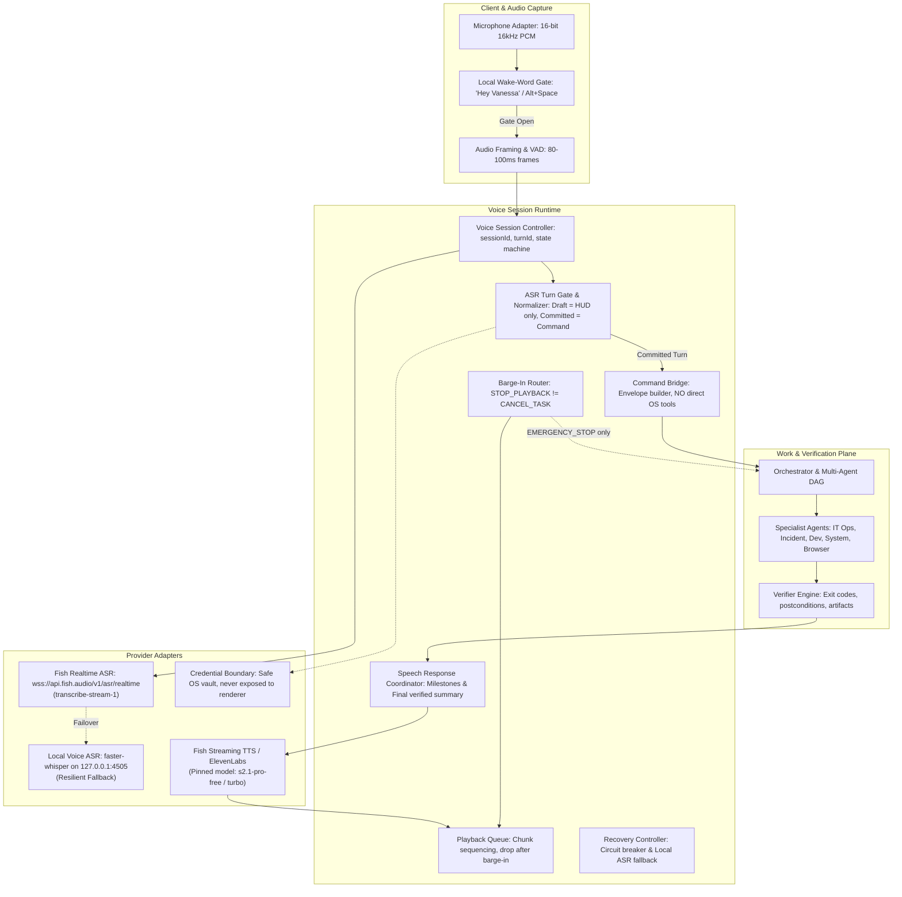
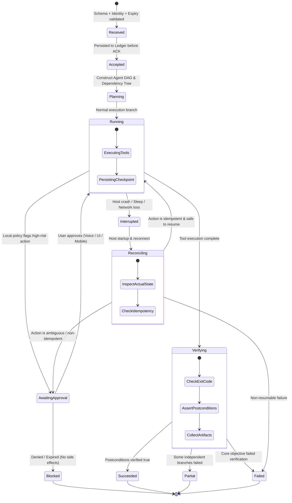

# Vanessa Architecture Specification (Revision 0.3)

> **Core Principle**: Voice owns speech sessions; Planner owns work; Policy owns authorization; Target device owns execution; Verifier owns completion claims.

---

## 1. Executive Summary

Vanessa Architecture Revision 0.3 addresses three critical requirements:
1. **Clean Voice Integration**: The voice subsystem is a dedicated session and transport layer, not a parallel orchestrator. Speech turns are strictly segmented into `draft` (HUD updates only) and `committed` (command triggers).
2. **Network Resilience & Durable Execution**: Remote commands are enveloped with `requestId` and `idempotencyKey`, persisted to an authoritative ledger before acknowledgement, and guarded against duplicate replay.
3. **Verifiable Agent Lifecycle & Recovery**: Failures and interruptions are explicit state transitions. Tasks progress through `received` $\rightarrow$ `accepted` $\rightarrow$ `planning` $\rightarrow$ `running` $\rightarrow$ `verifying` $\rightarrow$ terminal states. "Opened terminal" is not proof of testing; postconditions and exit codes must be verified.

---

## 2. Component Architecture Diagrams

### 2.1 Mobile $\rightarrow$ PC Task Routing

---

### 2.2 Voice Pipeline Component Map

---

### 2.3 Task Lifecycle & Failure Recovery

---

## 3. Core Architectural Decisions Locked

| Area | Decision | Rationale |
| :--- | :--- | :--- |
| **Desktop Client** | Electron UI with 90×90px compact circular orb docked in screen corner (`BR`, `BL`, `TL`, `TR`). | Non-intrusive, always available, direct access to Windows APIs via context-isolated preload boundary. |
| **Voice Layer** | Dedicated session & transport runtime. Zero direct OS execution from voice layer. | Prevents unverified hallucinated side-effects. Audio layer only streams and manages session state. |
| **Fish Audio ASR** | WebSocket streaming via `wss://api.fish.audio/v1/asr/realtime` with model `transcribe-stream-1`. | Official low-latency real-time protocol. Differentiates `draft` (HUD) vs `committed` (planner input). |
| **Local ASR Fallback** | Local Python `faster-whisper` daemon on `ws://127.0.0.1:4505`. | Guarantees 100% offline autonomy if internet or cloud API keys fail. |
| **Orchestration** | Authoritative Task DAG with local SQLite ledger, sequence numbers, and cancellation tokens. | Non-blocking execution of independent tasks via `Promise.all`; strict dependency ordering. |
| **Remote Connectivity** | Authenticated WSS relay with device identities, idempotency keys, and sequence replay. | Survives Wi-Fi drops, sleep mode, and reconnects without repeating non-idempotent commands. |
| **Verification Gate** | "Opened terminal is not proof of testing." Mandatory exit code checking & postcondition assert. | Autonomous coding and incident fixes must prove correctness before reporting success. |
| **Barge-In Router** | `STOP_PLAYBACK` $\neq$ `CANCEL_TASK`. Separate cancellation commands. | Speaking stops audio chatter immediately without accidentally aborting background builds or tests. |

---

## 4. Implementation Invariants

1. **ASR Invariant**: `partial` or `draft` transcripts must NEVER trigger planner execution. Only a `committed` turn enters the planner.
2. **Audio Privacy Invariant**: Local wake-word gate (`Hey Vanessa` or `Alt+Space`) gates cloud audio streaming. No raw room audio is streamed to external cloud APIs while idle.
3. **Execution Invariant**: Every remote or voice command must have an `idempotencyKey` and must be persisted before the target device sends an `ACCEPTED` status.
4. **Verification Invariant**: A task status cannot transition to `succeeded` based solely on process spawning. It requires actual completion, verification of exit code (`code === 0`), and postcondition validation.
