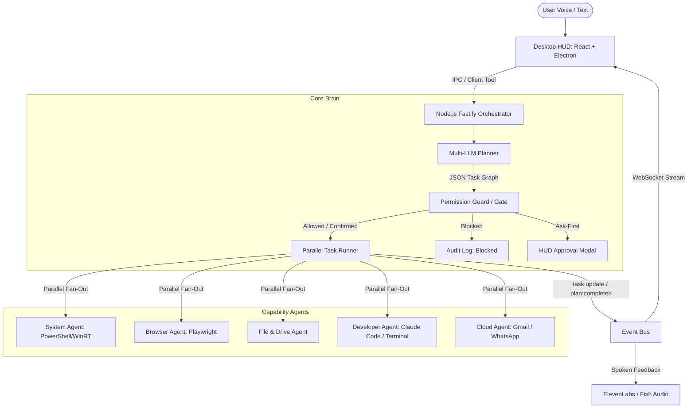

# Vanessa Architecture Deep Dive

## Overview
Vanessa operates as a voice-first orchestrator on top of Windows 11. Rather than relying on fragile GUI clicking or vision models alone, Vanessa uses direct OS APIs, PowerShell, terminal execution, and browser automation to deliver fast, reliable actions.

## Parallel Task Runner (DAG Resolution)
Tasks in a Plan specify `dependsOn: string[]`. 
- An independent task (`dependsOn: []`) runs immediately.
- Multiple independent tasks run concurrently with `Promise.all`.
- Dependent tasks wait until all parent tasks reach `status === "success"`.
- If a parent task fails, dependent tasks are not executed, while other independent branches continue.

## Emergency Kill-Switch
Engaged by pressing `Esc` in the desktop HUD or sending `POST /api/cancel`.
- Immediately cancels all running, pending, and awaiting tasks.
- Emits `audit:log` event and updates task statuses to `cancelled`.
