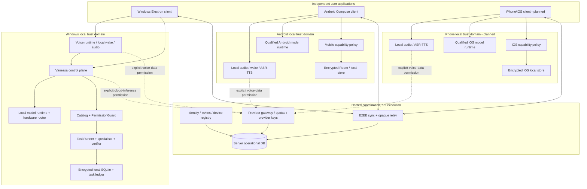

# Vanessa — Integrated Product, Architecture & Production Plan

**Version:** 1.0, with owner-directed adoption amendments 
**Source document:** supplied integrated plan, labelled “Prepared: 22 November 2026”; that source date has not been independently verified 
**Repository:** `Kshitij-Tripathi87/Project_Vanessa` 
**Status:** Canonical product, architecture and delivery planning baseline; implementation status is established by source and test evidence, not this plan 
**Release target:** 18 December 2026 was proposed in the source document, not confirmed as a commitment; release requires a separate evidence-based go/no-go

The owner approved adding this corrected plan and an S0 report to the current branch. This approval does **not** authorize application-code changes, commits, pushes, pull requests, paid provider calls, account changes, provisioning or deployment. Obtain separate approval for those actions.

### Owner decisions and precedence

1. **Build locally, test, then consider deployment.** No gateway, domain, VPS or hosting provider has been selected. None is a prerequisite for local development or fake-provider tests. A hosted gateway or relay is a future option only after the relevant functionality is built, tested and separately approved; it is never a reason to send data to the cloud by default.
2. **Android and iPhone are both in product scope.** The owner wants the widest feasible phone compatibility and confirmed that includes iOS as well as Android. A universal guarantee is not technically established: define and test an explicit OS/version, ABI, hardware and feature matrix, and make unsupported configurations fail or degrade honestly without silent cloud inference. Current source contains an Android app with `minSdk = 26`; that is a build constraint, not proof that any particular phone works. No iOS app was found under `apps/` in this audit. iOS implementation and real-device acceptance remain work to do. Any release omitting an in-scope platform must be explicitly scoped and approved, not advertised as universal.
3. **Credits are not permission to spend.** The owner has reported starting credits privately for Sarvam, Fish Audio and ElevenLabs; exact API eligibility, account scope, units, reset/expiry and approved allocation remain unverified. Do not put account-specific figures or credentials in this public repository, and do not treat reported credit as authorization for a live or billable call.
4. **Local-first remains mandatory.** Independent clients use local capabilities where qualified; hosted audio, text, source code and private data require the appropriate explicit, scoped permission. Models propose; the device control plane authorizes, executes and verifies.
5. **This session stays on its current Arena branch.** Do not create or switch to `develop` or any other branch in this session. Branch names and workflow outside this session are not decided by this plan.
6. This plan takes precedence over conflicting **product and delivery plans**. Existing detailed documents remain supporting or historical specifications, and their source-level claims must be rechecked. It does not override the code's actual behavior or authorize a change merely by describing it. See [the S0 baseline](S0_BASELINE.md) for the incomplete evidence and known failures.

---

## Executive decision

This plan combines the architecture depth of *Vanessa Product & Architecture Baseline v0.1* with the execution discipline of *Vanessa: Production Plan to Closed Beta (Dec 18, 2026)*.

The two source plans are complementary:

- **v0.1 baseline** is the stronger product/architecture specification: independent Windows and Android clients, local-first inference, encrypted memory synchronization, capability ownership, hardware-qualified models, stage-specific voice routing, and explicit UX requirements.
- **December 18 plan** is the stronger delivery plan: a real beta date, read-only baseline audit, provider gateway, invitations and quotas, provider state machine, fault injection, device performance checks, release freeze and operational runbook.

This v1.0 makes the architecture from v0.1 authoritative and adopts the best execution mechanisms from the December 18 plan. The owner additionally confirmed iPhone/iOS alongside Android in mobile product scope. Conflicting assumptions are resolved in the decision register below.

**The release principle is non-negotiable:** the source document's 18 December target is unconfirmed and cannot bypass acceptance. Build and test before any separately authorized deployment. If a privacy, security, authorization, cancellation or verification gate fails, release is delayed or optional scope is reduced; a known safety failure is not shipped.

## 1. Product and release decisions

### 1.1 Product direction and unresolved scope

| Area | Decision |
|---|---|
| Positioning | General-purpose assistant with deep engineering capabilities |
| Platforms | Independent Windows, Android and iPhone/iOS applications are in product scope. Exact supported OS versions, hardware and features require an evidence-backed matrix; iOS is not yet implemented |
| Shared experience | Shared identity, conversations, memory and logical task continuity |
| Intelligence | Local-first; hosted inference only when explicitly permitted |
| Voice | Existing stack; LiveKit, Deepgram and Cartesia are optional evaluation candidates, not automatic dependencies |
| Providers | ElevenLabs, Fish Audio, Sarvam, local Whisper; also LiveKit, Deepgram and Cartesia |
| Memory | Encrypted local memory with controlled synchronization between authorized devices |
| Beta | Small, controlled, multi-user and multi-machine beta |
| Distribution | Windows desktop installer plus Android and iPhone/iOS builds for the supported release scope; iOS tooling, signing and device qualification remain to be established |
| Priority workflows | (1) general typed/voice conversation; (2) approved multi-step PC tasks; (3) coding and repository workflows; (4) cross-device continuity; (5) persistent memory and contextual follow-up |
| Privacy invariant | No source-code or sensitive-data transfer to hosted models without explicit permission |

### 1.2 Recommended decisions adopted from the December 18 plan

| Recommendation | Integrated decision |
|---|---|
| Closed beta date | The original 18 December 2026 target and 15 December freeze are proposals only; dates require owner confirmation and verified staffing, devices and acceptance evidence |
| Read-only audit first | Record current branch SHA, test counts, skipped tests, open security findings and package state before changing code |
| Provider gateway | A possible future hosted boundary for centrally managed credentials, budgets and approved provider calls. Build and test locally first; no domain, host, deployment or live call is approved |
| Sync and relay | Future cross-device sync/relay is a separate logical boundary that transports end-to-end encrypted content and has no execution authority; no hosting is needed for local development |
| Quota accounting | Durable, centralized reservations and settlements across users/devices, supplemented by provider-reported usage where available |
| Provider state machine | HEALTHY / LOW / RESERVE / EXHAUSTED plus circuit-breaker states; test proposed thresholds with synthetic usage first, and calibrate live only after authorization |
| Fault injection | Exercise process/network faults and synthetic provider failures locally. Live provider faults or spend require separate approval, hard caps and a safe test environment; state-only tests are insufficient |
| Wake word | Local wake detection only; PC hands-free wake is a target. Android wake defaults to off and can be enabled only by explicit opt-in on tested device profiles |
| Release freeze | Freeze an approved release candidate before release; the proposed 15–17 December dates are unconfirmed |
| Beta operations | Invite control, per-user limits, emergency kill switch, health dashboard, feedback path and rollback package |

### 1.3 Conflicts resolved

| Conflicting proposal | Resolution |
|---|---|
| Sarvam LLM as the default route | Rejected as a default. A qualified local model remains the default. Sarvam and other hosted models are eligible only for request classes and data categories the user has permitted. |
| All voice audio routed through the VPS | Rejected as a default. Local wake detection and local speech routes remain the default. A hosted ASR/TTS path requires the appropriate voice-data permission and an active session indicator. |
| Phone is only a PC remote control | Rejected. Android and iOS are intended to be independently useful for conversation, qualified local inference, voice, local memory and platform-permitted local actions. Each can delegate PC-owned actions to a paired Windows executor without gaining PC authority. iOS remains unimplemented. |
| Windows SQLite is the sole authoritative memory store | Rejected for shared memory. Each device stores its local encrypted replica; synchronization reconciles changes. A PC remains authoritative only for tasks executed on that PC. |
| Every provider's credits can be modelled as one generic balance | Rejected. Capacity is provider/account/capability specific. Shared pools are modelled only where provider documentation or account telemetry confirms them. |
| All providers must automatically fail over to one another | Rejected. Failover is limited to providers permitted by the request's privacy policy, compatible with the stage/language, healthy, within budget and qualified by tests. |
| Android wake word is mandatory regardless of device | Modified. Local wake is enabled only where OS/background/battery tests pass. Push-to-talk remains available on every supported device. |
| LiveKit must replace the current voice pipeline | Rejected. LiveKit is evaluated as an optional media/session layer; it does not replace Vanessa's planner, task runtime, policy or verifier. |
| Every mobile phone is already supported | Rejected as a present-tense claim. Android and iOS are both in scope; pursue widest feasible support and publish measured platform/version/ABI and feature limits, with honest local degraded modes. |

---

## 2. Product definition and boundaries

Vanessa is a private, voice-capable personal assistant that can hold general conversations, maintain contextual memory across authorized devices, understand engineering workspaces, and execute supported tasks on the device that owns the relevant capability.

It is not simply a chatbot, a wake-word demo, a thin wrapper around cloud models, or an unrestricted computer-control agent.

### 2.1 Product invariants

1. **Independent clients:** Windows, Android and iOS are product targets. Each supported client must provide a useful local conversation experience within its qualified capabilities even when the other device or internet is unavailable. Android is the current mobile implementation; iOS must still be designed, built and qualified.
2. **Shared logical identity:** Authorized devices share user identity and selected conversations/memory/task history through an authenticated protocol.
3. **Local-first inference:** Local qualified models are selected first. Cloud inference is not an automatic fallback.
4. **Explicit data egress:** Hosted ASR, LLM and TTS each have separate permission scopes. The user can see which provider receives which data.
5. **One execution authority per device:** PC actions are executed by the PC control plane; Android- and iOS-local actions are executed only by their respective platform runtime and permitted OS APIs. The relay and model providers execute no device tools.
6. **Model is not authority:** A model proposes; typed schemas and deterministic policy validate; a registered handler executes; a verifier determines the outcome.
7. **Evidence before success:** A process launch, tool call, response string or model claim is not task completion.
8. **Durable control semantics:** Stop speaking, stop listening, cancel task and emergency stop are distinct operations.
9. **Privacy-preserving sync:** Hosted sync stores ciphertext, not plaintext memory, source code, prompts, transcripts or device decryption keys.
10. **Qualified hardware support:** A model/runtime is supported only for a measured hardware/backend/context configuration.

### 2.2 Non-goals for this beta

- Unrestricted autonomous execution or arbitrary model-generated shell/PowerShell.
- Production deployment, account payments, external messaging or destructive operations without action-specific approval.
- Training on private user conversations by default.
- A single model that must run on every phone and PC.
- Cloud execution of PC tools or a cloud agent with unrestricted PC authority.
- Public app-store launch or enterprise fleet administration.
- Guaranteed hands-free wake on every Android or iOS device, including configurations where OS background policy, battery, privacy or device capability prevents it.
- A fully featured admin portal if a protected admin API/CLI and basic usage dashboard meet beta operations needs.

---

## 3. Current repository baseline and implementation reality

The repository is an existing multi-package system. The plan must extend it rather than redraw the same components and accidentally create competing implementations.

### 3.1 Existing foundations identified in the repository review

| Area | Existing code/foundation | Treatment |
|---|---|---|
| Windows client | Electron + React + TypeScript shell, floating orb/HUD, typed/voice input, approvals, Windows capabilities and installer workflows | Retain the Electron main/preload/renderer trust boundary; complete the product surfaces and state projection |
| Android client | Kotlin/Jetpack Compose application; PR #87 merged `ConversationController` wiring in `MainActivity`, UI projection, on-device ASR and opt-in offline-TTS lifecycle | Preserve the merged wiring; verify end-to-end behavior, persistence, task UI and network state rather than rebuilding it or claiming physical acceptance |
| iPhone/iOS client | No iOS app was found under `apps/` during this audit | Design and implement the approved platform scope; qualify local conversation, permissions, storage, voice and platform-limited capabilities before advertising support |
| Orchestrator | Node/TypeScript planner, orchestrator, `PermissionGuard`, `TaskRunner`, resource locks, event bus, result recorder and critic | Retain as the Windows execution authority |
| Agent catalogue | 12 agents, 62 declared actions, 46 selectable, 16 blocked | Keep it canonical; do not let a model or voice framework add authority |
| Voice | Separate voice service and WebSocket/session lifecycle; local Whisper and adapters for Sarvam, Fish Audio and ElevenLabs | Consolidate behind stage-specific provider contracts; evaluate additional providers and LiveKit only if selected and approved |
| LLM router | Environment-selected Ollama, NVIDIA and Sarvam paths | Replace static selection with policy/capability/resource-aware routing; retain provider clients where valid |
| Memory | SQLite / `node:sqlite` Memory Palace and task-related stores | Add encryption, schema migration, user/device scopes, provenance and encrypted sync |
| Usage | Shared usage-meter implementation with in-process reservations/settlement | Persist reservations and settlements; coordinate shared account capacity on the gateway |
| Hardware | PR #91 is merged on `main` with standalone hardware-probe and resource-estimator foundations. PR #90 was merged into a separate integration branch, not into `main` | Preserve PR #91; reconcile PR #90's overlapping work before any adoption. Add manifests, validated loaders, registry and benchmark qualification later |
| Protocol | Shared TypeScript conversation contract and Kotlin parity work | Make this the canonical cross-client contract and add task, approval, sync and provider fixtures |
| Packaging | Windows setup/installer workflows exist; README says the Setup EXE is not yet signed or fully offline | Re-verify actual artifact types, signing, upgrades, uninstall and rollback; do not overstate readiness |

### 3.2 Known integration gaps to verify in S0

- PRs #85 and #86 merged desktop typed-conversation and voice-bridge wiring; PR #87 merged Android Activity, reducer projection, on-device ASR and opt-in offline-TTS wiring. Preserve those implementations rather than rebuilding them. Their existence is not proof of a complete physical-device journey.
- The shared conversation path is in-memory/bounded; durable multi-turn persistence, memory retrieval, clarification and safe restart recovery still need end-to-end evidence and/or implementation.
- Validate desktop voice/typed correlation, Android lifecycle and error paths, and the live ASR/TTS journey on supported devices; design and implement the missing iOS client. Do not infer success from a plan or a build.
- Android remote v2 is not yet the same as a general natural-language request entering the PC orchestrator.
- Remote transport/relay availability and token checks require verification; a pairing UI is not evidence of an authenticated session.
- Current model routing is not an adaptive, benchmark-qualified model/runtime router.
- Current usage accounting is not a durable cross-process, cross-device, account-wide provider ledger.
- Hardware detection/estimation foundations do not yet prove that a specific model/engine/backend tuple can run reliably.
- Some tool paths and old audit items require renewed security review: remote command/approval authentication, command construction/interpolation, full path and symlink validation, relay room cleanup and real fault-injection coverage.

### 3.3 Read-only audit rule

Before editing any code, record:

- `main`, the active session branch, any existing integration branch and relevant open PR head SHAs (without creating or switching branches);
- clean-checkout build/test results, with pass/fail/skip counts by suite;
- Windows installer, Android build and iOS implementation/build status;
- known open security findings and action-catalogue differences;
- generated protocol/artifact drift and lockfile integrity;
- a reproducible baseline report (`baseline.json` plus a human-readable summary).

Do not fix failures during this initial measurement. Re-run on a fresh isolated snapshot to ensure the baseline is reproducible. A baseline failure is not a reason to hide or reclassify the failure. The [S0 report](S0_BASELINE.md) and [machine-readable summary](S0_BASELINE.json) are partial: raw temporary logs were not retained in the repository, and live account, physical-device and full security evidence remain open.

### 3.4 PR reconciliation policy

- **PR #88:** retain as an acceptance-test asset. Verify its opt-in Windows journey and connect the evidence to the release-candidate matrix.
- **PR #89:** its intelligence-first design was merged into `main` at `d7da0dc9c021cac8a825b94ba2155aed25cab5aa`, after this session branch's `1dd201b` base. The [merged design](https://github.com/Kshitij-Tripathi87/Project_Vanessa/blob/d7da0dc9c021cac8a825b94ba2155aed25cab5aa/docs/engineering/INTELLIGENCE_FIRST_MODEL_RUNTIME_PLAN.md) is a supporting specification; a documentation merge is not runtime implementation.
- **PR #90:** merged at `7a2bb34fccabf617446eba37ffc08dc842c5d0cd` into `integration/intelligence-first-architecture`, not into `main` at the time of this check. Its merge diverges from current `main` and overlaps files added by PR #91. Compare actual code and evidence before taking any additional work from it; do not adopt it blindly.
- **PR #91:** merged into `main` at `1dd201b40e762a1a210a318791a0f08d69d51aab` and is included in this branch. Its hardware/resource code is standalone; it does not complete adaptive routing, model registry, loader integration or benchmark qualification.

Do not merge any of these solely because branch CI is green. Reconcile ancestry, changed-file scope, generated artifacts, lockfile changes, acceptance coverage and security findings first. No commit, push, PR creation or merge is performed under this planning document; those actions require a separate implementation go-ahead.

---

## 4. Target architecture

### 4.1 Architectural shape

### 4.2 Service boundaries

| Component | Owns | Must not own |
|---|---|---|
| Windows Electron renderer | UI, local input presentation, conversation/task projections | API keys, filesystem authority, unrestricted process execution, policy decisions |
| Windows main/preload | Secure IPC, window lifecycle, microphone/device permissions, controlled local service access | Model-generated command interpretation or policy bypass |
| Windows control plane | PC request/session state, planner invocation, policy, approvals, PC task lifecycle, result verification | Cloud account billing authority or mobile-local tasks |
| Android application/runtime | Android conversation, local speech/model selection, local memory and supported Android capabilities | Windows process execution or bypass of Windows approval/policy |
| iPhone/iOS application/runtime (planned) | iOS conversation, qualified local speech/model selection, local memory and sandbox-permitted iOS capabilities | Windows process execution, unrestricted OS control or bypass of Windows approval/policy |
| Voice runtime | Audio capture/transport, ASR session, VAD/turn commit, streaming playback, barge-in and voice-provider state | Tool execution, task authorization or independent task planning authority |
| Model/provider router | Model and provider eligibility, context/capacity checks, routing, bounded retries | Permission grants or action execution |
| Provider Gateway | Invite/token validation, centrally held provider credentials, provider capacity telemetry, spend reservations, hard quotas, provider API proxy | Device tools, plaintext memory storage, task execution or hidden cloud routing |
| Sync/Relay service | Device rendezvous, ciphertext delivery, event forwarding, replay protection, expiry and revocation | Plaintext memory/transcript access, provider credentials or execution authority |
| Local model runtimes | Load and run qualified local models on the owning device | Access to device tools beyond their request/response contract |

### 4.3 Separate logical services if a hosted path is approved

The hosted portion of the diagram is a future option, not an existing deployment. No hosted service, domain or provider has been chosen. Local product work and fake-service tests must not wait on one. If a hosted path is later approved after build and testing, the **Provider Gateway** and **Sync/Relay** may share infrastructure only while remaining separate logical trust domains with separate credentials, routes, data retention, logs and access policies. Provider, region, budget and deployment require a later explicit decision.

- Relay/sync content is end-to-end encrypted. The service sees ciphertext and minimal routing metadata.
- The provider gateway is different: for an explicitly approved cloud request, it must proxy the approved payload to the named provider. It may therefore handle that payload in plaintext transiently in memory. It must not persist prompts, audio, source files or transcripts by default.
- User consent must disclose the actual external recipient. A gateway proxy is not a privacy shield against the model provider.
- No service on the VPS receives Windows, Android or iOS execution authority.

### 4.4 Persistence strategy

The following is a target architecture, not a claim that current stores are encrypted or synchronized. Confirm implementation and key protection with tests before making that claim.

**On Windows:** encrypted local SQLite stores conversations, memory, task checkpoints, approvals, event replay cursors and local usage traces.

**On Android:** encrypted Room/SQLite-backed storage stores conversations, local memory, device-local tasks and sync state.

**On iOS (planned):** an encrypted local store protects conversations, local memory, device-local tasks and sync state; key custody uses reviewed iOS facilities such as Keychain and hardware-backed protection where supported. This is not implemented or verified yet.

**On the hosted side:** PostgreSQL is recommended for multi-user identity, invitation state, device registrations, durable quota reservations/settlement, provider-account telemetry and encrypted-envelope metadata. It must not store plaintext conversation/memory payloads or device decryption keys. Redis is not a beta requirement; add it only if measured presence/queue throughput justifies it.

Each client is the local source of truth for its local data. Windows is authoritative for a Windows-executed task; each mobile platform is authoritative for its own local tasks. The sync layer replicates signed/encrypted state and does not override executor truth.

### 4.5 Task ownership and cross-device execution

- A local Android or iOS task is executed by that platform using only its permitted and explicitly authorized capabilities; iOS support is planned, not implemented.
- A local Windows task is executed on Windows through the existing Vanessa orchestrator.
- A mobile-originated PC task is delivered to an explicitly selected paired Windows executor. That PC validates and plans the request locally, applies its catalogue and `PermissionGuard`, requests approval where needed, executes and verifies locally, then publishes task events/evidence to the phone. Android and iOS integrations require separate evidence.
- The phone is not a second planner for PC actions. It is an independent assistant and client capable of delegating work.
- If the target PC is offline, the task is `pending_delivery` or `waiting_for_device`, not `started`.
- Remote approval must be authenticated and cryptographically bound to the exact action, parameters, target device, policy version and expiry. Pairing alone is not consent.

### 4.6 Exactly-once and recovery

Exactly-once execution cannot be assumed across crashes, networks and external side effects. The runtime uses request IDs, idempotency keys, resource locks, event sequence IDs and a reconciliation policy:

1. Before execution, persist the intent, target, approved scope and idempotency identity.
2. Persist each lifecycle transition and evidence reference.
3. On restart, inspect non-terminal work and determine whether the side effect occurred.
4. Resume only operations proven safe/idempotent; otherwise require user resolution.
5. Never replay a non-idempotent action merely because its acknowledgement was lost.
6. Expired/revoked approval or device credentials never become valid after restart.

### 4.7 Core shared contracts

Keep the TypeScript/Kotlin contract authoritative and versioned. At minimum define:

- `IdentityRef`, `DeviceRef`, `DeviceCapabilitySnapshot`;
- `Conversation`, `Turn`, `Message`, `ConversationSyncEnvelope`;
- `TaskRequest`, `Task`, `TaskEvent`, `TaskResult`, `EvidenceRef`;
- `ApprovalRequest`, `ApprovalDecision`, `ApprovalDigest`;
- `VoiceSessionProfile`, `VoiceSessionEvent`, `ProviderCapabilitySnapshot`;
- `ModelManifest`, `HardwareProfile`, `InferenceBudget`, `InferenceTrace`;
- `MemoryRecord`, `MemoryMutation`, `SyncCursor`, `DeletionTombstone`;
- `PrivacyGrant`, `DataClassification`, `ProviderEgressReceipt`.

Every contract needs schema versioning, strict validation, bounds, replay/idempotency behavior and cross-platform conformance fixtures. A wire-protocol change updates TypeScript and Kotlin implementations and generated fixtures together. The planned iOS codec/reducer must consume the same canonical schemas and fixtures, including strict UTF-16 length semantics where required; it must not create an independently divergent protocol.

---

## 5. Voice-agent architecture and provider routing

### 5.1 Voice is a pipeline, not a provider toggle

Each voice turn is a composition of independently selected stages:

1. Wake detection / push-to-talk activation.
2. Audio capture and VAD / endpointing.
3. Speech recognition (ASR).
4. Conversation/context assembly.
5. Language-model response or task planning.
6. Permission/approval and task execution when the request asks for action.
7. Response narration.
8. Text-to-speech (TTS) and playback.
9. Turn completion, usage settlement and memory policy.

The ASR provider, LLM provider, TTS provider and media transport may be different. A session cannot silently switch all stages because one provider supplied the first stage.

### 5.2 Provider roles and release posture

| Provider/runtime | Candidate role | Initial posture |
|---|---|---|
| Local Faster-Whisper | ASR | Default local speech route on qualified host hardware |
| Sarvam Speech | ASR and TTS | Hosted option after explicit voice-data permission; validate language, latency and quota |
| Fish Audio | ASR/TTS capabilities where supported by the configured API/model | Existing adapter retained; verify current endpoint/model and real quota accounting |
| ElevenLabs | TTS and supported speech/agent capabilities | Existing adapter retained; subscription/usage snapshot adapter; hosted only with consent |
| Deepgram | ASR / streaming speech | Optional candidate; add and test an adapter only if chosen and separately authorized, including project/region limits and streaming lifecycle |
| Cartesia | TTS / streaming speech | Optional candidate; evaluate and measure only if chosen and separately authorized |
| Windows/Android/iOS system TTS | Candidate local TTS fallback | Use only when a locally installed offline voice is verified; availability and offline operation are device-dependent. iOS integration is planned |
| Local Ollama / validated local engines | LLM | Default local inference route on each device where a qualified model fits |
| Sarvam / NVIDIA and future hosted LLMs | Hosted LLM | Explicit, request-scoped permission only; never a local failure fallback by default |
| LiveKit | Realtime media/session transport and optional pipeline integration | Evaluate in a bake-off; it is not a separate task orchestrator or an automatic requirement for every voice path |

**Provider qualification is stage-specific.** A provider may be available for TTS in English but not qualified for Hindi/Hinglish ASR or vice versa. Do not mark a stage/language combination supported until contract tests and a real-device quality/latency test pass.

### 5.3 One voice session owner

The existing voice-agent service remains the owner of the PC voice lifecycle. Android and the planned iOS client own their respective platform audio lifecycles while using the same shared session/event semantics. LiveKit may carry real-time audio if selected; it does not duplicate turn commit, task planning, permission or execution state.

### 5.4 Local wake and activation policy

- Pre-wake audio remains on the device. No audio is sent to a provider before explicit activation.
- PC local wake-word detection is a beta target; push-to-talk remains a manual fallback.
- Android wake-word monitoring is local, opt-in and device-gated. It defaults to off and may be enabled by the user only on tested configurations meeting battery, thermal and reliability limits. It may require a foreground service and persistent notification.
- If the Android wake service is killed or exceeds the battery budget, disable hands-free mode and leave push-to-talk available. Do not hide the degraded state.
- On iOS, push-to-talk is the initial target. Do not promise always-on wake or background microphone access; any hands-free mode must be permitted by the OS and separately qualified for privacy, reliability and battery. If no qualified offline speech route exists, retain a truthful local typed mode without silently uploading audio.
- The wake detector does not itself grant permission for hosted ASR or hosted LLM processing.

Candidate wake engines can be compared in S1 using measured false accepts, false rejects, CPU, memory, battery, OS support and distribution licence conditions. Pick one based on evidence, not preference.

### 5.5 Privacy gate before hosted processing

A cloud request is eligible only when all checks pass:

1. User has enabled the relevant provider/capability class.
2. The current request's data classification permits that destination.
3. If the payload includes source code, repository data, private files, logs, credentials or private memory, the user has explicitly approved the exact scope for this request.
4. The provider is listed as an allowed recipient for that grant.
5. The grant is not expired or revoked.
6. The gateway has budget and capacity.

The system must show a concise transfer disclosure before a first-time or materially changed transfer: data categories, named provider, purpose, retention/processing boundary and whether the gateway will handle the payload. Local-only mode hard-blocks all hosted requests, including fallback.

### 5.6 Provider capacity model

The provider router tracks independent dimensions. Do not collapse all of them into one percentage:

| Dimension | Meaning | Source / confidence |
|---|---|---|
| Credit/balance | Spendable account credit or remaining subscription allowance | Provider API when available; otherwise app estimate or manually entered starting balance |
| Usage | ASR seconds, TTS characters/audio, LLM input/output tokens, requests | Provider-reported usage reconciled with local event ledger |
| Rate limit | Requests/tokens/audio per time window | Provider headers/documentation/dashboard; separate per API where applicable |
| Concurrency | Simultaneous streams/requests allowed and currently reserved | Provider account/project limit plus gateway reservations |
| Context capacity | Maximum context and currently available input/output tokens for this request | Model/API metadata and local token estimate |
| Session health | Latency, error rate, connection state and breaker state | Gateway/provider measurements |
| Freshness | Age and last successful retrieval of telemetry | Gateway timestamp |

Every value shown to users is marked as one of: `provider_confirmed`, `provider_reported_stale`, `app_metered`, `estimated`, `manual`, or `unknown`. Unknown is not unlimited. Do not display a numeric credit balance when there is no reliable source.

#### Provider-specific accounting rules

- **Sarvam:** current official billing documentation describes one organisation-level credit pool shared across APIs, workspaces and keys, while rate limits are independently applied by API. Model one shared credit balance plus per-API rate-limit buckets; do not allocate separate independent credits to STT/LLM/TTS unless the provider later changes its billing model.
- **ElevenLabs:** use the subscription endpoint where authorized to read character usage/limit and reset information; map API usage and any pay-as-you-go balance separately where available.
- **Fish Audio:** track API credits/spend separately from account concurrency. The current developer page documents a default concurrent-request allowance shared across keys; confirm the actual account limit at onboarding and never infer it from the number of API keys.
- **Deepgram:** rate limits are project- and region-specific; store project/region scope, not just account/key scope.
- **Cartesia:** do not assume a usage/balance endpoint. Until the connector can obtain authoritative telemetry, track app-metered spend and label provider balance as unknown/manual.
- **LiveKit:** record session/transport usage and health separately from underlying model-provider usage. A LiveKit session does not make model-provider quota visible automatically.

Provider limits and APIs can change. Revalidate the provider adapters against their official docs and account dashboards during S0 and again before the release candidate.

### 5.7 Durable quota ledger and reservations

Every billable operation writes a durable usage event before calling the provider:

`reserve → provider call → settle | fail | release → reconcile`

Required fields:

- `usageEventId`, `requestId`, `turnId`, `userId`, `deviceId`;
- provider, account/workspace/project scope, capability, model and region;
- usage unit and reserved quantity/cost;
- estimated and provider-reported actual quantity/cost;
- currency, rate-table version, source and confidence;
- reservation/settlement status and timestamps;
- idempotency key and provider response/reference ID where available.

Reservations must be transactional across concurrent users/devices. Provider usage events are reconciled, not silently overwritten. A mismatch above a configurable threshold (initial proposal: 10%) raises an operator alert and marks the displayed estimate accordingly.

Set hard caps at three levels:

1. global provider-account cap;
2. per-beta-user daily or period cap;
3. per-request/session ceiling.

If a hosted gateway is later implemented, it must expose an immediate global kill switch and provider-specific disable switch. The current in-process meter does not establish this durable cross-user enforcement. Normal CI must use fake provider accounts and never consume live credits.

### 5.8 Initial provider state machine

These thresholds are **configurable proposed starting values**, not current enforcement or universal provider facts. Before implementing them, define each provider/account/capability allocation, the denominator, reservation treatment, telemetry freshness, resets, top-ups and reconciliation. Reported account credits are neither a confirmed usable API allowance nor authorization to spend:

| State | Starting threshold | Router behavior |
|---|---|---|
| HEALTHY | More than 20% of known/estimated usable budget | Eligible for new turns |
| LOW | 5–20% remaining | Route new turns to an eligible alternative; allow an existing turn to finish if it has a reservation |
| RESERVE | Below 5% | Preserve for explicitly configured critical/last-resort operations only |
| EXHAUSTED | Zero balance, definitive quota exhaustion or provider quota error | Stop new reservations; open breaker until refreshed/recovered |
| DEGRADED | Health/latency/error threshold breached | Avoid new turns temporarily; retain diagnostics |
| UNKNOWN | Capacity cannot be established | Do not treat as unlimited; apply conservative configured per-user/global cap or disable that route |

For providers without a confirmed balance API, the threshold is based on a visibly labelled local estimate or a separately approved manual allocation. The router never calls that value provider-confirmed. If no qualified, healthy and already permitted alternative exists, return a truthful degraded result or ask for permission; do not silently use an unauthorized hosted provider.

### 5.9 Error handling and failover

- Classify authentication errors, permission errors, quota exhaustion, rate limits, invalid requests, timeouts, connection resets and provider 5xx separately.
- Initial circuit-breaker defaults: 3 consecutive/qualifying failures in 30 seconds opens the provider for 60 seconds; then one half-open probe. Tune using real measurements.
- Switch providers only at safe turn/stage boundaries. Never discard a committed transcript because a TTS provider failed.
- Fail over only to a provider already allowed by the request's privacy grant, compatible with language/format, within budget and qualified by tests.
- Do not fail from local to hosted automatically. If the user has not approved cloud processing, show a local degraded result, ask for permission or offer typed mode.
- Permit at most one bounded pre-dispatch model retry/fallback inside the request deadline. Once a plan is authorized or execution begins, inference retry must not silently regenerate a different executable plan.
- Do not replay non-idempotent provider or task requests without an idempotency proof.

### 5.10 Context-window and session-budget management

For each LLM request, calculate:

`available_input = min(model_context, provider_context, user_limit) - system - policy - schema - conversation - memory - tool_output - reserved_output - safety_headroom`

Track:

- model-declared maximum context and output tokens;
- provider-specific context and max-output limits;
- estimated tokens in system policy, schema, current request, recent turns, retrieved memory and tool results;
- output reserve, tool-call reserve and safety margin;
- concurrent requests and per-user request budgets;
- effective current availability and telemetry source.

Never silently truncate the current user request or required policy. If context is too large, first compact/summarize older context locally with provenance, remove irrelevant retrieval, or ask the user to narrow the request. Hosted summarization is subject to the same privacy gate. The UI/diagnostics surface shows approximate context usage and which model/provider is selected.

### 5.11 Voice latency and quality validation

Proposed initial targets, to be confirmed by S0 measurement:

- Simple, local-first command: wake/activation to first audio p50 ≤ 2.5 seconds; p95 ≤ 4 seconds on the named reference hardware and model profile.
- Streaming playback begins before the entire answer is synthesized when the adapter supports it.
- Barge-in stops the current playback generation and allows a new user turn without cancelling the underlying task.
- ASR accuracy and intent accuracy are measured separately. Do not claim 90% intent accuracy based only on word error rate.
- English, Hindi and Hinglish are the proposed closed-beta language set. Use at least 60 scripted utterances as a smoke test (20 per language); this is not a statistically robust benchmark. Expand to 200+ held-out utterances before a wider beta.

Fish Hindi/Hinglish quality, Sarvam/Deepgram/ElevenLabs stage performance and Cartesia latency must be measured in a provider bake-off. Language-aware routing chooses the best **qualified** option per stage, not a fixed provider order.

### 5.12 LiveKit adoption gate

Keep the existing WebSocket voice path as the baseline until a measured comparison shows LiveKit materially improves reconnect behavior, mobile audio transport, jitter handling, interruption or cross-device media quality. Test a cascaded STT→LLM→TTS topology first. If adopted:

- it owns media/session transport only;
- Vanessa still owns conversation correlation, consent, model routing, task planning, policy, execution, verification and usage accounting;
- no independent LiveKit agent is permitted to invoke PC tools;
- provider credentials and data-egress rules remain at the gateway boundary.

---

## 6. Local model and hardware-adaptive intelligence

### 6.1 Model tiers

The product should select among model tiers instead of requiring one model to cover all devices and requests:

- **Tier C — constrained:** small quantized model or deterministic/local rules for lightweight conversation and intent tasks.
- **Tier B — core:** practical local model for common assistant conversation and typed plan generation.
- **Tier A — capable:** stronger local model for coding, multi-step reasoning and complex synthesis on machines with sufficient resources.
- **Specialists:** embedding/reranking or speech models only where benchmarks show meaningful improvement.
- **Hosted escalation:** only for a request whose data classification and explicit grant permit it. No automatic escalation from local failure.

The exact model families and sizes are benchmark outputs, not fixed guarantees. Current Ollama support and the merged PR #91 hardware foundation are inputs, not proof of performance.

### 6.2 Hardware probe

Collect locally, with unknown values preserved:

- OS/version, architecture, CPU instruction support, RAM and free memory;
- GPU/NPU vendor/model, total/free memory, driver/runtime, compute capability and actual backend readiness;
- unified/shared memory topology where reported;
- battery/thermal state for mobile devices;
- installed model engines and versions;
- current concurrency and memory reserved by other Vanessa services.

Do not infer VRAM, CUDA support or engine compatibility solely from a GPU name. Do not upload hardware diagnostics without a separate diagnostics permission.

### 6.3 Model manifest and qualification

Each model manifest includes:

- model ID, revision/checksum, format, parameter count, quantization and tokenizer/template;
- license and distribution restrictions;
- architecture metadata needed for KV/cache estimation;
- native context and output limits;
- supported OS/CPU/GPU/NPU engines and backends;
- required memory, runtime workspace and concurrency estimates;
- capabilities: JSON/schema output, tools/planning, streaming, cancellation and language support;
- provenance/trust state (verified, user-imported, unverified).

Unverified artifacts cannot enter the default execution-critical path. Verify model checksum, manifest signature/provenance and license before download/load.

### 6.4 Resource estimator

Estimate the full serving footprint, not weight size alone:

`total ≈ weights + KV cache + runtime workspace + context buffers + allocator/headroom + concurrent request reserve`

For a conventional transformer, a useful first estimate is:

`KV bytes ≈ 2 × layers × KV heads × head dimension × bytes per cache element × context tokens × concurrent sequences`

This is an estimator only; MLA, sliding-window attention, quantized cache, MoE and engine-specific layout need model-specific or measured data.

Require at least 20–30% memory headroom after OS/runtime reserves as a starting guard. This resource-headroom percentage is separate from the provider-credit threshold in Section 5.8. A model that fits only at zero headroom is not a supported selection. Reject unknown/unsafe fits as `unknown`, not `fits`.

### 6.5 Model selection sequence

1. Classify the request: conversation, direct lookup, simple action plan, multi-step plan, coding, research/synthesis or high-ambiguity task.
2. Apply the privacy policy first. Local-only tasks cannot select a hosted model.
3. Filter by integrity, licence, OS/architecture, engine/backend, tokenizer/template, required modalities and structured-output/cancellation capabilities.
4. Estimate weights, KV cache, workspace, context, concurrency, free memory and deadline.
5. Rank remaining candidates by benchmark results for the task class, language and hardware cohort.
6. Select the smallest/least expensive candidate that clears the quality threshold with headroom.
7. If no qualified local option exists, ask for clarification, explain the limitation or present an explicitly approved hosted route. Never switch silently.
8. Record model/runtime/quantization/backend, resource estimate, benchmark cohort, prompt/schema revision and fallback reason in a privacy-safe trace.

Fallback is allowed before a plan is dispatched. Once execution starts, task retry/recovery is controlled by the task runner, not by generating a new plan in the background.

### 6.6 Hardware cohorts

Create measured cohorts rather than promising that a particular parameter band runs everywhere:

| Cohort | Capability profile | Expected behavior |
|---|---|---|
| H0 — legacy/constrained | Older CPU, low RAM, no useful accelerator | Start app, typed/voice I/O where possible, small local model or deterministic fallback, reduced context/concurrency |
| H1 — mainstream | Modern CPU, moderate RAM, integrated GPU or entry GPU | Core quantized model, normal conversation, bounded plans, modest context |
| H2 — capable | Higher RAM and discrete GPU/NPU | Stronger local model, larger context, better concurrency and coding workflows |
| H3 — workstation | Multi-GPU/high-memory local environment | Larger model options and concurrent local tasks, still subject to qualification/quotas |

Qualify Android and iOS independently by OS/version, ABI, RAM, SoC, engine/backend readiness, background policy, thermal profile and battery behavior. The current Android app declares API 26 as its minimum; when the optional native llama.cpp build is configured, its Gradle settings restrict the native build to `arm64-v8a` and specify Android API 28. Those build settings are not a demonstrated device support matrix. Redmi 6A may be a low-end reference only if it is actually available and in the support matrix; do not make it a hard gate based on an unconfirmed device assumption. No iOS app or tested iOS minimum was found under `apps/` in this audit; choose the supported iOS versions and model/runtime profiles from real evidence. Do not infer accelerator support or invent available memory on Apple or Android hardware. An installation or minimum OS alone does not prove local model, voice, background or task capability. Where no qualified model fits, offer an honest local degraded experience; never silently use hosted inference.

`E0`–`E4` in the merged foundation are evaluation fixtures; `H0`–`H3` above are proposed descriptive support cohorts. Neither set guarantees model size, backend support or device capability. A GPU name does not prove a usable engine, and unknown memory remains unknown.

### 6.7 Benchmark gates

Track per model revision, quantization, runtime, hardware cohort and language:

- model load success and peak memory;
- first-token and total generation latency;
- tokens/sec and time-to-first-audio for voice path;
- context overflow and cancellation correctness;
- structured output validity and planner action accuracy;
- task-class quality and unsupported-action rate;
- thermal stability and battery cost on Android and iOS reference devices;
- fallback frequency and failure reason.

A model that loads but fails quality or stability is not qualified.

### 6.8 Intelligence-first P0 boundary

Prioritize one adaptive intelligence system, not one model artifact or inference engine for every device. The merged PR #91 contracts, local probe and conservative estimator are a standalone foundation only. The remaining P0 needs validated manifests and engine/backend evidence, admission and loader integration, context and concurrency budgets, and task-specific quality gates before routing a model into use. A stronger model never obtains new tool permissions: the backend still authorizes, executes and independently verifies.

Use synthetic `E0`–`E4` hardware cohorts and injected fixtures to evaluate this intelligence slice; physical Windows acceptance in draft PR #88 is not on its P0 critical path. Real Windows, Android and iOS devices remain necessary for the broader advertised beta and its platform-specific release gates. Never infer a usable backend from GPU presence, turn unknown memory into zero, or send local hardware profiles to a hosted provider without separate authorization.

---

## 7. Identity, memory, synchronization and security

### 7.1 Identity and beta access

For a closed multi-user beta, use invite-based registration with short-lived access tokens, refresh/revocation, device registry and per-user quotas. Exact identity provider (OIDC/passkey provider) remains an ADR; do not tightly couple shared protocols to one vendor.

- Invite codes are single-use/expiring and rate-limited.
- Device pairing requires user approval and a short-lived QR/code or signed challenge.
- Device credentials are rotated, scoped and revocable.
- Revocation blocks future sync fetches and task submissions promptly; in-flight tasks follow explicit cancellation/reconciliation policy.
- User A and User B must have isolated conversations, memory, usage and tasks.

### 7.2 Provider key custody

If a hosted, no-API-key tester experience is later approved and implemented:

- shared provider credentials live only in the protected Provider Gateway environment;
- keys are never embedded in APK, installer, renderer bundle, logs, crash reports or repository;
- keys are scoped to the minimum endpoints and rotated through operator procedure;
- client tokens are short-lived and scoped to the user's allowed providers/caps;
- the client never receives the upstream provider key;
- a BYOK/local developer mode may exist separately, with credentials stored in OS-protected storage, but it is not the default beta mode.

The gateway is a sensitive service because it proxies approved content. It must not store request payloads or transcripts by default. Provider data processing and provider retention still apply to the provider itself.

### 7.3 Local encryption and key management

- Windows encryption keys are protected with OS facilities such as DPAPI/CNG or a reviewed equivalent.
- Android key material is protected by Android Keystore; use hardware-backed storage where available.
- The planned iOS client protects key material using reviewed platform facilities such as Keychain and hardware-backed options where supported; this protection is not yet implemented or validated.
- SQLite/Room database encryption and attachment encryption are explicit requirements, not assumptions based on app sandboxing.
- Encryption key rotation, backup/recovery and device replacement must be designed and tested.
- Recovery material must not be silently escrowed by the sync server. The exact recovery model is an ADR before implementation.

### 7.4 End-to-end encrypted sync

The sync/relay service stores encrypted envelopes and minimal routing/index metadata. It must not have the keys to decrypt:

- conversation contents;
- long-term memory text;
- local files/repository contents;
- task private parameters/evidence content unless the user separately permits a displayable shared projection;
- attachments and private diagnostics.

Use versioned records, per-device sequence IDs, deduplication, authenticated sender identity, expiry, replay prevention and deletion tombstones. A deleted memory must not reappear when an offline device reconnects. Conflicting user edits are surfaced for resolution rather than overwritten silently.

### 7.5 Memory categories

| Category | Scope/retention | Default write policy |
|---|---|---|
| Turn context | Recent conversation turns; bounded and session-scoped | Persist committed turns locally; sync only when enabled |
| Working memory | Active task plan, intermediate observations and deadlines | Ephemeral/checkpointed; compact or purge after task completion under retention policy |
| Long-term memory | Preferences, facts, projects, entities, useful procedures | Explicit save or user-approved rules; provenance required |
| Episodic memory | User-approved summaries of meaningful tasks/incidents | Save only verified/redacted result summaries or explicit user-approved notes |
| Operational ledger | Request IDs, approvals, safe events, usage and evidence references | Durable; not a transcript/secret store |

Never store credentials, API keys, passwords, authorization headers or hidden secrets. Unverified outcomes cannot be promoted into trusted memory. A memory record includes source/provenance, owner/scope, confidence/verification state, timestamps, retention, classification, version and deletion state.

### 7.6 Retrieval policy

- Hybrid keyword/full-text retrieval first; introduce embeddings/reranking only if measured retrieval quality justifies it.
- Retrieve by relevance, user/project scope, freshness and confidence.
- Hard-cap memory context (initial target: about 800 tokens per request, configurable by model/context budget).
- Preserve source references and mark retrieved memories as reference data, not instructions.
- Avoid unbounded retrieval or sending the entire memory database to a model.

### 7.7 Memory controls

Both clients support inspect, search, correct, export, delete, pin, pause category capture and view sync status. Explicit `remember` and `forget` commands must work in local mode. Deletion creates a tombstone that syncs to every authorized replica. Account/device deletion has a documented server retention and backup expiry policy.

### 7.8 Security invariants

- One canonical PC execution boundary: catalogue validation → parameter validation → path/target policy → risk derivation → approval → lock/idempotency → fixed handler → postcondition verification.
- Never let model-supplied risk lower the catalogue's risk.
- Remove command-string interpolation. Use fixed executable paths, argument arrays, typed parameters, bounded working directories and process-tree timeouts.
- Validate paths after canonical resolution; cover symlinks, nonexistent target ancestors, `oldPath`, `newPath` and every action parameter that accepts a path.
- Secure Electron IPC: context isolation, sandbox, `nodeIntegration: false`, validated sender/frame, restrictive CSP/navigation and minimal preload API.
- Authenticate every remote command and approval endpoint. Use message signatures/nonces/expiry and replay protection.
- Relay has no execution authority; network reachability or pairing never grants broad access.
- Logs/audit redact content/secrets at every persistence boundary; default logs contain identifiers, statuses, usage metadata and hashes rather than raw payloads.
- Hosted egress is denied by default and tested by an egress-guard suite.
- Destructive remote actions remain blocked until remote authorization and approval have independent security review.

### 7.9 Operational monitoring

Collect privacy-minimized operational signals: version, OS/device cohort, service health, provider error class, coarse latency, app crash and anonymized request correlation. Do not collect raw audio, full transcript, source code or arbitrary file content by default. Diagnostic sharing is an explicit opt-in and must be redacted before upload.

---

## 8. Windows, Android and iPhone product surfaces

Windows and both in-scope mobile clients are intended to be independent. They share contracts and visual language but not identical screen layouts. Android exists in the current repository; iOS is planned and must respect its own sandbox, accessibility and background execution rules.

### 8.1 Shared destinations

1. Assistant / Home.
2. Conversations and history.
3. Tasks and task evidence.
4. Devices and pairing.
5. Memory manager.
6. Voice and model settings.
7. Privacy, identity and security.
8. Diagnostics, help and feedback.

### 8.2 Windows application screens

| Screen | Purpose and required interactions |
|---|---|
| Floating Orb / Compact HUD | Always-available entry point; idle/listening/transcribing/planning/approval/executing/speaking/degraded/error states tied to real events; push-to-talk, stop speaking, stop listening and task cancel separated |
| Mission Deck / Assistant Home | Primary transcript, composer, voice controls, active task summary, privacy mode and quick access to tasks/approvals |
| Conversation History | Search, resume, rename, export, delete, pin and sync status |
| Task Center | Local/delegated tasks, filters, delivery state, executor, progress and cancellation |
| Task Detail / Evidence | Plan, dependencies, approvals, timestamps, outputs, postconditions, artifacts and truthful outcome |
| Approval Review | Exact action/target/parameters, risk, data egress, side effects, expiry, approve once/reject |
| My PC / Devices | Device health, capability registry, local model/hardware readiness, paired devices and revocation |
| Memory Manager | Provenance, category, scope, confidence, retention, edit/delete/export and sync state |
| Voice Studio | ASR/TTS stage selection, language/voice, health, capacity, test phrase, consent and per-provider budget |
| Model & Runtime Center | Hardware probe, model manifests, installed models, context budget, runtime/benchmark qualification and resource headroom |
| Privacy & Security Center | Local/cloud controls, data categories, provider destinations, permissions, device sessions and key recovery |
| Settings & Diagnostics | Audio, startup, language, shortcuts, update channel, doctor, redacted logs and service health |
| First-run Onboarding | Identity, device key creation, microphone, hardware scan, local model setup, optional sync/cloud providers and safe sample journey |

### 8.3 Mobile application screens

| Screen | Purpose and required interactions |
|---|---|
| Welcome / Sign-in / Registration | Invite, identity, local-only option, device registration and key setup |
| Assistant Home | Independent chat/voice entry, local task cards, device summary and approvals |
| Conversation | Transcript, typed input, push-to-talk, playback, follow-up, task references and sync status |
| Voice Session | Mic/stream status, local/hosted disclosure, live transcript, endpointing, stop controls and provider state |
| Tasks | Local and delegated tasks, target device, delivery/execution state and result |
| Task Detail / Approval | Exact PC/mobile action, approval scope, expiry, cancellation, evidence and result |
| Devices | Pair, select, inspect, revoke and view capabilities/status |
| Memory | Inspect, save, correct, delete, export and sync/tombstone status |
| Voice & Model Settings | ASR/TTS selection, platform-qualified model options, language, context and provider permissions |
| Privacy & Account | Cloud permissions, device tokens, sessions, retention, export/delete and sign-out |
| Notifications / Activity | Approval, task, device, provider quota and sync notices; no sensitive lock-screen content by default |
| Mobile Settings / Diagnostics | Audio, language, accessibility, platform-permitted wake settings, storage, service health and redacted diagnostics |

The iOS implementation is a required product target, not an existing app. Adapt these destinations to iOS conventions and platform restrictions; use the same backend-owned authority and shared contract semantics without assuming Android APIs exist on iOS.

### 8.4 UI rules

- Primary experience is conversation; task and evidence detail are secondary but immediately accessible.
- Visual direction: deep charcoal/obsidian, restrained cobalt/cyan and lime accents, Inter and JetBrains Mono. No purple gradients, glassmorphism or decorative fake intelligence.
- UI state is a projection of backend events, never locally invented success/provider readiness.
- Reduced motion, contrast, keyboard/accessibility labels, text scaling and predictable hit targets are required.
- Display the target device and executor for every delegated task.
- The provider/capacity indicator shows source and freshness. Unknown values must be labelled.
- Keep API keys out of renderer/UI state. Secure key changes occur through trusted native/gateway credential paths.

---

## 9. Functional requirements and acceptance IDs

Priorities: **P0** beta blocker; **P1** required quality; **P2** post-beta enhancement.

| ID | Priority | Requirement | Evidence |
|---|---|---|---|
| FR-001 | P0 | Windows, Android and iOS each support independent local typed conversation on qualified profiles | Offline-start and conversation E2E on each supported platform |
| FR-002 | P0 | Typed and spoken turns share canonical conversation/turn/request IDs | Protocol conformance and transcript replay |
| FR-003 | P0 | Local-first inference is default; cloud model route needs explicit scoped permission | Egress-denial tests and provider request audit |
| FR-004 | P0 | Hosted speech data needs separate ASR/TTS consent and provider disclosure | Voice-session permission tests |
| FR-005 | P0 | PC task requests from supported mobile clients enter the same Windows orchestrator | Android-to-PC and iOS-to-PC E2E with task correlation when advertised |
| FR-006 | P0 | Android and iOS own and execute approved platform-local capabilities independently within OS sandboxes | Platform-local capability E2E for each supported mobile OS |
| FR-007 | P0 | Model proposal cannot grant authority or lower risk | Adversarial planner/policy tests |
| FR-008 | P0 | Protected action approval is digest-bound and expires | Tamper/expiry/replay tests |
| FR-009 | P0 | Task success requires independent postcondition evidence | False-success regression suite |
| FR-010 | P0 | Stop speaking, stop listening, cancel task and emergency stop are distinct | All 10 existing cancellation cases |
| FR-011 | P0 for any paid/shared hosted path | Provider Gateway enforces per-user/global caps before paid calls; local offline development does not require a hosted gateway | Concurrent reservation and over-cap abuse tests |
| FR-012 | P0 | No provider key appears in APK, installer, renderer, repository or logs | Artifact and secret scans |
| FR-013 | P0 | Local data stores are encrypted and keys are OS-protected | At-rest inspection and key access tests |
| FR-014 | P0 for the full cross-device beta | Sync/relay transports encrypted payloads and supports revocation/replay protection; local development uses local/fake transport until hosting is separately approved | E2EE, replay, revoke and offline-reconnect tests |
| FR-015 | P0 | Memory has provenance, user controls and deletion tombstones | Remember/forget/export/cross-device deletion tests |
| FR-016 | P0 | Provider routing understands capacity, rate limits, concurrency, errors and health | Simulation + provider contract/chaos tests |
| FR-017 | P0 | Context capacity is measured and safely budgeted before LLM call | Long-context and overflow tests |
| FR-018 | P0 | Hardware/model fit is based on manifests, runtime and memory estimates | Mocked hardware/resource tests and real cohort benchmark |
| FR-019 | P1 | PC hands-free wake works locally; PTT remains available | Scripted wake/false-accept/false-reject run |
| FR-020 | P1 | Mobile wake is opt-in, OS-permitted and available only on tested profiles; push-to-talk remains the target | Physical Android/iOS permission, reliability, battery and thermal tests |
| FR-021 | P1 | English, Hindi and Hinglish voice flows pass quality targets | Per-language ASR/intent/TTS evaluation |
| FR-022 | P1 | Provider failover preserves committed turn and task identity | Forced exhaustion/429/timeout/5xx suite |
| FR-023 | P1 | User can inspect provider/model used and usage provenance | UI + audit verification |
| FR-024 | P1 | Clean install, update, uninstall and rollback work | Windows, Android and iOS release-candidate runs for advertised platforms |
| FR-025 | P1 | Multi-user data and provider budgets are isolated | User A/User B isolation and concurrency tests |
| FR-026 | P1 | Diagnostics and beta feedback are usable and privacy-minimized | Support drill and opt-in telemetry test |
| FR-027 | P0 | Android and iOS are included in product scope with a truthful OS/version/hardware/feature matrix and local degraded behavior | Per-platform compatibility and offline/privacy evidence; explicit approval for any narrower release |

---

## 10. Delivery strategy: build locally, test, then decide on deployment

The source plan proposed a 22 November–18 December 2026 schedule. These dates are unconfirmed proposals, and staffing, device availability and scope remain unresolved; a feasible schedule requires owner confirmation. No infrastructure purchase or deployment is implied by this plan.

### 10.1 Workstreams

- **A — Client/runtime integration:** durable conversation, mobile controller, event replay, task continuity and UI projections.
- **B — Voice and provider control:** local voice, provider contracts and fake adapters; capacity and quotas can be designed and tested without a live gateway.
- **C — Identity/memory/sync/security:** local encryption, permissions, memory and reviewed encrypted-sync design; use local/fake services before any approved hosting.
- **D — Intelligence/QA/release:** hardware/model registry, context budgets, synthetic and physical-device tests, release packaging and evidence.

One contract owner coordinates schemas and prevents independent teams from creating competing conversation, task or agent protocols.

### 10.2 Phases and gates

| Phase | Outcomes | Gate |
|---|---|---|
| S0 — Baseline and decisions | Record source SHAs, tests, known failures and security gaps; define the Android/iOS support matrix and provider-budget semantics | Partial baseline exists; remaining evidence and owners are explicit. No domain or VPS is required for local work |
| S1 — Local product foundation | Implement separately approved local client/runtime work, preserve task authority and privacy, and use fake provider boundaries | Relevant unit/contract tests pass without paid calls or deployment |
| S2 — Local vertical slice | Connect supported client conversation, locally authorized execution and honest evidence; exercise offline/restart behavior | Typed and voice journeys pass on named supported environments, with failures and limitations recorded |
| S3 — Integration and hardening | Add separately approved features, encrypted storage/sync tests, fault injection, quota simulations, model qualification and packaging | Privacy, safety and verification gates pass; unsupported devices degrade honestly |
| Acceptance | Run clean-install, real-device/audio, isolation, rollback and any separately approved provider tests | Applicable mandatory Section 12 criteria pass with linked evidence; otherwise no release |
| Deployment / beta decision | Choose domain, hosting, identity, test users, spending caps and rollback only if the owner asks to proceed | Separate approval and explicit go/no-go; a paid call or deployment is never automatic |

Automated tests run throughout development; “build, then test, then deploy” does not mean postponing safety tests until the end. Provider/relay designs and fake implementations can be worked on locally; production hosting is deferred.

### 10.3 Critical path

1. Baseline and reconcile shared conversation/task contracts and known failures.
2. Local-first privacy/egress policy, task authority, approval, cancellation and verification.
3. Intelligence-first P0: model/runtime qualification, conservative resource admission, task-specific quality gates and truthful degraded behavior, using synthetic fixtures for the foundation slice.
4. Desktop and Android conversation-controller integration; design and implement the missing iOS client against the same contracts, in parallel where dependencies permit.
5. Local encrypted storage, recovery design and encrypted sync/replay tests when cross-device features are developed.
6. Fake-provider quota, concurrency and fault tests; implement a durable provider gateway before any approved shared paid path.
7. Real-device acceptance, packaging, and only then a separately approved beta/deployment decision.

No VPS, domain, live provider key or spend is a blocker for the local path. Full cross-device or hosted beta requirements remain mandatory for whichever capabilities are advertised; deferring deployment does not waive security.

### 10.4 Branching and change governance

- Work in this Arena session stays on its active branch; do not create, switch, rename or push another branch.
- `main` remains the release baseline. A `develop` branch was proposed by the source plan but is not assumed to exist and is not created by this session.
- Reviewed changes need requirement IDs, tests and evidence. Commits, pushes and PR creation/merge require the owner's separate go-ahead and must follow the active session's branch restrictions.
- A release candidate must come from an explicitly accepted, known-green commit; production deployment requires its own authorization and go/no-go.

### 10.5 Definition of Done for a feature

A feature is complete only when all apply:

- requirement and UX acceptance criteria are met;
- schema/protocol/migration changes are versioned and TS/Kotlin parity is green;
- data classification and permissions are implemented;
- success, error, timeout, offline, cancellation and recovery behavior are handled;
- unit, contract and integration tests pass;
- a reproducible end-to-end scenario proves the user workflow;
- evidence is linked (test output, redacted logs, screen recording or artifact hash);
- diagnostics and rollback behavior exist;
- docs and release notes are updated;
- no new unresolved High finding is introduced.

A green build, passing unit tests, merged PR or visible animation is not feature completion.

---

## 11. Test strategy and quality gates

### 11.1 Test pyramid

| Layer | Required coverage |
|---|---|
| Unit | Provider state transitions, usage reservations, context math, model fit, memory policy, encryption envelopes, event reducers, task states, path validators, approval digest |
| Contract | Every provider adapter; TypeScript/Kotlin conversation/task/approval/voice/memory schema; recorded provider fixtures |
| Integration | Orchestrator + catalogue + PermissionGuard + TaskRunner + verifier; voice service + provider fakes; gateway + quota DB; encrypted sync + device registry |
| Scenario | Five priority workflows, PC-only and Android/iOS-local work, each supported mobile-to-PC task, cancellation and restart/replay |
| Failure injection | Provider 401/402/403/429/5xx, timeout, disconnect, 5-second latency, exhausted credits, gateway down, relay down, duplicate/reordered messages, process kill, model OOM, disk full |
| Security | Prompt injection, shell interpolation, path escape/symlink, IPC spoofing, token replay, revocation, hosted egress denial, secret scan, user isolation |
| UX | Empty/loading/offline/degraded/error/approval/verified/partial states, keyboard/touch, accessibility, reduced motion, text scaling |
| Release | Clean Windows install/update/uninstall/rollback; signed Android/iOS install/update for advertised platforms; real mic/audio, sync restore, low-resource devices and multi-user beta smoke |

### 11.2 Provider router test plan

- Unit tests for every state transition and hysteresis rule.
- 10,000 synthetic turns across balances, cost units, concurrency, user caps and resets.
- Contract tests for each adapter using recorded fixtures.
- Chaos tests: kill provider mid-turn, inject 401/402/429/5xx, inject five-second latency, drop WebSocket and fail gateway.
- Concurrent tests: multiple clients reserve from the same provider account and user cap without overspend/race.
- Only after separate owner approval of the provider, data scope and spend: one carefully capped live smoke call per release-enabled provider/capability during an approved staging phase. Otherwise use fakes and leave live qualification blocked; no unbounded daily smoke.
- Reconcile ledger to provider dashboard/API and alert on material discrepancy.

### 11.3 CI gates

**Every PR:** format/lint, strict typecheck, package build, touched tests, protocol validation, TS/Kotlin parity, policy/path/IPC/remote-auth tests where relevant, secrets scan, fake-provider tests and a requirement/evidence link.

**Reviewed integration candidate:** full workspace build, unit/contract/scenario suites, orchestrator failure drills, provider simulation, sync/replay tests, Android emulator flow, Windows package smoke and artifact/SBOM generation. This session does not create or switch to a `develop` branch.

**Release candidate:** real Windows clean install, signed artifacts for each advertised mobile platform, actual microphone/audio route, local model by supported cohort, PC↔mobile continuity, User A/User B isolation, device revocation, sync outage/reconnect, deletion propagation, performance/thermal and rollback. A capped live provider smoke is required only for a release-enabled hosted provider and only after separate owner approval; otherwise that provider remains disabled/unqualified.

Normal CI must never need a live provider secret or consume paid quota.

---

## 12. Closed-beta release exit criteria

The following are mandatory for the full proposed closed beta unless explicitly marked as a gated optional capability. Local development and local test runs can proceed without a hosted service; they do not constitute this full beta. Each applicable release criterion must have an evidence link and a named test environment, and a hosted feature cannot be enabled without its controls and separate approval.

### 12.1 Mandatory gates

1. **Clean installation:** a tester installs the Windows build on a clean Windows 11 machine and release builds on supported Android and iOS devices. Android is the current implementation; iOS remains to be built and qualified. A narrower release must be explicitly approved and must not claim universal phone support. A tester does not need to enter a provider API key. Invite sign-in is allowed.
2. **Independent operation:** Windows and each supported mobile client open and provide typed conversation with the other device and any hosted service unavailable, within their qualified local model/capability limits.
3. **Voice path:** PC push-to-talk works reliably; local wake is enabled only if the scripted wake test passes. Voice interaction works in the qualified beta language set. Supported Android and iOS profiles have working push-to-talk; any wake-word is opt-in, OS-permitted and gated by device results.
4. **Language smoke test:** at least 60 scripted utterances across English, Hindi and Hinglish (20 each) are scored separately for ASR quality and intent accuracy. Proposed target: ≥90% correct intent on the smoke set; all failures are reviewed. This small set is a smoke gate, not a statistically sufficient product benchmark.
5. **Cross-device task:** a natural-language request from each supported Android and iOS client reaches the selected Windows PC, is planned/authorized locally, requests approval when needed, executes and returns verified evidence to both clients.
6. **Provider resilience:** forced exhaustion, 401/402/429/5xx, timeout and network failure for each release-enabled provider produces a safe eligible fallback or a truthful degraded result without losing committed turns or task identity.
7. **No credential leakage:** zero provider keys in APK, installer, renderer bundle, logs, repository artifacts or crash reports; automated scans and package inspection pass.
8. **Task controls:** all 10 stop/cancel cases from the existing application build plan pass. Stop speaking and stop listening never imply task cancellation. Unconfirmed termination remains unresolved.
9. **Truthful completion:** zero false `done`/`verified` reports in the end-to-end test suite. Every verified task has postcondition evidence.
10. **Privacy:** local-only requests produce zero hosted provider egress. Any approved cloud request has a consent record naming the provider and data scope. Source code/private repository data is not sent absent explicit request-scoped permission.
11. **Multi-user isolation:** User A and User B cannot read each other's memory, conversations, provider profiles, tasks or usage; revoked devices cannot read future sync items or submit accepted tasks.
12. **Encrypted memory/sync:** local stores are encrypted; relay receives ciphertext; a memory deletion tombstone propagates; restart/reconnect does not resurrect deleted data or duplicate side effects.
13. **Quota protection:** provider reservations are durable, per-user/global caps enforced server-side and global/provider kill switches work. Unknown provider balance is never represented as an exact confirmed balance.
14. **Hardware qualification:** at least one local model profile is qualified for each advertised Windows hardware cohort; Android and iOS inference claims match actual supported model/device profiles. Unsupported devices degrade honestly.
15. **Release integrity:** versioned Windows and advertised mobile artifacts are produced from the approved RC; install/update/uninstall and rollback are rehearsed. Windows code signing is preferred; if unavailable for this closed beta, use verified artifact hashes and a controlled install guide while clearly disclosing SmartScreen warnings.

### 12.2 Optional/gated capability

- Mobile always-on wake word is enabled only by explicit opt-in on individually validated, OS-permitted device profiles. If it misses wake false-accept, false-reject, battery or thermal budgets, ship it disabled and retain push-to-talk. No iOS background-wake capability is assumed.
- LiveKit is enabled only if the media bake-off demonstrates material improvement. If the existing WebSocket path meets requirements, keep it for beta and retain LiveKit behind an experimental flag.
- Non-primary provider adapters may be present but marked experimental until real language, quota and fault tests pass. Do not silently route traffic to an unqualified adapter.

### 12.3 Provisional performance budgets

Confirm baselines in S0 rather than treating these as measured facts:

- simple local voice command: activation-to-first-audio p50 ≤2.5 s and p95 ≤4 s on named reference hardware;
- Android wake idle battery drain target ≤4% per hour on a representative low-end reference profile, measured screen-off and under a documented network/standby setup;
- cold start, peak RAM, model load time, thermal throttling and audio interruption are measured and published per device cohort.

If the lowest-end reference device cannot meet the wake budget, disable Android wake by default. Never falsify the support matrix to hit the date.

---

## 13. Risk register and scope-cut order

| Risk | Severity | Mitigation / decision |
|---|---|---|
| Proposed schedule too compressed or unconfirmed | High | Confirm staffing and scope; integrate and test continuously, preserve release gates and postpone if a P0 gate fails |
| Gateway becomes an accidental default cloud path | Critical | Local-first router; explicit provider/data grants; egress-denial tests; user-visible provider receipt |
| Provider shared credits/concurrency are mis-modelled | High | Provider-specific telemetry adapter, documented account scope, conservative estimates and hard gateway caps |
| Gateway compromise exposes centrally held keys | High | Least-privilege secrets, short-lived client tokens, rotation, isolated service, audit and emergency revoke |
| Gateway sees approved payload in plaintext | High | Explicit disclosure, in-memory proxy only, no payload logging/persistence; send only approved fields |
| Mobile background wake drains battery/is killed or is restricted by OS policy | Medium/High | Local-only opt-in wake, platform-permitted lifecycle, device bake-off, toggle off if unsupported or budget fails |
| iOS client and qualification do not yet exist | High | Build and test the in-scope iOS client, signing/tooling and representative devices; do not advertise iPhone compatibility without evidence |
| LiveKit increases scope/latency | Medium | Keep existing WS baseline; adopt only on measured improvement |
| Fish/Sarvam/ElevenLabs/Cartesia language quality varies | High | Per-language/per-stage bake-off; only route to qualified combinations |
| Sync conflict or lost encryption keys | High | Versioned E2EE envelopes, deletion tombstones, backup/recovery ADR, restore drills |
| Remote approval or relay bypass | Critical | PC remains authority, signatures/nonces/expiry, tamper/replay/revoke tests, destructive remote actions blocked |
| False task completion | Critical | Verifier mandatory; zero false-success suite; no success on catch or process launch |
| Low-end hardware cannot run selected model | Medium | Cohort-specific model and local degraded mode; do not assume model fit by parameter count |
| Unsigned Windows installer warns testers | Medium | Sign if available; otherwise verified hashes, clear SmartScreen guide and tightly scoped invite beta |

### 13.1 Scope-cut order if the schedule slips

Cut or defer in this order:

1. Mobile wake word defaults to off; retain local push-to-talk on qualified Android/iOS profiles.
2. Full LiveKit adoption; retain current WebSocket voice transport if it passes tests.
3. Advanced memory extraction/embeddings; keep explicit/rule-based writes, full-text retrieval and user controls.
4. Experimental provider adapters not yet qualified; retain local defaults and a verified hosted path where permitted.
5. Relay anywhere-access beyond the validated beta topology; retain secure LAN/paired access if the same task protocol works.
6. Nonessential visual polish and advanced admin screens; retain usable diagnostics and task/evidence UI.

**Never cut:** local-first default, explicit cloud consent, no secret leakage, user isolation, device revocation, task authority/approval, stop/cancel correctness, verification, encrypted memory/sync or quota enforcement.

---

## 14. S0 open decisions and required evidence

These are not reasons to invent assumptions. Close them at the phase where they affect implementation.

| Decision | Required input/evidence | Deadline |
|---|---|---|
| Gateway domain and hosting provider/region | None selected; decide domain, TLS, provider, region, budget and rollback only after building/testing and before any separately approved deployment | Before deployment, not a local-build blocker |
| Identity method | OIDC/passkey-capable provider or chosen beta identity flow; account recovery behavior | Before multi-user beta |
| Hosted provider accounts | Owner reported credits privately; verify API eligibility, account scope, units, reset/expiry, spend owner and an explicitly approved allocation. Do not record account-specific balances or credentials in this public repository | Before any live or paid call |
| Provider capacity APIs | Confirm exact telemetry endpoints and account/project scope; never infer an authoritative balance from a website or subscription allowance | Before provider routing is enabled |
| Beta user count/invites | Approximate number of testers, consent and per-user daily cap | Before invitations |
| Mobile support and reference devices | Android and iOS are confirmed in product scope; decide supported OS versions, ABI, SoC/RAM, available physical devices and release coverage, then publish a tested feature matrix. Any release omitting an in-scope platform requires explicit owner approval | Matrix before support claims; physical evidence before advertised release |
| Windows test machines | Two clean Windows 11 machines if available; hardware profiles and audio devices | Before physical release acceptance |
| Encryption recovery | User-held recovery phrase/key export versus another reviewed approach | Before memory sync implementation |
| LiveKit decision | Bake-off criteria and whether WS baseline is insufficient | S1/S2 |
| Local model matrix | Existing models, exact hardware, quality/latency results and distribution licences | S1/S2 |
| Windows code signing | Certificate availability and ownership; if unavailable, approved closed-beta warning procedure | Before RC |
| Telemetry/data retention | What operational fields may be collected, consent/opt-out and deletion window | Before staging |

### 14.1 Provider documentation to re-check

Provider billing and rate-limit behavior changes over time. Revalidate during S0 and at RC. The following current official documentation informs the accounting design:

- Sarvam credits and per-API rate limits: https://docs.sarvam.ai/api/getting-started/pricing
- Sarvam account-wide billing pool: https://docs.sarvam.ai/api/platform/billing
- ElevenLabs subscription/usage endpoint: https://elevenlabs.io/docs/api-reference/user/subscription/get/
- ElevenLabs API-key scope and quota security: https://elevenlabs.io/docs/api-reference/authentication
- Fish Audio developer concurrency/pricing information: https://fish.audio/app/developers/
- Deepgram region/project rate limits: https://developers.deepgram.com/reference/api-rate-limits
- LiveKit pipeline types: https://docs.livekit.io/agents/models/pipelines/
- LiveKit self-hosting trade-offs: https://docs.livekit.io/transport/self-hosting/

---

## 15. Implementation backlog by milestone

### M0 — Baseline / contract freeze

- Capture reproducible test/build/installer/Android baseline and establish the missing iOS source, build tooling and test baseline.
- Reconcile open PRs and branch ancestry; do not merge blindly.
- Freeze canonical conversation/task/approval/provider/memory schemas.
- Build a requirements-to-code map and identify owners.
- Re-run the listed high-risk audit checks.
- Inventory provider account scopes, balances and limits without exposing keys.
- Inventory Windows, Android and iOS test devices and local model/runtime profiles without uploading hardware details.

**Exit:** baseline report, accepted architecture decisions, P0 list and no unknown release-critical dependencies.

### M1 — Identity, gateway, quotas and controls

- Invite issuance/redeem/revoke; user/device registry; short-lived tokens.
- Design and test Provider Gateway authentication and isolated credential handling with fakes; do not provision a gateway or request credentials without separate approval.
- Durable account/user/session usage ledger and atomic reservations.
- Provider capability snapshots, health breaker and admin kill switch.
- User isolation tests and secret scanning.
- Complete task stop/cancel semantics and digest-bound approval validation.

**Exit:** user A/B isolated; upstream keys never reach clients; usage reservations survive restart/concurrency; cancellation suite green.

### M2 — Shared conversation and cross-device task flow

- Extend and validate the already-merged desktop transcript and voice-turn integration with shared conversation contracts.
- Extend and validate the already-merged Android ConversationController, Activity, UI, ASR/TTS and lifecycle wiring; design and implement the missing iOS client with shared contract conformance.
- Durable transcript and event replay across restart/reconnect.
- Natural-language request from each supported Android and iOS client to the paired Windows control plane.
- PC-owned planning/approval/execution/verification and phone result projection.
- Device revoke and offline/pending-delivery semantics.

**Exit:** five priority workflows have end-to-end vertical slices; no duplicate PC orchestrator.

### M3 — Voice control plane and provider qualification

- Normalize ASR/TTS adapter contracts; retain local Whisper and existing providers.
- Evaluate Fish/Sarvam/ElevenLabs by stage/language; add Deepgram or Cartesia adapters only if selected and separately approved.
- Evaluate a feature-flagged LiveKit prototype against WS only if the optional bake-off is authorized and useful.
- Add streaming audio queue, interruption fencing, backpressure, reconnect and turn-boundary failover.
- Implement privacy grant checks, provider usage reservations and fallback matrix.
- Add local wake benchmarks and platform-permitted Android/iOS device gating; iOS hands-free capability must not be assumed.

**Exit:** reliable voice flow on supported apps; enabled combinations have contract evidence and, for any release-enabled hosted provider, a separately approved live smoke under caps. Unapproved or unqualified providers remain disabled; no provider receives unapproved audio/text.

### M4 — Memory, model runtime and hardware fit

- Encrypt local SQLite/Room and move keys to OS-protected storage.
- Add memory schema/provenance, explicit remember/forget, retrieval and E2EE sync.
- Add tombstone/conflict/replay/restore behavior.
- Extend the merged PR #91 foundation with manifest validation, model registry, qualified engine adapters and actual loader integration; reconcile PR #90's separately merged integration-branch work only if justified.
- Add context budget preflight and per-request inference trace.
- Benchmark local profiles by Windows, Android and iOS cohort.

**Exit:** memory survives/reconciles safely; local model auto-selection is qualified; no silent cloud escalation.

### M5 — Beta hardening and release

- Run the 10,000-turn synthetic provider simulation; a live fault matrix requires separate approval, explicit limits and a safe environment.
- Complete security re-audit and automated artifact secret scan.
- Run real-device voice, Android/iOS battery/thermal and clean Windows install journeys for supported profiles.
- Build an approved RC, signed Android/iOS artifacts for supported release platforms and a Windows installer; verify hashes, upgrade/uninstall and rollback.
- Publish support/known-limitations, privacy notice, telemetry options, onboarding and feedback path.

**Exit:** all mandatory Section 12 criteria green with reproducible evidence and explicit go/no-go.

---

## 16. Go/no-go dashboard

Maintain a single release board with these statuses: `NOT_STARTED`, `IN_PROGRESS`, `BLOCKED`, `PASS`, `FAIL`, `WAIVED_BY_SCOPE` (only for optional capabilities). No P0 requirement can be waived.

Each row records:

- requirement ID and owner;
- implementation PR/commit;
- test command or test scenario;
- environment and hardware;
- latest pass/fail/skip result;
- evidence path/hash;
- unresolved defect/security issue;
- release decision.

A go/no-go review before any separately authorized release checks:

- all mandatory acceptance criteria passed;
- no open High/Critical security issue;
- all provider caps/kill switches active;
- rollback tested;
- release artifacts and hashes verified;
- operator runbook and tester support channel ready;
- known limitations clearly disclosed.

If a mandatory gate fails, postpone the beta or reduce optional functionality. Do not relabel a failure as a pass.

---

## 17. Final recommendation

Use this corrected v1.0 as the single canonical Vanessa product plan. Earlier plans remain historical or supporting references, not competing authority. Retire conflicting provider-default, phone-only-controller and host-only-memory assumptions. Keep existing source-level implementation facts and security controls; do not replace working modules just to match a diagram.

The decisive architecture is:

- **Windows, Android and iOS are in product scope and should be independent and locally useful; broad phone compatibility requires an honest support matrix and tested platform capabilities.**
- **Each device executes only the capabilities it owns.**
- **The existing Windows orchestrator remains the only PC execution authority.**
- **Local models and local speech are the default.**
- **If later approved and implemented, the Provider Gateway handles only explicitly approved cloud work and centrally protects provider keys/quotas; none is deployed now.**
- **If later approved and implemented, Sync/Relay transports encrypted state but has no plaintext memory or execution authority.**
- **A model can suggest a plan; it cannot approve, execute or declare success.**
- **The source plan’s 18 December target is unconfirmed and cannot override security, correctness, tests or the owner’s deployment decision.**

This plan and the partial S0 reports are documentation only. They do not themselves change application behavior, provision a server, access an account, authorize spending or establish release readiness.
