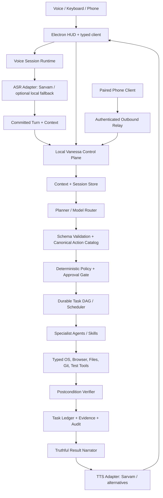

# Vanessa — Product, Architecture, and Delivery Plan

**Status:** Architecture plan for implementation, based on source inspection  
**Audit date:** 2026-10-25  
**Target branch:** `Vanessa-Prototype-1-MAIN`  
**Audited branch head:** `703c34ce54d721ab8f5981bf6ef294e0a6a2f6bf`  
**Product target:** Windows 11 first; voice-native, privacy-first engineering and IT copilot  
**Rule:** Do not merge to `main` until branch reconciliation, automated checks, and Windows acceptance tests are complete.

---

## 1. Product thesis: a cinematic control layer, not another chatbot dashboard

Vanessa should feel like a quiet, capable operating-system intelligence: always available as a compact corner orb, conversational when addressed, and able to execute bounded tasks across Windows, browsers, files, repositories, tests, and IT workflows. The interface should suggest science-fiction systems through restraint, motion, sound, precision, and visible evidence—not through decorative animations or fake AI activity.

The product is specifically an **AI-native control layer for engineering and IT work**. The initial memorable demo is:

> “Hey Vanessa, investigate this failure, inspect the repository and logs, prepare a fix, run the relevant tests, and show me the evidence. Do not deploy.”

A successful result means the actual task completed and its postconditions were checked. Opening a terminal, launching a browser, making a model call, or narrating “done” is not completion.

### Product principles

1. **Voice is the fastest input, not a parallel execution engine.** The voice layer owns audio sessions; it does not run shell commands or decide permissions.
2. **The model proposes; deterministic code authorizes.** An LLM may suggest an action plan, but typed schemas, policy, path boundaries, approvals, and runtime checks determine what is allowed.
3. **Every claimed outcome has evidence.** Report completed, partially completed, awaiting approval, blocked, or failed—never a success claim based only on process launch.
4. **Local-first control and explicit cloud boundaries.** Idle microphone audio remains local. Provider calls occur only during an explicitly activated voice turn. Users can see what is sent to a provider.
5. **Multi-agent means specialists with contracts, not many free-roaming prompts.** Each specialist receives a bounded task, narrow tools, explicit inputs/outputs, deadline, cancellation, and verification requirements.
6. **The HUD is a truthful instrument panel.** Every animation and status reflects real system events, audio level, or task progress.
7. **The application is recoverable.** Sessions, approvals, task state, idempotency, provider failures, and restart recovery have defined lifecycle behavior.

---

## 2. Current branch audit

This is a source-level audit of the target branch and its important runtime paths, not a claim that a packaged Windows build or live Sarvam session has been exercised in this environment.

### Existing application structure

| Area | Existing implementation | Role |
|---|---|---|
| Desktop shell | `apps/desktop/src/main/index.ts`, `main/ipc.ts`, `main/security.ts`, `preload/index.ts` | Electron overlay, trusted IPC bridge, permissions, window docking and global shortcuts |
| HUD | `apps/desktop/src/renderer/App.tsx`, `components/*`, `stores/vanessaStore.ts` | Compact orb, expanded controls, plans, tasks, approvals, audit/memory views |
| Desktop voice client | `hooks/useAudioCapture.ts` | Captures/resamples microphone audio, streams frames over WebSocket, queues audio, handles barge-in |
| Voice service | `services/voice-agent/src/server.ts`, `session/voiceSession.ts` | WebSocket protocol, voice-session state machine, ASR, orchestration handoff, TTS and provider state |
| Sarvam adapters | `asr/sarvamAdapter.ts`, `tts/sarvamTts.ts` | Direct WebSocket adapters for realtime transcription and streaming synthesis |
| Planner/model routing | `services/orchestrator/src/core/{planner,router,sarvamChat,geminiClient}.ts` | Intent to typed task plan and model provider routing |
| Task execution | `core/{orchestrator,taskRunner,permissionGuard,resourceLocks,critic,eventBus}.ts` | Policy checks, DAG execution, approvals, locks, lifecycle, events and task review |
| Specialists | `services/orchestrator/src/agents/*`, `agents/agentCatalog.ts`, `agents/registry.ts` | Windows, browser, files, coding/developer, memory, IT ops, knowledge and testing |
| Memory/ledger | `core/privacy.ts`, `memory/memoryPalace.ts`, `core/workingMemory.ts` | SQLite memory, task checkpoint and idempotency ledgers, privacy filtering |
| Skills | `skills/*/SKILL.md`, `core/skillsRuntime.ts` | Repeatable workflows and procedure instructions |
| Remote access | `services/relay/src/*`, `services/orchestrator/src/remotePwa.ts`, remote routes in `server.ts` | Pairing, phone companion and task relay |
| Operations | `scripts/launch-vanessa.cjs`, `launcher-config.cjs`, `check_readiness.ts`, `setup_windows.ps1` | Windows process startup, configuration checks, readiness and logs |

### Good foundations to keep

- The app already has a compact 90×90 transparent Electron shell and a ~72px orb, corner docking, global push-to-talk, and a larger drawer view.
- Electron uses context isolation, disabled renderer Node integration, a sandboxed renderer, a preload bridge, and a constrained microphone permission handler. Keep this trust boundary and tighten it; do not move OS automation into React.
- The voice session already keeps ASR disconnected until explicit activation, separates partial transcript handling from a committed turn, applies Sarvam-specific local speech gating, and uses request IDs/idempotency keys when sending a command to the orchestrator.
- Provider adapters exist for Sarvam, Fish Audio, and ElevenLabs, allowing provider swapping without changing the whole application.
- A typed agent catalog, planner constraints, resource locks, approval flow, SQLite ledgers, audit events, and failure-drill tests provide a useful baseline.
- The Sarvam adapters have mocked WebSocket/HTTP tests, so most protocol/regression work can be done without burning live API quota.

### High-priority inconsistencies and risks

| Priority | Finding from the branch | Why it matters | Plan response |
|---|---|---|---|
| P0 | `config/providers.yaml`, `config/models.yaml`, `config/agents.yaml`, `.env.example`, and runtime defaults disagree about active providers, agent names, and model routing. `policy.yaml` appears to duplicate hard-coded authorization rules. | A change can be correct in one config yet ignored by the live process. Readiness and UI can report the wrong provider. | Introduce one validated runtime configuration contract. Generate readiness/provider UI from it; remove duplicated/stale sources only after references are migrated. |
| P0 | Several agent results are optimistic. The Windows Wi-Fi handler has catch/fallback paths that return success/connected; browser navigation claims “loaded” after starting a URL handler; YouTube “play” opens search results. `taskRunner.ts` can treat a non-null result as success without an explicit passing verification. | Vanessa may announce a false result and schedule dependent work based on an unverified task. | Make verification mandatory and separate “accepted/launched” from “completed/verified.” Fix each adapter’s postconditions. |
| P0 | `developer.agent.ts` allows arbitrary shell command strings and interpolates prompt text into a PowerShell string in the legacy Claude route. Other agents also contain dynamic command construction or interpolate arguments in subprocess strings. | Prompt injection or special characters can become command execution. A model-produced command must not bypass the user’s trust boundary. | Remove shell interpolation, use argument arrays and fixed scripts, scope working directories, constrain executable/action allowlists, time out and terminate process trees. Disable unsafe legacy actions until remediated. |
| P0 | Permission policy is split between YAML, catalog metadata, and `PermissionGuard`; some direct endpoints can perform actions without the same validation path as a planner task. | Security differs by entry point; a prompt or alternate endpoint may bypass expected checks. | Put policy at a single tool-execution boundary through which voice, typed, local API, and remote tasks must pass. Validate all input schemas server-side. |
| P0 | The UI contains hard-coded user folders under a machine-specific Windows profile. `MemoryPalaceViewer`, remote pairing, folder settings and other components use direct `127.0.0.1` fetches. | It breaks on another user/machine and mixes UI with API plumbing. | Derive folders from backend settings; expose a typed API through preload/main or a typed local client. Never ship machine-specific paths. |
| P1 | `App.tsx` is ~877 lines and renders a bespoke compact orb while a separate `VoiceOrb.tsx` exists; it also imports a legacy ElevenLabs hook while the current pipeline uses the voice service. The store’s provider enum/default omits Sarvam. | Duplicate UI/voice paths drift and make state bugs hard to diagnose. | Split the HUD into state-driven components; establish one canonical voice entry point and provider state contract. |
| P1 | `useAudioCapture.ts` uses `ScriptProcessorNode` and decodes each encoded TTS chunk independently with `decodeAudioData`. Encoded MP3/WAV WebSocket chunks may not be standalone complete files. WebSocket reconnect uses a simple fixed delay. | Audio can clip, fail to decode or become sluggish; reconnect storms and stale playback are possible. | Move capture/playback to AudioWorklet where practical; confirm actual Sarvam chunk semantics; build a bounded playback queue, backpressure, sequence handling and jitter-tolerant reconnect. |
| P1 | `SarvamChatClient.complete()` reads an SSE stream but buffers the full generated response before returning. TTS begins only after the full planner/response call finishes. | Slow first-audio latency; the user does not perceive a continuous natural assistant. | Build streaming deliberately after the core turn lifecycle is stable: model deltas → sentence buffer → TTS queue → renderer playback, with abort propagation. |
| P1 | ASR settles estimated usage at `transcript.final` before the provider’s `session.end.audio_duration_s` may be consumed; service shutdown can close the session immediately. The chat client creates its own `UsageBudget`, separate from the voice service’s STT/TTS ledger. Default cap zero means meter-only. | Usage can be inaccurate and per-process estimates are not a reliable application-wide hard cap. | Create one shared logical usage contract and persisted ledger; reconcile with provider usage; enforce a configured non-zero hard limit when requested. |
| P1 | Browser/file/Windows agents sometimes report optimistic verification. File path policy has to be enforced at the actual file operation boundary, including symlink and nonexistent-target checks. | Incorrect actions can chain to downstream tasks, and path parameters can vary by agent. | Central schema + path policy, resolve physical paths, verify after mutation, and make unsafe/unsupported operations fail closed. |
| P1 | The memory/skill agent discovers a large vendored `Agents and tools/` project via multiple guessed folder names and runs Python `-c` commands with values embedded in command text. Memory writes redact some content but task params/results and returned raw data need a consistent review. | Tight coupling, injection risk, unclear source-of-truth, possible secret persistence. | Treat the vendored project as an explicit dependency boundary; use fixed entry points and typed stdin/argv; define memory allow/deny rules and redaction before disk/model use. |
| P1 | The orchestrator’s phone pairing URL returns laptop loopback, which a separate phone cannot reach; the UI text says secure relay although the visible pairing path uses local routes. Relay rooms/rate-limit maps need cleanup. | Remote phone → PC is not production-ready even if the modal appears connected. | Defer remote control until device identity, authenticated outbound relay, pairing rotation, expiry, event sequence/replay, and tests are complete. |
| P1 | Failure drills are partly state checks rather than real fault injection; `scripts/test_real_voice_pipeline.py` describes a local Whisper path and may not fully match the current Sarvam path. | Green tests can fail to exercise the failure that they claim to test. | Rename expectation accurately and create scripted fake-provider, process-kill, network-drop, cancellation, and recovery tests. |
| Release blocker | Feature branch is diverged from `main` (compare showed 8 commits ahead, 7 behind) and has significant removals compared with main, including portable/Forge packaging files, test scripts, a Playwright browser agent, and a large lockfile deletion. The PR is not mergeable as currently reported. | A feature branch can build while release packaging or capabilities present on main disappear during merge. | Keep working on this branch, but perform a path-by-path reconciliation report before merge. Do not restore/merge blindly; establish which removals are intentional and regenerate the lockfile on a controlled checkout. |

### Current-state caution

The branch has meaningful unit-test scaffolding, but no live provider/physical-microphone acceptance is confirmed by this audit. Existing commit/PR descriptions are not substitute evidence for a fresh run. This document is a plan, not a claim that the listed gaps are already fixed.

---

## 3. Target architecture

The primary design decision is **one local Vanessa Control Plane per PC**. Every interaction surface sends a typed command envelope to that control plane; it owns state, policy evaluation, execution, persistence, and truthful results. The desktop HUD is a client of this plane—not a second orchestrator.

### Component responsibilities

- **Electron main process:** window lifecycle, OS shortcuts, trusted IPC, safe local client, machine preferences and protected credential lookup. It does not interpret freeform model output as shell instructions.
- **Renderer:** presentation and local input capture only. It receives typed events/status, never provider API keys, filesystem authority, or raw execution tools.
- **Voice runtime:** capture/session lifecycle, wake/PTT gate, VAD, turn commit, ASR transport, TTS playback events, barge-in, voice-specific cancellation and provider status. It cannot execute OS commands.
- **Control plane/orchestrator:** one owner of task/session state, context assembly, planner invocation, policy decision, approvals, task ledger, event sequence, retry/reconciliation, cancellation and result summary.
- **Planner/model router:** translates intent into a validated graph containing only canonical actions. It must not mint new tools or permission levels. Unknown/ambiguous actions become a clarifying question or a safe explanation.
- **Policy engine:** deterministic allow/ask-first/block decision based on canonical tool, parameters, data classification, resource scope, and risk. The policy engine—not the LLM—sets the minimum risk tier.
- **Task scheduler:** persists acceptance before acknowledgement; executes independent DAG nodes concurrently only when dependencies are verified; uses cancellation tokens, deadlines, global/per-agent concurrency limits, and shared-resource locks.
- **Tool runtime:** typed, small, auditable methods for Windows, browser, filesystem, tests and provider actions. Each call has schema validation, allowlists, bounded resources, a structured result and a verifier.
- **Specialist agents:** reasoning/procedure wrappers that select safe tools and produce structured output; they do not own privileges or bypass the tool runtime.
- **Skills:** declarative, versioned repeatable procedures layered on tools. A skill teaches a workflow; it does not silently grant a new permission.
- **Memory and context:** separate transient dialogue, current task working memory, long-term preferences/knowledge, task ledger, and security audit. Store provenance, source, time, retention, and redaction status.
- **Provider adapters:** normalized, swappable ASR, TTS, chat/planner and optional embedding interfaces; provider-specific event parsing remains isolated within adapters.
- **Observability:** one correlated run ID and task IDs across ASR, chat, orchestration, tools, verification and TTS; safe, redacted telemetry with stage latencies and provider usage.

### Required command and task contracts

Every incoming command should normalize into a schema-validated envelope containing:
- `requestId`, `idempotencyKey`, `source`, `originDeviceId`, `sessionId`, `createdAt`, `expiresAt`, and `schemaVersion`;
- the committed command text, language and bounded context references (not arbitrary hidden files);
- trace/correlation metadata, with sensitive values excluded.

Each task needs:
- canonical `agent` and `action`, schema-valid `params`, `dependsOn`, `acceptanceCriteria`, and derived risk tier;
- a lifecycle (`received → accepted → planning → running → verifying → succeeded | partial | failed | blocked | awaiting_approval | cancelled | interrupted`);
- execution deadline, cancellation signal, lock set, allowed tool set, and persisted checkpoint;
- evidence and a verification object with explicit postconditions and observed values.

Only `succeeded` tasks whose postconditions are independently verified can satisfy downstream dependencies. `accepted`, `started`, `launched`, and `navigated` are distinct, non-terminal facts.

---

## 4. What to adapt from OpenClaw

Use OpenClaw as an architectural reference, not as code to copy wholesale. Vanessa is a voice-first Windows task control plane; it does not need every OpenClaw channel, provider, messaging connector or runtime.

1. **A single Gateway/control plane.** OpenClaw describes the Gateway as the source of truth for sessions, routing and channel connections. Vanessa should similarly have one local authority for command identity, state, approval, event routing and execution.
2. **A serialized run lifecycle with streaming.** OpenClaw’s agent loop separates intake, context assembly, inference, typed tool execution, streaming, persistence and terminal outcome. Vanessa should make these stages explicit and correlated.
3. **Typed tool calls instead of freeform shell access.** Validate each tool input against its schema and sanitize/summarize results before emitting events or putting them back into the model context.
4. **Isolation by agent purpose.** OpenClaw agents can have distinct workspaces, state and session histories. For Vanessa, coding tasks should use a bounded worktree/workspace; file tools should be root-scoped; browser tasks should use a dedicated controlled profile; memory should have a specific data scope.
5. **Tool policy and sandbox boundaries.** Read-only inspection, scoped writes, subprocess execution, browser navigation, credentials, and remote control should have different capabilities. Keep risky/elevated tool execution disabled by default and ask for task-specific approval.
6. **Skills are procedures, tools are capabilities, plugins are integrations.** A `SKILL.md` can describe the safe sequence for a network incident, test run or folder setup, but the actual low-level capabilities stay in code and remain policy-gated.
7. **Cancellation and terminal settlement.** Stop speaking immediately, but do not equate “stop audio” with “cancel the job.” A canceled run must lose authority to initiate new tools and must settle its final ledger state.
8. **Treat retrieved content as untrusted data.** A web page, README, issue body, log file or memory record may contain prompt-injection text. It can inform the task; it cannot change the system prompt, grant a permission, or broaden an allowlist.

Official reference reading:
- [OpenClaw architecture](https://docs.openclaw.ai/architecture)
- [OpenClaw agent loop](https://docs.openclaw.ai/concepts/agent-loop)
- [OpenClaw multi-agent routing](https://docs.openclaw.ai/concepts/multi-agent)
- [OpenClaw security guide](https://docs.openclaw.ai/gateway/security)
- [OpenClaw tool and agent permissions](https://docs.openclaw.ai/gateway/security/tool-permissions)

---

## 5. Agent model and responsibility contracts

Create one canonical catalogue as the runtime contract, then make configuration and docs refer to it. Do not maintain independent lists that drift.

| Agent | Owns | Must not own | Success evidence |
|---|---|---|---|
| Orchestrator / planner | Task graph, dependencies, routing and re-planning | OS tools, authorization override, unsupported actions | Validated graph and lifecycle trace |
| Voice | ASR/TTS session, turn commitment, playback and interruption | Filesystem/shell execution or policy decisions | Transcript/result correlation, audio completion and turn state |
| Windows/system | Supported Windows settings, app launch and system diagnostics | Arbitrary PowerShell from model text | Read-back state from OS API/command or explicit “unable to verify” |
| Browser | URL opening, controlled page navigation, search, allowed page inspection and playback | Sign-in bypass, credential extraction, arbitrary localhost/private-network probing | Observed final URL/title and playback state where a capability supports it |
| Files | Root-scoped search/read/write/rename/archive operations | Paths outside approved roots, silent arbitrary uploads/deletes | Resolved path, output artifact, size/hash or existence/postcondition |
| Developer/coding | Repository inspection, isolated changes, safe coding-agent lifecycle | Unbounded host shell, secrets, automatic production deployment | Diff/worktree, command transcript, exit code and relevant test report |
| Testing | Approved test profiles, process execution and result collection | Inventing arbitrary shell commands or treating process launch as pass | Executed command profile, exit code, test summary and artifact |
| IT operations | Diagnostic collection, log analysis, runbook execution and bounded remediation | Unsupported remediation or non-reversible changes without approval | Observations with source/time and verified follow-up status |
| Knowledge | Runbook/document search and retrieval | Arbitrary file traversal or treating document text as instructions | Source locations and concise grounded summary |
| Memory | Store/recall user-approved preferences and task evidence | API key storage, hidden permanent tracking, cross-user leakage | Record ID, provenance, retention and redaction result |
| Narrator | Honest concise progress and final summary | Inventing results or stating model inference as an observation | Summary constructed from terminal task states and verified evidence |
| Remote-device/relay | Authenticated device pairing, bounded routing and event delivery | Local OS execution, provider credentials, authority expansion | Device identity, auth outcome, sequence and delivery receipt |

### Canonical contract cleanup

- `services/orchestrator/src/agents/agentCatalog.ts` should be the versioned action/schema capability contract (or become generated from a single reviewed declaration).
- `registry.ts` should register only canonical executable agents. Compatibility aliases must not expose legacy/insecure paths.
- `config/agents.yaml` should either generate/validate agent metadata against the catalog or be removed after migration; today it is not a dependable runtime source of truth.
- `config/policy.yaml` and `PermissionGuard` must be consolidated into one policy evaluator with tests. No action may be allowed merely because a model plan omitted its risk.
- Each agent should have a doc under `docs/agents/<agent>.md` or one maintained `AGENTS.md` with its purpose, triggers, schema, allowed tools, prohibited operations, approval tier, timeout, retry policy, postconditions, tests and known limits.
- Skills should remain in `skills/<skill-name>/SKILL.md`; each skill declares objective, safe steps, prerequisites, locks, approval needs, output evidence and failure handling. A skill must not grant more tools than the caller already has.

---

## 6. Sarvam voice pipeline: high-priority execution plan

The current branch uses explicit TypeScript WebSocket/HTTP adapters, which are the production integration path visible in this repository. Do not introduce a second Python voice runtime just because the Python SDK is installed locally. Use the SDK only if a parity test demonstrates a concrete feature advantage over the current adapter protocol.

### 6.1 Session/turn ownership

Implement a single session lifecycle in `services/voice-agent/src/session/voiceSession.ts`:
1. Start idle with no upstream microphone audio.
2. Activate only on push-to-talk or a deliberately enabled local wake-word detector.
3. Collect frames with a documented encoding/sample-rate contract.
4. Keep partial transcripts as HUD drafts; they can never trigger a task.
5. On a final/committed transcript, close the capture turn cleanly, assign one request ID, and submit to the orchestrator once.
6. Track planning, approval, running, verification and terminal result events for that same request.
7. Start response synthesis only from the actual response/progress policy—not a made-up “done.”
8. Handle “stop speaking” separately from “cancel task.” An emergency cancellation revokes the active run’s ability to start new work.
9. Ignore old-generation chunks/events after interruption, reconnect or a newer turn.

### 6.2 Adapter requirements

**STT: `services/voice-agent/src/asr/sarvamAdapter.ts`**
- Maintain the current documented realtime PCM format and model settings.
- Validate audio-frame size and keep the queue bounded.
- Treat partial/final/session-end/error events as a strict state machine.
- Do not discard authoritative provider audio duration during finalization. Preserve enough session lifetime to reconcile `session.end.audio_duration_s`; fall back to a clearly labeled estimate only when the provider cannot return usage.
- A reconnect may resume the current activation only when request identity, provider protocol and billing behavior make it safe. Never duplicate a committed transcript.
- Add tests for empty speech, slow session begin, timeout, fatal authentication/quota responses, duplicate finals, session-end ordering, disconnect and disposal.

**TTS: `services/voice-agent/src/tts/sarvamTts.ts`**
- Validate supported model, speaker, language, codec and sample-rate configuration at startup.
- Ensure the completion event is interpreted exactly once; reject a completion with no audio, surface provider errors and cancel promptly on abort.
- Confirm whether returned MP3/WAV chunks are independently decodable or whether the provider sends continuous encoded fragments. Do not rely on decoding arbitrary chunks independently.
- Prefer a streaming-safe audio format/player strategy. If using PCM, honor actual sample format, channel count and sample rate; if using an encoded format, buffer/assemble valid segments or use a streaming decoder.
- Bound queue size, chunk duration and total response length; drop obsolete audio after barge-in.
- Test malformed chunk data, multiple chunk ordering, provider close before completion, timeouts, abort during synthesis, completion ordering and no-audio response.

**Chat/planning: `services/orchestrator/src/core/sarvamChat.ts` and `core/router.ts`**
- Keep one well-defined provider adapter and one source of model config.
- Preserve the streaming SSE path instead of buffering a response and calling it streaming. First deliver reliable incremental text to the response layer, then use sentence-boundary buffering to hand complete speakable segments to TTS.
- Do not send planner JSON fragments to TTS. Separate planner output from user-facing spoken narration.
- Apply a per-run deadline and AbortSignal from desktop/session cancellation all the way down to fetch, tool scheduling and audio playback.
- Use bounded prompt/context windows and sanitize results returned from tools before adding them to subsequent model calls.

**Desktop playback: `apps/desktop/src/renderer/hooks/useAudioCapture.ts`**
- Keep exactly one playback queue and one current playback generation.
- On cancel/interrupt: increment generation, stop scheduled nodes, clear queued segments, cancel fallback speech, and tell the voice session what stopped.
- Move microphone processing from `ScriptProcessorNode` to an AudioWorklet when the test harness and browser support are in place; make frame conversion deterministic and test it separately.
- Add bounded exponential retry and connection-state UI. Never silently reconnect a closed task turn and resubmit the same utterance.
- Surface provider status and errors to the HUD without printing credentials or full raw provider payloads.

### 6.3 Shared quota and API credentials

- Development: keep credentials in a local ignored `.env` file, read only by trusted Node services. Verify `.env` and logs are excluded by `.gitignore`; never log a key or send it to the renderer.
- Open-source desktop distribution: do **not** embed a shared Sarvam key in JavaScript, Python, Electron resources or a compiled binary. A packaged key is extractable.
- Production shared service: a backend holds the provider key, authenticates users/devices, rate-limits, applies per-user quotas, and enforces an account-level cost/request ceiling. Desktop clients receive only short-lived scoped authorization to your service, never the Sarvam key.
- Bring-your-own-key can remain an optional local mode for open-source/developer users who explicitly supply their own credential.
- Use one logical ledger for STT seconds, chat input/output tokens, TTS characters and request counts; include provider, model, requestId, estimates/actuals, currency/rate source and settlement status. Persist the ledger and budget reservations before provider calls.
- A configured production cap must be non-zero and enforced before a paid call. A zero cap should be explicitly called “meter-only,” not mistaken for protection. Provider dashboard usage is authoritative; local estimates are advisory until reconciled.

---

## 7. Reliable execution, safety, and truthful verification

This is the highest value backend work. Finish it before adding broad autonomy or new agent types.

### 7.1 Typed tool boundary

Every tool call passes through one service:
1. Validate agent/action name and parameters against the canonical schema.
2. Resolve paths against approved roots and existing physical ancestors; resolve symlinks before checking containment.
3. Derive the risk tier in backend code and attach required approval.
4. Check caller identity, task authority, deadline, idempotency and cancellation state.
5. Acquire the relevant lock and concurrency slot.
6. Execute a fixed command template/API with arguments passed as values, not concatenated into shell/PowerShell source.
7. Capture exit code, bounded stdout/stderr, timestamps, timeout and artifacts; redact before logging/persisting.
8. Run deterministic postconditions and persist the terminal result.
9. Emit one correlated result event. A downstream task runs only when its dependencies are verified successful.

Avoid “universal command” tools in the initial production profile. Provide narrow tools such as `windows.bluetooth.set`, `windows.wifi.status`, `browser.open_url`, `files.search`, `git.diff`, and `tests.run_profile`. Generic terminal execution requires a constrained command profile and explicit approval; it should not accept arbitrary model-crafted shell text by default.

### 7.2 Result contract

Use explicit results such as:
- `accepted`: request persisted; execution has not necessarily started.
- `started`: process/service was launched; outcome is not known yet.
- `succeeded`: operation finished and required postconditions were checked.
- `partial`: useful work completed, but at least one criterion could not be proven or some branches failed.
- `awaiting_approval`: no side effect should occur until approval is received.
- `blocked`: policy rejected the action.
- `failed`: operation did not complete.
- `interrupted`: host/provider/session stopped; reconcile before replay.

A result should include `verified`, `postconditions[]`, `evidence[]`, optional `exitCode`, `artifacts[]`, timing, and an honest reason when unknown. Do not synthesize a passing verification from “the handler returned a value.” Remove success-on-catch fallbacks from agents.

### 7.3 Authorization and prompt-injection defenses

- The model cannot set its own allowed tools, risk level, file root, remote identity or approval status.
- Explicit approval is scoped to one task/action and expires. Approval must bind to a stable hash of the exact action and material parameters, so a changed plan requires new consent.
- Treat browser, repository, file, email, memory and issue content as untrusted inputs. The content can be quoted or summarized but may never instruct the runtime to reveal secrets, alter policies or run new commands.
- Block credential access/exfiltration, destructive system operations, hidden persistence, production deployment and path escape by default.
- Keep raw API keys, authorization headers, tokens and passwords out of audit logs, task params/results, memory and model context. Add redaction at every persistence/output boundary rather than only in the long-term-memory writer.
- Use a restrictive local listen address. The local control plane should accept only expected origins and authenticated/paired clients where applicable. Add request schemas, size limits, rate limits, and origin checks at all HTTP/WebSocket entry points.
- A phone is untrusted until paired. Do not say that a relay is secure or connected until token validation and a confirmed transport session prove it.

---

## 8. Context, memory and recovery

Keep four distinct data categories rather than treating all stored text as “memory”:

1. **Turn context:** recent dialogue for reference resolution; bounded by token/character limits and scoped to a session.
2. **Working memory:** current plan, task outputs, locks, deadlines and agent notes. Cleared or compacted after the run.
3. **Long-term memory:** explicit user preferences and useful task/incident knowledge, with provenance, opt-in, retention, recall controls and a user-facing forget/delete workflow. Do not store credentials.
4. **Operational ledger/audit:** request IDs, lifecycle transitions, tool calls, approval decisions, safe result/evidence, budget settlement, and recovery state. This is an audit record, not a store for full transcripts/secrets.

Use SQLite initially, as already present, but make its location independent of the current working directory. Create a user data directory under the operating system's app-data location with clear permissions, database schema versioning, migrations, WAL/busy timeout and backup/restore documentation.

On startup, inspect tasks left in non-terminal states. Reconcile actual operating-system/resource state before resuming. Resume only operations proven idempotent; require user resolution for ambiguous or external/non-idempotent side effects. Expired approvals must not revive after restart. The event stream should include sequence IDs and replay after a reconnect so the HUD cannot miss a state transition.

---

## 9. The sci-fi UI: cinematic, minimal, and evidence-first

### Visual language

- **Idle:** one floating glass/obsidian orb in the chosen screen corner. Slow low-amplitude light movement, no fake processing text.
- **Listening:** a distinct ring/waveform responds to actual mic level; an obvious local-microphone indicator explains whether audio is local or streaming.
- **Thinking/planning:** a restrained orbital arc or segmented halo; the display should show a real stage label such as “Planning” and elapsed time rather than a generic “AI thinking” animation.
- **Executing:** an orbiting activity marker linked to actual task events; the compact orb remains unobtrusive while a tiny progress strip indicates the live task.
- **Approval:** amber/red glass card with exact action, scope, relevant parameters, irreversible effects, why it requires approval, expiry, and Approve once / Reject. Never use color alone as the warning.
- **Speaking:** audio-reactive pulse synchronized to output levels/chunks, with a clear Stop speaking control.
- **Verified completion:** a subtle checkmark and short factual summary, expandable to evidence/exit code/postconditions. “Verified” must be driven by backend verification.
- **Degraded/offline/error:** distinctive state and one practical next step. Do not represent provider unavailability as listening/ready.

### Compact mode and expanded deck

Keep the small corner overlay as the default, with the current 90×90px window and ~72px core orb as the baseline. Expand to a compact ~580×680px “Mission Deck” rather than a conventional full-screen dashboard. The expansion can show:
- live transcript and conversational response;
- active task plan as a small DAG/timeline, with task state and dependencies;
- an activity stream that reveals actual provider/agent progress;
- approval queue and recent evidence;
- privacy controls, allowed folders, active provider and usage;
- memory/skill details and diagnostics behind secondary panels.

### Design system

Create CSS tokens for background layers, translucency, borders, text hierarchy, focus rings, state colors, spacing, radius, typography, shadow and motion durations. Use a small controlled palette (deep ink, cool cyan/blue, violet for reasoning, amber for approval, red for error); keep content readable and avoid rainbow neon. Add reduced-motion behavior, keyboard navigation, screen-reader labels, high-contrast focus states and predictable hit areas.

### UI engineering changes

- Break `App.tsx` into a small shell plus reusable components for HUD, orb, transcript/response, task activity, plan, approval, diagnostics, memory, privacy and settings.
- Choose one orb implementation; remove duplicate/dead UI paths after confirming references.
- Replace hard-coded inline CSS for design-critical elements with tokens/classes and motion primitives.
- Remove the legacy ElevenLabs renderer path where it duplicates the voice-session route; preserve provider adapters only behind the chosen voice-service interface.
- Make UI state a projection of backend events. The UI should not invent task lifecycle, provider status, estimated success or remote connection state.
- Add visual regression screenshots at compact/expanded states and every voice/approval/error state; include keyboard-only and reduced-motion checks.

---

## 10. File-by-file delivery map

| Files / folder | Planned work |
|---|---|
| `docs/architecture.md` | Keep as architecture contract; update diagrams after implementation decisions are finalized. |
| `docs/codebase-audit.md` | Replace stale risk notes with dated findings/fixes and clear “source review vs runtime verification” labels. |
| `docs/agents/*.md` or `AGENTS.md` | Document every canonical agent: purpose, triggers, inputs, action schemas, tool allowlist, risk/approval, timeouts, retries, verification and tests. |
| `config/{agents,policy,providers,models,limits}.yaml` | Establish one canonical validated config; remove conflicting defaults; fail-fast on invalid combinations and unknown actions. Keep secrets out of config YAML. |
| `packages/shared/src/types/*`, `commandRequest.ts`, `usageMeter.ts` | Versioned command/task/result/event schemas, lifecycle enum, provider status, structured evidence, cancellation metadata, shared usage contract. |
| `services/voice-agent/src/server.ts` | Provider-neutral configuration/readiness responses, request limits, validated WS protocol, redacted errors, consistent shutdown. |
| `services/voice-agent/src/session/voiceSession.ts` | Explicit session/turn state machine, request correlation, cancellation-generation fencing, separate stop-playback vs cancel-task, truthful progress and no duplicate commits. |
| `services/voice-agent/src/asr/sarvamAdapter.ts` | Strict ASR event lifecycle, authoritative usage reconciliation, bounded frames/reconnect, duplicate final/cancellation tests. |
| `services/voice-agent/src/tts/sarvamTts.ts` | Completion/chunk semantics, abort correctness, audio encoding contract, queue boundaries and provider-specific tests. |
| `services/voice-agent/src/audio/*` | AudioWorklet migration, deterministic PCM framing, VAD/speech gate tests, pluggable local wake-word, barge-in tuning. |
| `services/voice-agent/src/diagnostics/providerDiagnostics.ts`, `usageBudget.ts` | Provider-neutral diagnostics, safe redaction, central/persisted budget integration and cap enforcement. |
| `services/orchestrator/src/core/router.ts`, `sarvamChat.ts`, `planner.ts` | Single provider config, real incremental stream interface, planner/user-response separation, bounded context, deadlines and cancellation propagation. |
| `services/orchestrator/src/core/orchestrator.ts`, `taskRunner.ts` | Persist-before-ack, durable task lifecycle, valid idempotency outcomes, dependencies only on verified success, kill-switch race fixes, cancellation and restart reconciliation. |
| `services/orchestrator/src/core/permissionGuard.ts`, `privacy.ts` | One policy boundary, typed schemas, risk floor, symlink-aware path enforcement at tool boundary, redaction before logs/storage/model context. |
| `services/orchestrator/src/core/resourceLocks.ts`, `eventBus.ts` | Cancellable queued locks, timeout/bounded waiter counts, sequenced/replayable events and run/task correlation. |
| `services/orchestrator/src/memory/memoryPalace.ts`, `core/workingMemory.ts` | App-data DB location, schema versioning, redacted input/output, purpose-specific retention, explicit forget/reset semantics, durable ledger and recovery. |
| `services/orchestrator/src/agents/agentCatalog.ts`, `registry.ts` | Canonical selectable actions, no accidental legacy alias exposure, schema/handler conformance tests. |
| `agents/windows.agent.ts`, `browser.agent.ts`, `file.agent.ts` | Honest results, argument-safe subprocesses, actual postcondition checks, strict path policy, distinguish navigation from loaded content/playback. |
| `agents/developer.agent.ts`, `coding.agent.ts`, `testing.agent.ts`, `memory.agent.ts` | Eliminate shell interpolation and embedded Python code, constrain commands, isolate coding work, collect real output/exit codes, safely pass user strings. |
| `services/orchestrator/src/skills/skillsRuntime.ts`, `skills/*/SKILL.md` | Versioned skill contract, trusted root discovery, schema/prerequisite validation, no skill-based privilege escalation. |
| `services/orchestrator/src/server.ts`, `remotePwa.ts`, `services/relay/src/*` | Authenticated entry points, payload schema/rate limits, token lifecycle, device identity, pairing/relay URL correctness, room/rate-limit cleanup and sequence replay. |
| `apps/desktop/src/main/{index,ipc,security}.ts`, `preload/index.ts` | Typed/validated IPC, sender-frame checks, restrictive trusted-app/CSP policy, reconnect lifecycle and minimal renderer authority. |
| `apps/desktop/src/renderer/App.tsx`, `components/*`, `stores/vanessaStore.ts` | Mission Deck component split, one orb, consistent Sarvam/Fish/ElevenLabs provider types, backend-event-driven visuals, remove absolute paths and direct API plumbing. |
| `hooks/useAudioCapture.ts`, `useElevenLabs.ts`, `useFishVoice.ts`, `useTaskStream.ts` | One voice/session transport, audio queue/chunk reliability, typed event parsing, bounded reconnect and cancellation. Retire redundant hooks after migration. |
| `scripts/launcher-config.cjs`, `launch-vanessa.cjs`, `check_readiness.ts`, `setup_windows.ps1` | Single config validation, process health identity, provider-neutral diagnostics, redacted logs, deterministic port ownership and smoke-check mode. |
| `services/*/src/tests/*`, `evals/drills/*`, `scripts/test_real_voice_pipeline.py` | Contract, fault-injection, real microphone and packed-app acceptance; align script descriptions with the provider they actually test. |
| `apps/desktop/package.json`, removed packaging files, `pnpm-lock.yaml` | Reconcile current branch with packaging capabilities from `main`; restore/rebuild only the intended release workflow and regenerate a complete lockfile in a controlled checkout. |

---

## 11. Phased execution plan and gates

### Phase 0 — Establish a trustworthy baseline (first)
- Confirm branch/ref, clean working tree and workspace package graph in a local Windows checkout.
- Generate a file-by-file compare report against `main`; classify each removal as intentional, obsolete, or accidental.
- Run package builds, existing mocked Sarvam suites, scenario/skill tests, and launcher tests without live provider calls.
- Fix only issues preventing reproducible tests/launch; do not mix UI redesign into this baseline.
- **Exit gate:** fresh baseline report records exact commands, pass/fail, known exclusions and branch reconciliation decisions.

### Phase 1 — Enforce honest task execution (P0 backend)
- Normalize tool results and lifecycle states.
- Remove success-on-catch/optimistic fallback paths from Windows/browser/file actions.
- Make postconditions mandatory for “verified success”; make dependent task scheduling require verified success.
- Enforce the same policy/schema boundary for desktop, voice, typed API and remote requests.
- Make authorization/approval scoped to exact immutable task parameters; persist before ACK.
- **Exit gate:** adversarial tests prove no model output can bypass risk tiers, no unverified launch passes as success, no duplicate request repeats a side effect, and cancellation settles terminal state.

### Phase 2 — Secure the execution substrate (P0 backend)
- Replace prompt/parameter string interpolation in PowerShell, Python `-c`, shell and Git commands.
- Add fixed scripts/argument arrays, validated executable/command profiles, scoped working directory and timeouts.
- Enforce normalized physical paths and symlink-safe approved roots at each file-operation entry point.
- Redact task parameters, stdout/stderr, results, audit events and memory before persistence or model reuse.
- Remove or disable unsafe legacy aliases until they conform.
- **Exit gate:** injection/path traversal/secrets-in-logs test suite passes; blocked requests have no OS side effects.

### Phase 3 — Make Sarvam voice reliable and responsive
- Verify provider readiness and configuration from one validated config.
- Fix ASR session duration/usage settlement, duplicated transcript handling, reconnect/cancel semantics and startup errors.
- Validate Sarvam TTS event/chunk contract on mocks; confirm chunk decode and output audio in the renderer without spending additional provider credits unnecessarily.
- Stream user-facing text to sentence-bounded TTS once the turn lifecycle is stable; add cancellation/backpressure and request-level correlation.
- Consolidate STT/chat/TTS budget records and enforce explicitly configured hard caps.
- Run **at most the minimal live acceptance set** after zero-credit tests: one short ASR/transcript check, one short TTS utterance, and one end-to-end voice turn. Re-test a failed layer only after inspecting logs.
- **Exit gate:** no credential leakage, no duplicate task submit, clean stop/restart, correct sample rate and audible end-to-end response, usage reconciliation recorded.

### Phase 4 — Reliable specialists and skills
- Make canonical catalog, registry, config and docs agree.
- Fix browser direct URL vs search, actual loaded-page verification and YouTube “search” vs “playing” claims.
- Fix Windows state read-back and errors; implement supported settings actions as safe, narrow tools.
- Tighten file actions and root policies; make each write operation verify artifact/result.
- Replace hard-coded machine paths and dynamic project discovery with runtime-resolved roots.
- Document/test every supported agent action; mark unsupported functions visibly unavailable.
- **Exit gate:** agent contract tests cover inputs, success evidence, failures, permissions, cancellation, timeouts and retry rules.

### Phase 5 — Durable memory, usage and recovery
- Move SQLite and logs to application data; add migration/versioning and retention policies.
- Separate memory from audit; add user-visible forget/reset and source provenance.
- Persist budget reservations/actuals in a single logical ledger and record configured spending ceiling.
- Add startup reconciliation for interrupted tasks and explicit operator resolution for ambiguous side effects.
- Add sequenced replay for desktop/phone event reconnect.
- **Exit gate:** restart during each lifecycle state produces a deterministic and safe reconciliation with no surprise replay.

### Phase 6 — Cinematic Mission HUD
- Establish tokens, typographic hierarchy, state colors, motion timing and accessible focus.
- Split the monolithic app shell and use one compact orb.
- Implement actual-state-driven listening/thinking/executing/approval/speaking/verifying/error/offline visuals.
- Add a concise live activity strip, plan/DAG, evidence view, provider/latency/usage panel and privacy consent.
- Add snapshot/a11y/reduced-motion tests.
- **Exit gate:** every UI state has an observable event backing it; no fake activity or success; compact mode remains nonintrusive.

### Phase 7 — Phone-to-PC continuity (only after local reliability)
- Choose a single relay architecture; do not leave two incompatible pairing systems.
- Device identity, one-time short-lived pairing code, signed/rotatable session token, revocation, rate limiting, event sequence/replay, transport TLS and replay protection.
- Authenticate each command and approval; apply the PC-local policy regardless of where the request originated.
- Make phone UI say “accepted” until the PC responds with status; approval binds to task ID/action hash and expires.
- Fix network addressing using outbound device connections, not a phone attempting to reach the PC’s `127.0.0.1`.
- **Exit gate:** wrong/expired/revoked token rejected, paired device reconnects and replays state, no unauthorized action on PC, relay never receives provider key or local file contents.

### Phase 8 — Reproducible Windows release
- Reconcile packaging files and lockfile against `main`; restore only reviewed/needed packaging.
- Build and launch on a clean Windows 11 test environment with no repository-specific absolute paths.
- Verify installer/portable lifecycle, first-run setup, missing-key mode, logs, app-data database, update/uninstall behavior and process cleanup.
- Add code signing/updater only when signing credentials and release ownership are agreed.
- **Exit gate:** clean install → setup → local health → minimal live voice acceptance → safe shutdown passes; all artifacts identify the tested commit.

---

## 12. Test strategy: protect the limited live API allowance

### Zero-credit tests first

1. **Unit/contract tests:** provider URL/config parsing, schema validation, PCM resampling/frame boundaries, VAD/speech gate, SSE parsing, TTS event parsing, budget reserve/settle/release, redaction and path containment.
2. **Fake local servers:** WebSocket/STT/TTS and HTTP/chat mock servers. Simulate latency, chunk ordering, invalid JSON, missing completion, 401/402/403/429, disconnect and timeout.
3. **Orchestrator tests with stub agents:** missing action, hallucinated parameters, duplicate idempotency key, approval expiry, dependency failure, partial plan, cancellation during running, crash/restart and fake tool errors.
4. **Security tests:** quote/metacharacter/prompt injection inputs, symlink escape, path traversal, secrets in output, untrusted page instructions, expired remote tokens, rate-limit behavior and unsafe legacy actions.
5. **UI tests:** each state rendered from a fixture event, no success until verification, interrupted speech has no stale queued audio, provider down is visibly degraded.
6. **Build/regression:** workspace/package builds, Sarvam adapter tests, launcher tests, planner/agent/catalog/skill tests and real fault-injection drills.

### Minimal live acceptance

Only after tests pass, use one short interaction per critical provider boundary and a final end-to-end turn. Use terse output, no long free-form requests, and examine local redacted logs before retrying. Provider dashboard usage is authoritative; do not infer “one test equals one billed request” without checking Sarvam’s product-specific billing/quota rules. Test the physical microphone and audio output because mocks cannot verify device permissions, acoustic framing, or actual chunk decoding.

### Required acceptance scenarios

- A short phrase produces the expected final transcript once.
- A short response produces audible, complete TTS output.
- A harmless Windows action is executed and then read back for verification.
- Partial transcript never executes; duplicate final never submits twice.
- User interrupts TTS; stale audio stops; task cancellation is explicit and separate.
- Provider timeout/auth/quota error produces a helpful degraded state and no false completion.
- An approval request cannot be executed before approval; changed parameters require fresh approval.
- A failed prerequisite prevents dependent tasks from executing.
- Restart during a safe idempotent task reconciles deterministically; ambiguous side effects ask for resolution.
- Renderer, logs, database, events and provider status never expose API credentials.
- Packaged Windows app starts on a machine whose username/profile path differs from the developer’s machine.

---

## 13. Release criteria and priority rules

### Release-blocking (must pass before broad demo/distribution)

- No known shell/prompt injection route through enabled actions.
- One deterministic authorization policy boundary for all execution entry points.
- No false “succeeded/verified” result from launch-only or unobserved actions.
- No credentials bundled in the renderer/package or committed to source.
- Correct source-of-truth configuration for selected provider and model.
- Sarvam STT → orchestration → TTS completes on a real Windows microphone/speaker with cancellation and error recovery.
- App-data paths and packaged startup work without user-profile hardcoding.
- Tests/build pass on the exact commit intended for distribution.

### Important next (after the safety path)

- First-audio latency and token-to-sentence streaming.
- Reliable browser page-state verification and task evidence.
- Skill/agent documentation and a canonical registry.
- SQLite schema/ledger migration and real failure-injection drills.
- Reproducible installer/portable packaging and release checks.

### Future / scale

- Fully hands-free local wake word by default only after wake precision/privacy testing.
- Per-agent worktrees/sandboxing and broader autonomous coding sessions.
- Phone-to-PC relay and remote approvals after device authentication is hardened.
- Cross-platform expansion to macOS/mobile after Windows task contracts and capability interfaces stabilize.
- Enterprise policy, tenant credentials, organization audit export and centrally managed budgets.

---

## 14. First implementation backlog

Work in this order; do not begin by adding more agents or polishing animations:

1. **Baseline and branch reconciliation report** — compare every divergent file against `main`, preserve current feature work and identify packaging/test regressions. No merge or reset.
2. **Truthful verification contract** — tighten `recordAgentResult`, task dependency gating, and Windows/browser/file agent results.
3. **Secure command/tool boundary** — remove shell interpolation and unsafe legacy action exposure; validate schema, cwd, filesystem roots and approvals centrally.
4. **One config/provider contract** — unify `.env.example`, launcher, readiness endpoint, router, YAML and UI provider states; remove stale hardcoded paths/provider assumptions.
5. **Sarvam lifecycle and audio contract** — authoritative STT usage settlement, TTS chunk decode strategy, cancellation generation, actual sample format and minimal live test.
6. **Persisted usage/ledger and recovery** — single budget, stored reservations/results, idempotency conflict behavior and replayable event stream.
7. **Agent/skill contracts and test improvements** — document all agents; convert simulated drills to real fault injection; browser actions must match what they claim.
8. **Mission HUD refactor** — clean state-driven components and visual system after backend states are truthful.
9. **Remote pairing and release packaging** — once the local control plane is robust and the feature branch’s removals are fully explained.

## 15. Final architecture decision

**Build Vanessa as a local-first, voice-native control plane with a cinematic HUD and a typed, policy-gated tool runtime.** Keep one owner for task state; keep providers replaceable; isolate specialist agents and their workspaces; persist meaningful state; make every result evidence-based; and keep secrets out of the shipped desktop application.

The memorable part will not be an orb alone. It will be that Vanessa hears a natural request, forms a coherent plan, safely acts across several tools, can be interrupted or recovered, shows exactly what is happening, and proves what it actually accomplished.
