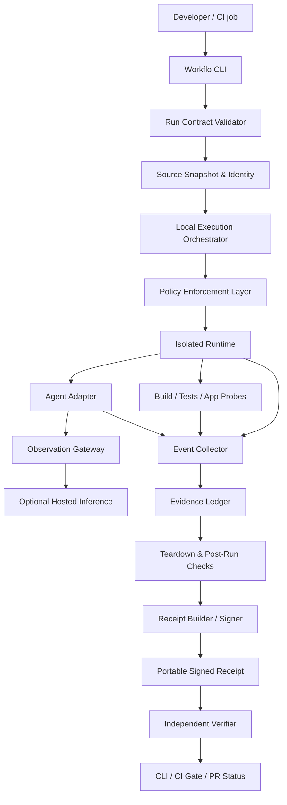

# Workflo — Product Strategy, Execution Plan and Market Research

**Research cut-off:** 21 November 2026  
**Purpose:** Define what Workflo does, what it should become as a product, how to build and sell it, who needs it, and how large the reachable market could be.  
**Scope:** Product definition, customer problem, architecture, security model, competitive landscape, market sizing, business model, go-to-market and validation. This is not a speculative 10–15-year forecast.

---

# 1. Executive decision

## 1.1 What Workflo should be

Workflo should be an **independent execution-assurance and evidence product for AI-assisted software development**.

It runs a specific software change in a policy-constrained environment, observes the actual execution, performs declared tests and probes, checks teardown, and creates a cryptographically signed receipt that another system or person can verify.

**Plain-language product promise:**

> Workflo runs AI-assisted software changes under explicit controls and produces verifiable evidence of what ran, what was observed, which checks passed, and how the environment was cleaned up.

The customer does not need to replace its coding agent, model provider, CI platform, or code scanner. Workflo should sit alongside those tools and provide an independent record of the execution.

## 1.2 The problem we are solving

AI coding agents can now create and modify software, invoke tools, run commands, install dependencies, start applications and interact with APIs. The agent's final message is not sufficient evidence that the intended work actually happened or that it happened within the required controls.

A team may have separate records in:

- Git and pull requests;
- IDE or coding-agent session logs;
- terminal output;
- CI pipelines;
- test reports;
- application logs;
- security scanners;
- sandbox or virtual-machine providers;
- agent observability systems.

Those records are difficult to bind into one independently verifiable statement about a particular source snapshot and run.

Workflo should make that statement easier to produce and verify.

## 1.3 What Workflo is not

Workflo should not try to become:

- another code-generation assistant;
- a general-purpose autonomous software engineer;
- a generic hosted sandbox or compute marketplace;
- a replacement for GitHub Actions, GitLab CI or other CI systems;
- a full static-analysis or application-security suite;
- a model observability dashboard;
- a proprietary LLM company whose value depends on owning the best model.

Those capabilities are either crowded, capital-intensive, already well-served, or better supplied through integrations.

## 1.4 Where the company should focus

| Decision | Recommendation |
|---|---|
| Product category | AI software execution assurance |
| Initial use case | Verify AI-assisted code changes before merge |
| Primary user | Developer, reviewer or platform engineer working with coding agents |
| Initial buyer | CTO, VP Engineering or Head of Engineering at an AI-active software team |
| Security co-buyer | AppSec, DevSecOps or platform-security lead |
| Initial environment | Local-first Linux execution, with CI integration as the first distribution expansion |
| Core asset | A portable, signed execution receipt and an independent verifier |
| Product moat to pursue | Evidence integrity, policy enforcement, agent neutrality and integration depth |
| Revenue model to test | Free local CLI; paid team policy, shared evidence and CI assurance; enterprise controls and deployment options |

## 1.5 The strategic correction

A sandbox is now a feature available from major developer platforms and infrastructure vendors. Docker documents local microVM sandboxes with workspace, network and credential boundaries. GitHub documents local sandboxing for Copilot CLI and the Copilot app. [1][2]

Therefore:

**“We run code in a sandbox” is not enough. “We produce independently verifiable evidence about a controlled execution” is the stronger product thesis.**

That is the product Workflo should build and sell.

---

# 2. What Workflo does — the product, end to end

## 2.1 The user experience

The ideal Workflo experience should be one understandable command, one run, one receipt, and one independent verification result.

A developer points Workflo at a repository or a proposed change. Workflo:

1. Checks the host and runtime prerequisites.
2. Identifies and hashes the source snapshot.
3. Loads a versioned run contract.
4. Prepares a disposable, constrained execution environment.
5. Resolves declared dependencies.
6. Enforces filesystem, process, resource and network policy.
7. Runs the declared build, test and application-startup steps.
8. Allows a supported agent to perform bounded inspection or test tasks where configured.
9. Captures machine-generated execution events and observations.
10. Runs verification checks against the recorded evidence.
11. Stops processes and tears down the environment.
12. Checks the teardown conditions that Workflo can actually observe.
13. Produces a signed, versioned receipt and a human-readable report.
14. Lets a separate verifier validate the receipt without trusting the agent's final summary.

The core user outcome is not a dashboard. It is a reliable answer to: **“What happened during this run, and what evidence supports that conclusion?”**

## 2.2 The primary workflow: verify an AI-generated change

The initial use case should be an AI-assisted pull request or local code change.

**Before Workflo:** a coding agent says it made a change and ran the tests. A reviewer must inspect the diff, infer which commands ran, find CI output, and decide whether the evidence is complete.

**With Workflo:** the change is executed under a declared contract. Workflo records the source identity, runtime policy, commands, process outcomes, test results, probes, agent activity and teardown checks. The reviewer receives a concise result and a receipt that can be verified independently.

This should work whether the code was written by a person, Claude Code, Codex, Copilot, Cursor or another supported agent. Workflo should not require the customer to adopt a specific coding model.

## 2.3 The receipt is the product's central output

The receipt should be a structured evidence object, not just a PDF report or a text log.

At minimum, it should bind together:

| Receipt section | What it records | Why it matters |
|---|---|---|
| Identity | Receipt ID, schema version, run ID, creation time | Unambiguous identification |
| Source | Repository identity, commit SHA, source snapshot hash, patch or working-tree hash | Shows which exact input was processed |
| Contract | Contract hash, policy version, declared run stages | Makes the rules of the run explicit |
| Runtime | OS, kernel/runtime versions, sandbox backend, image/rootfs identity | Establishes relevant execution context |
| Permissions | Filesystem mounts, writable locations, network policy, credentials boundary, resource limits | Shows what the run was permitted to access |
| Commands | Command identity, start/end times, exit status, timeout and output digests | Distinguishes actual command events from agent claims |
| Agent activity | Agent adapter/version, tool events, action summaries and permitted observations | Connects agent activity to the execution record |
| Tests and probes | Test suite identity, result, output digest, application health/API probe outcomes | Shows which declared checks completed |
| Teardown | Processes and resources checked, cleanup result, residual-state checks and any uncertainty | Makes cleanup evidence explicit |
| Evidence manifest | Hashes, event-chain data, evidence file references | Allows tamper detection and completeness checks |
| Attestation | Signature metadata, key identity, certificate or trust-root reference | Allows a separate verifier to validate origin and integrity |
| Limitations | Missing telemetry, unsupported controls, skipped checks and unverified claims | Prevents the report from overstating certainty |

A successful receipt must not be emitted as “passed” when required evidence is missing, a security control failed to attach, telemetry was lost, or teardown could not be established.

## 2.4 Three different kinds of statements

Workflo's report must clearly separate:

1. **Observed facts** — machine events and measurements captured by the runtime.
2. **Verifier conclusions** — deterministic checks performed over the run record and evidence.
3. **Agent-generated interpretations** — model-produced explanations or recommendations.

These are not interchangeable. The agent's explanation must never be promoted to an observed fact simply because it is plausible.

## 2.5 What a green result should mean

A Workflo “pass” should mean only that:

- the expected source identity was recorded;
- the required policy controls were successfully applied;
- the declared run stages completed;
- the required test and probe conditions passed;
- the evidence manifest is complete under the run contract;
- the receipt signature and integrity checks pass;
- the configured teardown checks passed;
- no required control was silently skipped.

It must not mean “the software is bug-free”, “the software is secure against all attacks”, or “nothing could have escaped”.

---

# 3. What Workflo already has and what remains to prove

This section uses the latest Workflo implementation notes supplied in the project context. These are reported project statuses, not an independent security audit or a claim that every feature is production-ready.

## 3.1 Reported implementation status

| Area | Reported status | Strategic significance |
|---|---|---|
| CLI | Core CLI completed and available through npm | Gives Workflo a developer-facing entry point |
| Agent runtime | Completed and verified on Linux | Establishes the central execution path |
| Evidence ledger | Implemented | Creates a place to record execution events and evidence |
| Teardown verification | Implemented | Supports a meaningful post-run assurance claim |
| Signed receipt | Receipt version 3 includes an `AgentActivity` summary | Establishes the portable artifact direction |
| Hosted inference/privacy gateway | Phase 5 reported complete | Supports an observation-only inference path |
| Source-code privacy invariant | Hosted model must not receive source code | Important trust and deployment differentiator if continuously tested |
| Security hardening specification | Phase 6 specification completed | Defines the hardening work and known defects |
| Run contract | Phase 7 run contract document completed | Establishes a declared lifecycle and exit-code taxonomy |
| Developer diagnostics | `workflo init`, `workflo doctor`, `workflo security-gate` commands added to the plan/CLI scope | Improves installation and policy-readiness workflow |

## 3.2 Known hardening gaps that must be treated as release blockers

The latest technical notes identify the following areas requiring resolution:

- Landlock ABI and enforcement correctness;
- nftables network-policy scope;
- cgroup attachment failure handling;
- process-tree termination and teardown behaviour.

These issues are not minor polish. They affect whether Workflo can honestly claim that the policy it records is the policy the operating system actually enforced.

**Release rule:** a control that fails to attach must cause a fail-closed result. Workflo must not silently continue in a weaker or unsandboxed mode and then create a passing receipt.

## 3.3 What “source code never reaches the hosted model” must mean

This should be an enforceable architecture invariant, not a marketing statement.

The hosted inference service should receive only the observation payloads that are explicitly allowed by the protocol. The protocol must prevent accidental transmission of:

- source files or source fragments;
- diffs and patches;
- repository archives;
- environment files and secrets;
- raw terminal output containing source or credentials;
- logs that include code snippets or sensitive customer data.

A strict allow-list schema is preferable to a deny-list filter. Any new field must be reviewed before it can cross the privacy gateway.

The local runtime should remain responsible for source access, command execution and evidence collection. Hosted inference, if used, should be a consumer of approved observations, not a remote executor of private code.

## 3.4 Current versus target state

| Capability | Current reported state | Required product-grade state |
|---|---|---|
| Local execution | Linux runtime verified | Reproducible, versioned and supportable execution across declared platforms |
| Isolation policy | Implemented in parts; hardening gaps known | Fail-closed controls with adversarial conformance tests |
| Network restrictions | Per-run network isolation exists | Explicit, testable policy enforcement including DNS, IPv4/IPv6 and proxy paths |
| Process control | Runtime exists; cgroup/teardown issues identified | Every child process accounted for and terminated within the declared boundary |
| Agent integration | Agent runtime and activity evidence exist | Stable adapter interface, version pinning and conformance tests |
| Evidence | Ledger and receipt v3 exist | Complete event schema, loss detection, provenance and independent verification |
| Privacy | Observation-only gateway exists | Automated leakage tests and a documented data-flow threat model |
| CI integration | Not yet the primary validated product surface | A low-friction GitHub Actions integration and clear PR outcome |
| Team management | Not the immediate core | Shared policy, access control, history, retention and administration |

---

# 4. How Workflo should be built

## 4.1 Product architecture

Keep the architecture modular. The execution runtime should not depend on the hosted AI service, and the verifier should not need to trust the runtime's prose report.

The receipt should remain useful even when optional hosted inference is disabled.

## 4.2 Layer responsibilities

### A. CLI and developer interface

Responsibilities:

- initialise a repository for Workflo;
- inspect host prerequisites;
- validate the run contract;
- start, monitor and cancel runs;
- display a concise stage-by-stage result;
- locate reports and evidence bundles;
- verify receipts locally or in CI;
- expose stable exit codes for automation.

The CLI should be the first-class product, not a thin front end to a required web dashboard.

### B. Run contract

A run contract defines what Workflo is expected to do and what it is allowed to do.

It should specify:

- source and workspace identity;
- allowed and denied filesystem paths;
- network policy and permitted destinations;
- credentials and secret-handling policy;
- process and resource limits;
- dependency-resolution policy;
- build and test commands;
- application startup and readiness probes;
- agent adapter and tool permissions;
- evidence requirements;
- teardown requirements;
- timeout and failure behaviour.

Contracts must be versioned, hashable and immutable for the duration of a run. The agent must not be able to modify its own run policy.

### C. Local execution runtime

Responsibilities:

- create and manage the isolated environment;
- enforce filesystem and network controls;
- isolate processes and resource consumption;
- capture command/process lifecycle events;
- stage declared dependencies;
- run application probes and test suites;
- terminate child processes and clean up resources.

The runtime should support a clearly documented backend interface so Workflo can use different host isolation mechanisms or sandbox providers without making their security assumptions invisible.

### D. Agent adapter

The adapter should normalise agent activity into a stable event format.

An adapter should record what Workflo can observe, for example:

- agent product and version;
- session and task identifiers;
- tool invocation name;
- action start and end;
- permitted input/output digests;
- result or error status;
- approval or denial events.

Workflo should not pretend it can capture hidden model reasoning. The relevant evidence is the externally observable activity and its relationship to the execution environment.

Start with one or two adapters that match the actual design partners. Add more only when there is clear demand.

### E. Observation-only privacy gateway

The gateway should be an explicit boundary between the local runtime and optional hosted inference.

It should:

- accept only schema-validated observation payloads;
- reject unexpected fields by default;
- record exactly what was transmitted;
- apply redaction and data-classification rules;
- avoid source-code transport;
- support disabling hosted inference entirely;
- expose automated tests that attempt to send source, patches and secrets and confirm rejection.

### F. Evidence ledger

The ledger should record events as an append-only sequence for each run.

A missing event, duplicate sequence, clock anomaly, digest mismatch or collector crash should be represented explicitly. The system must not silently repair or omit evidence and then report a clean run.

### G. Independent verifier

This is one of Workflo's most important engineering investments.

The verifier should be separately invocable and should validate:

- receipt schema and version;
- signature and trust chain;
- source and contract hashes;
- evidence-manifest digests;
- event ordering and required stage presence;
- required test/probe results;
- declared policy application results;
- teardown evidence;
- unsupported or missing evidence;
- expiry and key-rotation policy where applicable.

A successful signature check proves integrity relative to the signing identity; it does not prove that every claim is true. The verifier must be explicit about the scope of each result.

### H. CI and team control plane

Only after local execution and verification are reliable should Workflo add a team service.

The team layer should provide:

- organization policy distribution;
- runner registration and health;
- repository and team-level configuration;
- receipt search and retention;
- PR checks and summaries;
- role-based access and audit logs;
- enterprise key management;
- private deployment options.

Avoid building a large dashboard before the CLI and receipt are used repeatedly.

## 4.3 Run lifecycle

The current run-contract lifecycle is a sound basis:

`PREFLIGHT → SNAPSHOT → DEPS → RESOLVE → ROOTFS → ISOLATION → PROBES → TEST → AGENT → TEARDOWN+VERIFY → RECEIPT → REPORT`

Each stage needs:

- a defined input;
- a defined output;
- an explicit success condition;
- an explicit failure condition;
- a timeout;
- required evidence fields;
- a stage-specific exit code;
- a decision on whether execution may continue after failure.

A stage should not be considered successful merely because its process started. Its postcondition must be checked.

## 4.4 Security engineering priorities

The order below is intentional. Workflo's claims depend on actual enforcement.

| Priority | Area | Required outcome | Why it is critical |
|---|---|---|---|
| P0 | Fail-closed isolation | Unsupported or failed controls stop the run | Prevents false confidence |
| P0 | Filesystem boundary | Only declared paths are accessible or writable | Protects host and repository state |
| P0 | Network boundary | Egress follows a testable default-deny policy | Limits exfiltration and uncontrolled access |
| P0 | Process/resource boundary | Every descendant is tracked, limited and terminated | Prevents runaway work and incomplete cleanup |
| P0 | Evidence completeness | Collector failures and dropped events invalidate or downgrade the receipt | Prevents silent evidence gaps |
| P0 | Receipt integrity | Canonical encoding, digest binding and signature verification work independently | Protects evidence from tampering |
| P0 | Privacy gateway | Source and secrets are rejected from hosted inference payloads | Protects customer IP |
| P1 | Reproducibility | Runtime, dependency and environment identity are recorded | Makes failures diagnosable |
| P1 | Threat-model testing | Hostile repository and agent behaviours are exercised continuously | Validates assumptions under adversarial conditions |
| P1 | Key management | Signing-key storage, rotation, revocation and trust roots are documented | Supports enterprise operation |
| P2 | Additional operating systems | Platform backends receive equivalent conformance tests | Expands the addressable developer base |

## 4.5 Mandatory security test matrix

Before describing the runtime as production-grade, test at least:

- the isolation backend is unavailable;
- the requested filesystem restriction cannot be applied;
- the network policy backend fails to attach;
- a child process forks descendants;
- a process ignores a graceful termination request;
- a process attempts to continue after the run timeout;
- IPv4 and IPv6 egress are attempted;
- DNS requests are made for allowed and denied destinations;
- an unapproved proxy or alternate network path is attempted;
- a repository contains hostile install/build hooks;
- a test command produces unusually large output;
- the event collector crashes or drops events;
- the signing process fails or the key is unavailable;
- the evidence bundle is modified after signing;
- the receipt is replayed against a different source snapshot;
- the hosted inference payload contains a source-code marker or synthetic secret;
- teardown is interrupted midway;
- the host reboots or the CLI is killed during a run.

For each case, define the expected receipt status. A security failure must not be converted into an ordinary test failure or hidden in a warning.

## 4.6 Standards and compatibility

Workflo should reuse established supply-chain and signing concepts rather than invent a completely isolated trust stack.

Relevant standards and projects include:

- **SLSA** for build-provenance concepts and levels;
- **in-toto** for describing and verifying software supply-chain steps;
- **Sigstore/Cosign** for signing and verification workflows;
- **GitHub Artifact Attestations** for build provenance in GitHub workflows;
- **OpenTelemetry** conventions where agent/runtime tracing interoperability is useful;
- **OWASP** guidance for agentic application risks;
- **NIST SSDF and its generative-AI supplement** for secure development process context.

Do not claim that Workflo is SLSA-conformant or compliant with any framework until the exact requirements have been mapped and independently checked.

---

# 5. What Workflo should build first

The build order should be determined by dependencies and product risk, not by a distant calendar vision.

## Phase A — Make the execution contract trustworthy

**Objective:** Every run is either demonstrably within its declared policy or clearly fails.

Deliverables:

- close the Landlock, nftables, cgroup and teardown gaps;
- fail closed on all enforcement failures;
- formalise the run-contract schema;
- finalise receipt v3 compatibility and schema evolution rules;
- add the security test matrix to CI;
- produce a threat model and explicit guarantee/limitation document;
- confirm that the agent cannot rewrite the contract or evidence ledger;
- verify source-code privacy at the hosted inference boundary.

**Exit criteria:** no unresolved P0 enforcement defects; all mandatory negative tests behave as expected; incomplete evidence cannot produce a clean pass.

## Phase B — Make the CLI useful in a real developer workflow

**Objective:** A developer can install Workflo, run a repository and understand the result without reading internal implementation documents.

Deliverables:

- clear `init`, `doctor`, `run`, `inspect` and `verify` workflows;
- one sample project per supported language/runtime;
- stable exit codes and actionable errors;
- compact terminal output plus machine-readable JSON;
- reliable run cancellation and recovery;
- versioned local configuration;
- documented Linux support and explicit unsupported-platform behaviour.

**Exit criteria:** a new developer can install, initialise, execute, inspect and verify a sample project without founder assistance.

## Phase C — Ship the pull-request use case

**Objective:** Workflo appears at the point where teams decide whether to merge an AI-assisted change.

Deliverables:

- GitHub Actions integration;
- PR check with concise pass/fail/needs-attention status;
- link or attachment to the receipt and evidence summary;
- ability to verify offline or in a separate CI job;
- contract configuration stored with the repository;
- optional integration with existing test and security tools;
- sensible caching without weakening source identity or evidence integrity.

**Exit criteria:** a design-partner team uses Workflo on real pull requests repeatedly, and reviewers rely on its receipt rather than treating it as decorative CI output.

## Phase D — Make it team-ready

**Objective:** Convert individual CLI usage into an organizational policy product.

Deliverables:

- shared policy management;
- team and repository-level controls;
- access control and audit logs;
- runner registration and health;
- evidence retention and search;
- customer-managed signing keys or an equivalent enterprise key model;
- private control-plane deployment options;
- administrative reports and usage/cost visibility.

**Exit criteria:** at least one paying team expands from a developer-led trial to an organization-wide workflow.

## Phase E — Expand integrations selectively

Only add an integration when it improves acquisition, retention or customer value.

Candidate integrations:

- GitLab CI and merge requests;
- GitHub Copilot, Claude Code, Codex and other agent adapters;
- Docker, E2B, Daytona or other sandbox backends;
- Sonar, Snyk, Qodo and security scanners;
- artifact registries and SBOM tools;
- enterprise identity and logging systems.

Do not build all integrations simultaneously. Start with the combination requested by the first customers.

---

# 6. What makes Workflo different

## 6.1 The competitive reality

The market is moving quickly. Important parts of Workflo's proposed feature set are already available elsewhere:

- isolated execution;
- local agent sandboxes;
- filesystem and network controls;
- agent-session logging;
- code review and security analysis;
- build provenance and artifact attestations;
- agent tracing and evaluation.

A differentiated product must connect those pieces in a way customers cannot get easily from their existing toolchain.

## 6.2 Workflo's intended differentiation

| Capability | Existing market baseline | Workflo should prove |
|---|---|---|
| Local execution | Docker and GitHub support local sandboxing | Receipts remain portable and independent of one sandbox or IDE |
| Network/filesystem policy | Sandboxes and coding agents offer policy controls | The receipt proves which policy was declared and whether enforcement succeeded |
| Agent visibility | Observability products capture traces and tool calls | Agent activity is bound to source identity, runtime policy and OS-level execution events |
| Tests and probes | CI systems already run tests | Results are tied to the exact source and run contract, with evidence digests |
| Build provenance | SLSA and GitHub attestations record provenance claims | The receipt adds run-level process, agent, test/probe and teardown evidence |
| Signing | Sigstore and other tools sign artifacts and claims | A separate verifier can check the complete Workflo evidence package |
| Privacy | Private/self-hosted offerings exist | Local source handling and observation-only remote inference are proven by tests |
| Teardown | Sandbox providers remove environments | Workflo records the precise resources checked and the limits of the cleanup claim |

## 6.3 The defensible product sentence

> Workflo is the independent evidence layer between AI-assisted software execution and the decision to trust or merge the result.

## 6.4 What should become hard to copy

A CLI or sandbox wrapper is easy to reproduce. These capabilities are harder to replicate well:

1. **A mature run contract** that describes execution permissions and required evidence clearly.
2. **A high-integrity event model** that binds source, policy, process activity and observations.
3. **A genuinely independent verifier** that can run outside the execution process.
4. **A strong conformance suite** proving that runtime backends enforce the declared contract.
5. **A portable receipt format** adopted by CI, security and agent tooling.
6. **Useful integrations** that fit into pull requests and enterprise policies.
7. **Customer trust** earned through transparent limitations, reproducible tests and third-party review.

The moat is not cryptography alone. Cryptographic signing is available to competitors. The moat is a complete, useful and trusted evidence system.

---

# 7. Competitive landscape

The companies below are not all direct competitors. They overlap with different layers of the Workflo product. A key strategic requirement is to integrate with strong adjacent products rather than rebuild everything they already do.

## 7.1 Competitor and adjacent-product matrix

| Company / product | Main layer | What it offers | Competitive pressure on Workflo | Workflo's response |
|---|---|---|---|---|
| Docker Sandboxes | Local/cloud execution isolation | Agent sandboxes using microVMs, workspace boundaries, network policy, credential proxying and optional organization governance | High on the sandbox part of the product | Do not compete on “we have a sandbox”; support or coexist with sandbox backends and prove the full run evidence |
| GitHub Copilot sandboxing | Coding-agent platform | Local sandboxing for Copilot CLI and app; cloud sandboxing options; integrated policy settings | High because it is built into a popular developer workflow | Stay agent- and platform-neutral; make receipts useful for non-GitHub agents and non-GitHub CI too |
| E2B | Managed sandbox infrastructure | Firecracker microVM-based execution environments, SDKs and enterprise deployment choices | High on hosted isolated execution | Treat as a possible execution substrate; do not build a commodity compute business |
| Daytona | Agent execution infrastructure | Composable isolated computers, SDK/API/CLI, persistence and agent tooling | High on execution environment capabilities | Integrate when customers use it; focus on cross-run evidence and independent verification |
| GitHub Actions / Artifact Attestations | CI and software provenance | CI workflows and signed build provenance including repository, commit, environment and workflow context | High overlap in provenance and pipeline distribution | Complement GitHub attestations; provide run-level execution evidence and verification, then link the records |
| GitLab Duo Agent Platform | SDLC agents and orchestration | Multiple agents and workflows across code refactoring, security scans, reviews and CI tasks | High platform-bundling threat | Avoid replacing the SDLC; provide independent assurance that can consume GitLab jobs and agent activity |
| LangSmith | Agent observability and evaluation | Tracing, evaluations, deployment and agent development tooling | Medium-to-high overlap in agent telemetry | Do not build a generic trace viewer; record host execution, policy, source identity and teardown evidence |
| Arize Phoenix / Langfuse / Braintrust | Agent tracing and evaluation | Open-source or hosted tracing, experiments and quality evaluations | Medium overlap | Integrate trace references where useful; distinguish run evidence from model-quality evaluation |
| Sonar | Code quality, verification and governance | Static analysis, code verification, AI coding integrations, security and SDLC governance | High adjacent competition, especially around the “verification” message | Consume its findings as evidence; do not claim to replace semantic code analysis |
| Qodo | AI code review and governance | Agentic PR review, repository context, rules, agent session review and governance | High adjacent competition at the PR decision point | Workflo should verify execution evidence beneath code review rather than duplicate review comments |
| Snyk | Application security and agent security | Code/dependency security, AI-generated code security and controls around agentic development | High adjacent competition on security governance | Integrate scanner outputs and remain focused on controlled execution and evidence provenance |
| SLSA / in-toto / Sigstore | Open standards and tooling | Build provenance, supply-chain attestations and cryptographic signing/verification | Foundational alternatives and interoperability requirements | Adopt standards where suitable; extend the evidence scope without inventing incompatible formats |

## 7.2 What the strongest competitors mean for the strategy

### Docker

Docker's security documentation describes each sandbox as a microVM with a separate kernel, an isolated Docker Engine, workspace modes, a policy-controlled network path and credential proxying. It also documents explicit caveats around shared workspaces, agent permissions and host-side integrations. [1]

**Implication:** Workflo cannot lead with local isolation as its unique capability. It should be able to use or interoperate with execution environments while retaining its own contract, evidence and verifier.

### GitHub Copilot

GitHub documents local sandboxing for Copilot CLI and the Copilot app. It describes controls over filesystem, network and system capabilities, and says local sandboxing is available without additional charge. [2]

**Implication:** A user may already receive acceptable sandboxing from their coding tool. Workflo's value must remain when the user changes agent, uses multiple agents, or needs a receipt for their CI or customer process.

### E2B and Daytona

E2B and Daytona focus on programmable, isolated execution environments for AI-generated code and agent workflows. Daytona documents a dedicated kernel, filesystem and network stack, plus SDK/API/CLI interfaces. [3][4]

**Implication:** Do not spend the company's scarce resources competing on VM startup speed, raw compute pricing or general-purpose sandbox hosting unless customers explicitly demand it.

### GitHub Artifact Attestations and SLSA

GitHub Artifact Attestations records signed provenance claims about where and how a software artifact was built, including repository, organization, environment, commit and workflow context. GitHub also explicitly warns that attestations do not guarantee that an artifact is secure. [5]

**Implication:** Workflo should not claim that signed receipts are a new idea or that a signature proves security. Its potential contribution is to capture execution-stage evidence—commands, agent activity, tests, probes, policy enforcement and teardown—and bind it to the source snapshot and run contract.

### LangSmith and other agent observability systems

LangChain's 2026 survey reports 89% of respondents have implemented agent observability, while 52% report offline evaluations. [6]

**Implication:** Observability is already established. Workflo should not build another generic model-call trace UI. Its unique evidence should come from the controlled execution environment and the independently verifiable run record.

### Sonar, Qodo and Snyk

These vendors are expanding into AI-assisted code verification, code review, agentic workflows and security governance. Sonar's 2027 survey reports that 76% of its 1,026 respondents generate AI code faster than they can verify it, while 77% report that stronger verification tools increase trust in AI-generated code. [7]

**Implication:** There is a real verification problem, but these vendors are credible and increasingly comprehensive competitors. Workflo should integrate with their results and avoid entering a head-on race to build the best static analyzer, code reviewer or vulnerability database.

## 7.3 Competitive positioning by customer question

| Customer asks | Workflo answer should be |
|---|---|
| “Why not use Docker or the sandbox built into my coding agent?” | Keep using it where suitable. Workflo's purpose is the independent run contract, evidence package and verifier across tools. |
| “Why not trust my CI logs?” | CI remains essential. Workflo binds the run's source, policy, events and evidence into a portable record and verifies its integrity. |
| “Why not use GitHub attestations?” | Use them for build provenance. Workflo addresses the execution evidence defined by its run contract and can link to existing attestations. |
| “Why not use LangSmith?” | Use it for agent traces and evaluations. Workflo records controlled host/runtime execution and its verification results. |
| “Why not use Sonar or Snyk?” | Use them for code quality and security scanning. Workflo can bind their outputs to the exact execution and receipt. |
| “Why not build this ourselves?” | Compare internal maintenance cost with a maintained contract, verifier, supported runtime backends, integrations and conformance testing. Workflo must demonstrate this cost advantage in pilots. |

---

# 8. The market: who needs Workflo and why

## 8.1 Market definition

Workflo sits at the intersection of several established markets:

1. developer tooling and platform engineering;
2. AI coding-agent infrastructure;
3. software testing and verification;
4. application and software-supply-chain security;
5. build provenance and audit evidence;
6. isolated code execution and sandboxing.

There is not yet a clean, widely accepted analyst category for “agent execution assurance receipts”. It would be misleading to take the published size of any one adjacent market and present it as Workflo's TAM.

The right approach is a bottom-up model using a relevant developer population, explicit qualification assumptions and transparent pricing scenarios.

## 8.2 Evidence that the need is real

### AI coding is moving into routine development

GitHub's 2026 Octoverse reported that more than 40% of pull requests on GitHub began with an agent's first draft by September 2026, up from 17% in March, with approximately 110 million agent-started pull requests in September. This is GitHub platform data, not a measure of every software developer worldwide. [8]

Stack Overflow's 2026 developer survey and JetBrains' 2025 ecosystem survey also report widespread AI coding-tool use among their respondents. Those surveys differ in sample and methodology and should not be combined into one universal adoption rate. [9][10]

### Verification is a reported bottleneck

Sonar's 2027 State of Code survey page reports that 76% of its 1,026 developer and engineering-manager respondents generate AI code faster than they can verify it, and 53% now spend more time reviewing than creating code. The survey is vendor-published, so treat the figures as directional evidence rather than a neutral census of the industry. [7]

### Agent systems are reaching production

LangChain's survey of more than 1,300 professionals reports that 57% of respondents have agents in production, 32% cite quality as a top barrier, 89% have agent observability implemented and 52% report offline evaluations. This includes agent use cases beyond software coding, so it supports the broader operating context rather than directly measuring Workflo's exact market. [6]

### A relevant developer base exists

CNCF and SlashData's Q3 2026 report estimates 21.2 million cloud-native developers worldwide, approximately 41% of the global developer population. It reports that 75% of cloud-native developers use AI coding tools. The underlying survey reached more than 14,000 respondents across 120 countries. [11]

This is the most useful public population proxy for Workflo because cloud-native developers are more likely to use automated build/test pipelines, containerised development and platform engineering practices. It is still an upper-bound proxy, not a count of prospective Workflo customers.

## 8.3 Ideal customer profiles

### ICP 1 — AI-active software teams

**Recommended first market.**

Typical characteristics:

- 10–200 software engineers;
- regular use of coding agents;
- meaningful repository and CI activity;
- multiple changes generated or substantially assisted by agents;
- engineering leaders responsible for quality and release speed;
- enough technical maturity to install a CLI and run a pilot;
- concern about source-code privacy or execution permissions.

Why they buy:

- shorter review cycles;
- fewer unverified “tests passed” claims;
- easier reproduction of failures;
- a controlled place to run agent-generated code;
- evidence that reviewers can inspect;
- consistent execution rules across the team.

Buyer: CTO, founder or VP Engineering.  
Champion: staff engineer, DevEx or platform engineer.  
Security partner: AppSec or security lead where present.

### ICP 2 — Platform engineering and internal developer platform teams

Typical characteristics:

- several repositories and delivery teams;
- standardised CI/CD;
- centralised developer tooling;
- a need to enforce common policies;
- agent adoption across teams.

Why they buy:

- one execution contract across repositories;
- centrally managed policies;
- standard evidence for CI and review;
- consistent runner and receipt management;
- fewer bespoke internal scripts.

This is an attractive expansion segment after the local CLI is proven.

### ICP 3 — Application security and DevSecOps teams

Typical characteristics:

- strict requirements around code, dependencies and execution;
- established scanning and security processes;
- a need to understand agent access and tool use;
- demand for auditable, reproducible evidence.

Why they buy:

- security controls applied before merge;
- evidence of the policy and runtime used;
- scanner results bound to a particular change;
- evidence retention and auditability.

This is a high-value buyer group but requires a mature threat model, independent security review and enterprise deployment options. Do not lead with regulatory claims before those capabilities exist.

### ICP 4 — Software consultancies and product engineering firms

Typical characteristics:

- many client repositories;
- repeated project setup and test workflows;
- client security requirements;
- use of AI coding agents to improve delivery efficiency.

Why they buy:

- repeatable run evidence per client change;
- proof of what the delivery team tested;
- standardised execution process;
- easier client handover and release documentation.

This segment can provide a useful channel, although client environments may make installation and procurement more complex.

### ICP 5 — Regulated and IP-sensitive enterprises

Typical characteristics:

- strict code and data residency requirements;
- private or self-hosted infrastructure;
- security and audit stakeholders;
- several teams and repositories;
- formal software release approval.

Why they buy:

- local or customer-controlled execution;
- policy enforcement and auditable results;
- evidence retention;
- customer-managed keys and deployment controls.

This is an expansion market, not the first market to pursue. Enterprise procurement will expose any immaturity in the runtime, privacy architecture or support process.

## 8.4 Market priority

| Segment | Problem urgency | Ability to pay | Sales cycle | Product fit now | Priority |
|---|---|---|---|---|---|
| AI-active software teams, 10–200 engineers | High where agents are used daily | Medium | Short-to-medium | High after security blockers close | 1 |
| Platform engineering teams | Medium-to-high | Medium-to-high | Medium | Medium; requires team controls and CI | 2 |
| Consultancies | Medium | Medium | Short-to-medium | Medium | 3 |
| AppSec / DevSecOps | High in sensitive environments | High | Medium-to-long | Medium; requires proof and integrations | 4 |
| Large regulated enterprises | Potentially high | High | Long | Low until security certification, deployment and support mature | 5 |
| Individual developers | Useful for adoption | Low | Immediate/self-serve | High | Acquisition channel, not primary revenue target |

## 8.5 India as an initial customer-discovery market

CNCF and SlashData's India 2026 report estimates 2.25 million cloud-native developers in India. It also reports that hybrid cloud is a prominent deployment model among Indian developers. [12]

This makes India a useful market for design-partner recruitment and founder-led sales, especially among product companies, SaaS teams, developer-tool startups and engineering service firms.

Do not multiply the India developer count by the global 75% AI-coding adoption rate and present the result as an India-specific target market. The available India-specific source summary does not establish that same adoption percentage for India.

---

# 9. Market sizing — a transparent, bottom-up model

## 9.1 Why this model is deliberately conservative

There is no reliable public figure for the number of companies that specifically need a standalone agent-execution evidence product. The model therefore begins with a developer population proxy and narrows it using clearly labelled assumptions.

The figures below are scenarios, not analyst forecasts and not evidence of actual customer demand.

## 9.2 Population proxy

CNCF/SlashData reports:

- 21.2 million cloud-native developers worldwide;
- 75% use AI coding tools. [11]

Derived active AI-tool user proxy:

`21.2 million × 75% = 15.9 million developers`

This 15.9 million is not Workflo's addressable market. It includes many developers who will never need or pay for a dedicated execution-assurance product.

## 9.3 Qualification scenarios

Use a small fraction of the 15.9 million AI-tool users as a first-pass pool of people working in teams where agent-generated changes, CI, security policy and independent execution evidence are commercially relevant.

| Scenario | Assumed qualifying share | Implied user pool | Status |
|---|---:|---:|---|
| Narrow | 1% | 159,000 | Conservative modelling assumption |
| Working case | 3% | 477,000 | Planning assumption to validate |
| Broad | 5% | 795,000 | Optimistic assumption; not yet validated |

The qualifying percentages are assumptions, not measured adoption rates.

## 9.4 Revenue-equivalent user pool

Test an annualised price range of **US$240–US$480 per paid seat per year** (equivalent to US$20–US$40 per month) as a pricing hypothesis.

| Qualifying pool | At $240 per seat/year | At $480 per seat/year |
|---:|---:|---:|
| 159,000 seats | $38.2M | $76.3M |
| 477,000 seats | $114.5M | $229.0M |
| 795,000 seats | $190.8M | $381.6M |

These values are **seat-equivalent revenue pools**, not a formal TAM and not forecast revenue. They assume every qualifying seat pays, which will not happen. Enterprise licensing, run volume and local-only use also complicate a pure seat model.

## 9.5 Company capture scenarios

A more useful question is what Workflo could become if it wins a limited number of real organisations.

| Scenario | Paying organisations | Average paid seats | Average revenue per seat/month | Implied ARR |
|---|---:|---:|---:|---:|
| Early commercial proof | 100 | 25 | $25 | $750,000 |
| Strong specialist business | 500 | 35 | $30 | $6.3M |
| Meaningful scale | 1,500 | 45 | $35 | $28.35M |
| Category leader scenario | 3,000 | 60 | $40 | $86.4M |

Formula: `organisations × paid seats × monthly price × 12`.

These are arithmetic scenarios only. The organisation counts, average paid seats and prices have not been established by customer research. They are useful as business planning targets only after real pilots validate usage and willingness to pay.

## 9.6 What market size should the founder believe?

The defensible conclusion is not “Workflo has a multi-billion-dollar market”. The defensible conclusion is:

- a large and growing developer population is adopting AI coding tools;
- agent observability and code verification are established spending areas;
- major platforms are adding execution isolation and agent controls;
- there is a plausible unmet need to bind source, policy, actual execution, tests, observations and cleanup into a portable evidence record;
- the standalone budget category and willingness to pay for that exact outcome still need validation.

Workflo can become a meaningful software business if a few hundred organisations repeatedly rely on its receipts in their release process. A much larger outcome requires the receipt format and verifier to become useful across multiple CI providers, agents and enterprises.

## 9.7 Pricing evidence and recommendation

Public pricing provides directional anchors, not direct comparables:

- LangSmith lists a free developer tier and a Plus tier at US$39 per seat per month, with usage-based charges and custom enterprise terms. [13]
- Qodo lists a Pro Team plan at US$30 and a credit-based review model, with custom enterprise plans. Its pricing unit is not the same as Workflo's. [14]
- Docker describes local sandbox compute as free and cloud compute as pay-as-you-go, with separate paid organization governance. [15]

These examples show that adjacent developer and agent tooling is sold through a combination of seats, usage, credits and enterprise contracts. They do not prove the right price for Workflo.

### Recommended packaging hypothesis

| Plan | What it includes | Pricing approach to test |
|---|---|---|
| Individual | Local CLI, local receipts, basic verifier, limited community support | Free |
| Team | Shared contracts, CI integration, receipt history, PR reporting, team policy | $20–$40 per active developer/month, or a team base fee plus included runs |
| Enterprise | Private runners, SSO/SCIM, customer-managed signing keys, policy administration, retention, deployment options, SLA | Custom annual contract |

Use included run allowances and metered overages only after measuring actual resource cost and usage patterns.

Avoid pricing purely per model token. Workflo's value is the controlled execution and verifiable evidence, not token consumption.

---

# 10. How Workflo should go to market

## 10.1 Lead with one use case

The first sales message should be:

**“Verify AI-assisted code changes before they merge.”**

Do not lead with “trust infrastructure for autonomous software systems”. That phrase may describe a broader category, but it is too abstract for initial customer acquisition.

## 10.2 Developer-led adoption

The adoption loop should be:

1. A developer installs the free CLI.
2. They run it on one repository.
3. Workflo produces an understandable report and receipt.
4. The receipt makes review or debugging easier.
5. The developer adds Workflo to a pull request or CI workflow.
6. Other developers and reviewers use it.
7. The engineering lead wants shared policies and evidence retention.
8. The organisation upgrades to a team or enterprise plan.

## 10.3 Founder-led design partners

Recruit 5–10 design-partner teams before scaling marketing.

The best early partners are not simply enthusiastic about AI. They must have a real workflow where agent-generated changes are executed and reviewed frequently.

Each partner should agree to:

- run Workflo on real repositories;
- provide anonymised usage and failure data where permitted;
- review receipt usefulness with developers and reviewers;
- identify security and privacy blockers;
- participate in a weekly product review;
- discuss a paid pilot if the agreed success criteria are met.

## 10.4 Pilot structure

Run a controlled pilot over a defined set of repositories and pull requests.

Measure:

- percentage of eligible changes run through Workflo;
- successful run completion rate;
- time from installation to first useful receipt;
- time spent collecting evidence before and after Workflo;
- issues discovered that ordinary tests or review missed;
- number of incomplete or misleading agent test claims identified;
- percentage of receipts independently verified;
- percentage of PR reviewers who open or rely on the report;
- repeat usage per developer and per repository;
- runtime overhead and failure rate;
- willingness to continue on a paid plan.

Do not count “the CLI was installed” as product-market fit. Repeated use in the real merge workflow is the meaningful signal.

## 10.5 Channels

Prioritise:

- developer communities and technical demos;
- open-source CLI and receipt verifier;
- GitHub marketplace/action distribution;
- platform engineering and DevSecOps communities;
- partnerships with engineering consultancies;
- technical content showing real evidence and limitations;
- targeted outreach to AI-active SaaS engineering teams.

Avoid broad brand campaigns before the product has repeated usage and a clear conversion path.

## 10.6 What to publish

Trust is part of the product. Publish:

- receipt schema and versioning policy;
- verifier source and reproducible test instructions;
- security architecture and threat model;
- supported operating systems and known limitations;
- privacy data-flow diagram;
- adversarial test methodology and results;
- examples of successful and failed receipts;
- integration guides;
- explicit statements about what a signature does and does not prove.

---

# 11. What to charge for and what to keep free

## 11.1 Keep the trust core accessible

A free local CLI and basic receipt verifier reduce adoption friction. A published receipt schema makes it easier for customers and partners to inspect what Workflo records.

Consider making the following open or inspectable:

- receipt schema;
- canonical encoding rules;
- verification library or CLI;
- local evidence inspection;
- security test vectors;
- threat-model documentation.

The exact licensing decision needs to balance adoption, commercial viability and contribution governance.

## 11.2 Monetise organizational value

Charge for capabilities that become more valuable across a team:

- shared contract management;
- organisation policy enforcement;
- centralised receipt history and search;
- CI orchestration and PR workflow integration;
- runner fleet management;
- access control and audit exports;
- retention and compliance reporting;
- enterprise key management;
- private or customer-controlled deployment;
- support commitments and integration assistance.

Do not hide the basic ability to verify a receipt behind a subscription. Independent verification is central to product credibility.

## 11.3 Pricing validation before finalising tiers

Interview and test pricing with:

- 10 engineering leaders at AI-active startups;
- 5 platform engineering leads;
- 5 AppSec/DevSecOps leads;
- 5 software consultancy or delivery leaders.

Show the same product at several pricing structures: per active developer, per verified run, team subscription plus usage, and annual enterprise license.

Ask what budget would pay, what alternative cost the product replaces, and what evidence is required before procurement.

---

# 12. How to measure whether Workflo is working

## 12.1 North-star metric

**Verified runs used in a real software decision per active organisation per week.**

This is stronger than downloads, registered users, or raw run count because it links the product to a customer workflow.

## 12.2 Product metrics

| Metric | Why it matters |
|---|---|
| Install-to-first-run time | Measures onboarding friction |
| First-run success rate | Measures runtime reliability |
| Contract validation failure rate | Shows configuration difficulty and policy issues |
| Isolation-control attachment success | Shows whether the runtime enforces what it claims |
| Evidence completeness rate | Core trust metric |
| Independent verification success rate | Core receipt-quality metric |
| Teardown verification rate | Core lifecycle metric |
| Runtime overhead, p50 and p95 | Measures developer workflow impact |
| Agent adapter compatibility | Measures agent neutrality |
| Hosted inference data rejection tests | Measures privacy invariant enforcement |

## 12.3 Customer-value metrics

| Metric | Why it matters |
|---|---|
| Eligible PR coverage | Indicates adoption in real workflow |
| Weekly active repos | Shows depth of use |
| Receipts opened by reviewers | Shows whether evidence is useful |
| Debugging time saved | Demonstrates economic value |
| Review cycle time | Demonstrates workflow improvement |
| Repeat run rate | Shows recurring value |
| Paid conversion | Shows willingness to pay |
| Expansion within an organisation | Shows enterprise value |

## 12.4 Initial internal success gates

These are proposed management gates, not published market benchmarks:

- 5 design partners run real code through Workflo;
- at least 3 use it on a weekly basis;
- at least 100 real runs are completed and inspected;
- reviewers can verify receipts without founder assistance;
- the team can demonstrate that missing evidence never produces a clean pass;
- at least 2 partners agree to a paid pilot or paid continuation;
- no unresolved P0 isolation or privacy defects remain.

If installation is easy but weekly use is low, the product may not solve a frequent enough problem. If teams use it but will not pay, the buyer or value proposition may be wrong.

---

# 13. Risks and decisions

| Risk | Why it matters | Response |
|---|---|---|
| Platform bundling | GitHub, Docker, GitLab or cloud vendors can add more assurance features | Stay cross-platform and make portable receipts the core |
| Sandbox commoditisation | Isolation alone is becoming widely available | Do not sell sandbox compute as the main product |
| Weak evidence quality | A signature can make a weak claim look authoritative | Separate observed facts, verifier conclusions and model summaries |
| Security overclaim | A false assurance statement can create serious customer harm | Publish a threat model, scoped guarantees and test results |
| Runtime friction | Slow or flaky runs will lead developers to disable Workflo | Measure overhead and integrate with existing workflows |
| Incomplete code coverage | Teams may assume Workflo proves more than it actually checks | Clearly state declared checks, skipped checks and limitations |
| Integration burden | Supporting every agent, CI platform and sandbox is expensive | Prioritise integrations from design-partner demand |
| Price/value mismatch | Teams may see evidence as a nice-to-have | Measure time saved and whether receipts change merge decisions |
| Enterprise procurement | Security buyers require mature controls and support | Start with AI-active teams; expand after security maturity |
| Internal build alternative | Platform teams may implement a simple wrapper themselves | Compete on maintained verifier, conformance tests, integrations and operational cost |
| Privacy leakage | Logs and observations can contain source or secrets | Strict payload schemas, local redaction and automated leakage tests |
| Signing-key compromise | Trust in all receipts can be undermined | Protected key storage, rotation, revocation and audit procedures |

## 13.1 Decisions to make now

1. **Primary job:** verify AI-assisted changes before merge, not general-purpose code execution.
2. **First environment:** Linux-first until other platforms meet the same security conformance bar.
3. **First distribution path:** CLI, then GitHub Actions and PR checks.
4. **Core evidence:** source + contract + enforcement + activity + tests/probes + teardown + signature.
5. **Privacy:** local source processing, strict observation-only hosted inference, and an offline mode.
6. **Open strategy:** make the receipt schema and verifier inspectable; monetise team and enterprise operations.
7. **First buyer:** engineering leadership at AI-active software teams.
8. **Security posture:** no “best effort” fallback that silently weakens isolation.

---

# 14. Final recommendation

Workflo should be built as **the independent execution-evidence layer for AI-assisted software changes**.

The opportunity is credible because AI coding is now common in developer workflows, agent deployments are moving into production, and verification remains a reported bottleneck. However, the market is competitive: sandboxes, agent tracing, code review, security scanning and build provenance already have capable vendors.

Workflo should not attempt to replace them.

It should connect their outputs to a single, verifiable run record that establishes:

- which source snapshot was used;
- which contract and permissions applied;
- which runtime executed the change;
- which commands and agent actions were observed;
- which tests and probes completed;
- whether required controls remained active;
- what teardown checks passed or failed;
- whether the receipt and evidence can be independently verified.

The next objective is not to build a broad platform. It is to prove that an engineering team will repeatedly use and pay for this result in its real pull-request process.

**Build the verifier and the evidence chain first. Make the local CLI excellent. Integrate into CI. Sell shared policy and team assurance only after developers rely on the receipts.**

---

# Appendix A — Research sources

The following sources were reviewed for this product and market assessment. Vendor surveys and vendor product pages are identified as such. Figures should be interpreted using each source's own methodology and population.

**[1] Docker — Security model for Docker Sandboxes.**  
Describes microVM isolation, workspace modes, network controls, credentials and trust boundaries.  
https://docs.docker.com/ai/sandboxes/security/

**[2] GitHub — About local sandboxing for GitHub Copilot.**  
Describes local and cloud sandboxing for Copilot CLI and the Copilot app, plus filesystem/network/system policy controls.  
https://docs.github.com/en/copilot/concepts/security-governance-and-network-settings/about-cloud-and-local-sandboxes

**[3] E2B — Security and compliance.**  
Vendor security documentation for sandbox isolation and deployment.  
https://e2b.dev/security

**[4] Daytona — Documentation.**  
Vendor documentation describing isolated sandboxes, SDKs, APIs, CLI and agent tooling.  
https://www.daytona.io/docs/

**[5] GitHub — Artifact attestations.**  
Official documentation for signed artifact provenance, verification and limitations.  
https://docs.github.com/en/actions/concepts/security/artifact-attestations

**[6] LangChain — State of Agent Engineering 2026.**  
Survey of more than 1,300 professionals; reports production agent use, quality barriers, observability and evaluation adoption. Vendor-published survey.  
https://www.langchain.com/state-of-agent-engineering

**[7] Sonar — State of Code Developer Survey 2027.**  
Survey page and findings from 1,026 developers and engineering managers; reports AI code verification and review trends. Vendor-published survey.  
https://www.sonarsource.com/the-state-of-code/developer-survey-report/

**[8] GitHub — Octoverse 2026.**  
Reports agent-started pull request activity on GitHub during 2026. Platform-specific data.  
https://github.blog/news-insights/octoverse/octoverse-commits-pushes-reach-new-highs-in-2026-as-developers-build-with-agents/

**[9] Stack Overflow — Developer Survey 2026, AI section.**  
Survey findings on AI coding assistant and agent usage.  
https://survey.stackoverflow.co/2026/ai

**[10] JetBrains — State of Developer Ecosystem 2025.**  
Survey of 24,534 respondents in 194 countries, including AI tool usage in software development.  
https://blog.jetbrains.com/research/2025/10/state-of-developer-ecosystem-2025/

**[11] CNCF and SlashData — State of Cloud Native Development Q3 2026.**  
Estimates 21.2 million cloud-native developers globally and reports AI coding-tool usage. Report is based on a Developer Nation survey with more than 14,000 respondents across 120 countries.  
https://www.cncf.io/reports/the-state-of-cloud-native-development-q3-2026/

**[12] CNCF and SlashData — State of Cloud Native Development in India 2026.**  
Reports an estimated 2.25 million cloud-native developers in India and hybrid-cloud adoption findings.  
https://www.cncf.io/reports/state-of-cloud-native-development-in-india-2026/

**[13] LangChain — LangSmith pricing.**  
Public pricing reference for developer, Plus and enterprise plans; pricing may change.  
https://www.langchain.com/pricing

**[14] Qodo — Pricing.**  
Public pricing reference for AI code review plans and enterprise features; pricing may change.  
https://www.qodo.ai/pricing/

**[15] Docker — Docker Sandboxes.**  
Product overview of local and cloud sandboxes, commercial usage and organisation governance.  
https://docs.docker.com/ai/sandboxes/

**[16] GitLab — GitLab Duo Agent Platform.**  
Official documentation describing agents and flows across the software development lifecycle.  
https://docs.gitlab.com/user/get_started/get_started_agent_platform/

**[17] Snyk — AI Security Platform.**  
Vendor positioning for AI-generated code and agentic development security.  
https://snyk.io/platform/

**[18] OWASP GenAI Security Project — Top 10 for Agentic Apps 2026.**  
Security risk taxonomy for agentic applications.  
https://genai.owasp.org/risk-maps-supported/top-10-for-agentic-apps-2026/

**[19] NIST — SP 800-218A.**  
Secure Software Development Practices for Generative AI and Dual-Use Foundation Models.  
https://csrc.nist.gov/pubs/sp/800/218/a/final

**[20] SLSA — Build Track Levels.**  
Framework for software build provenance and build platform requirements.  
https://slsa.dev/spec/v1.2/levels

**[21] Sigstore — Cosign Quickstart.**  
Signing and verification tooling, certificates and transparency-log evidence.  
https://docs.sigstore.dev/quickstart/quickstart-cosign/

**[22] Arize — Phoenix.**  
Open-source AI observability and evaluation project.  
https://github.com/Arize-ai/phoenix

---

# Appendix B — Market model notes

1. The 15.9 million AI-tool developer proxy is calculated from 21.2 million cloud-native developers multiplied by the 75% AI-coding-tool-use share reported by CNCF/SlashData.
2. The 1%, 3% and 5% qualifying shares are scenario assumptions. No source currently measures the number of developers or organisations that need Workflo specifically.
3. The $20–$40 monthly seat price is a test range, informed by adjacent developer-tool pricing but not established willingness to pay for Workflo.
4. Seat-equivalent revenue pools assume all qualified seats pay and are therefore upper bounds, not expected revenue.
5. Organisation capture scenarios are simple arithmetic models. They do not include churn, support costs, hosting costs, sales costs, discounts, taxes or enterprise contract structure.
6. The strongest evidence of market demand will be repeat usage, buyer access and paid pilots—not a larger theoretical TAM spreadsheet.

# Appendix C — Terminology

| Term | Meaning in Workflo |
|---|---|
| Run | One execution of a source snapshot under a run contract |
| Run contract | Versioned description of permissions, stages, required evidence and success conditions |
| Evidence ledger | Append-only record of machine-observed run events and evidence references |
| Observation | A permitted measurement or output captured during execution |
| Agent activity | Observable interaction between an agent adapter and the runtime/tools |
| Receipt | Signed, structured output binding identity, policy, events, evidence and verification results |
| Verifier | Separate component that validates receipt integrity and evaluates the declared evidence requirements |
| Attestation | A signed claim about an artifact, build or execution context; not by itself proof of correctness or security |
| Teardown verification | Checks that declared processes/resources and sandbox state were removed within the observable boundary |
| Fail closed | Stop or mark the run failed when a required security control cannot be enforced |
